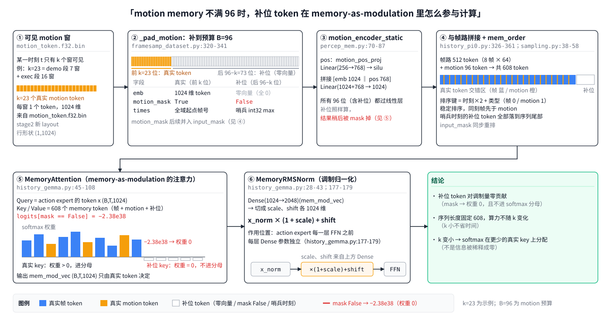

> **历史收尾限制（2026-10-27）**：本轮已按用户要求停止于70k交付；事后源pin比较为DATA_LINEAGE=FAIL（16个同名H5的SHA全部不同）。原启动遗漏此同源检查，不得沿用本计划重新起跑或将失败WAIVE；70k仅作为有来源错配的历史实验留档。

# 1026-vla-stage2-memory-1024-train-plan.md — 用阶段 III 最后 ckpt（EMA）把每窗 4×256 拼成 1 个 1024 维 memory token，窗 33／步长 32，训一条 mixed8 VLA 80k

> **G5实施裁决更新**：用户明确「同意按照你说过的更省时方案 做」「encoder只抽机小部分」，随后「同意继续」。本次改为CPU全量字节/文件SHA核验＋GPU分层1,024窗，不再执行全库encoder重算；只声明抽样encoder一致，其他闸门及已接受的G2例外保持。
> **实施授权补记（2026-10-26）**：用户已明确「开工 有问题问用户 所有subagebt必须全部astra high」「同意推送 要和github同步」；在G2报告本次跨FP32/FP16最大误差0.013544513720267467超过0.01后，又明确裁决「可以忽略 继续做」。据此继续原主run，限定接受本次G2数值例外；原FAIL证据不变，另以WAIVED记录绑定原失败SHA、ep105和G0清单，完整来源身份及其余闸门仍严格。下文r3的“只规划”是编写时的历史状态，不撤销本次实施授权。具体记录见本文末节与训练档案。

> **权威与授权**：只规划不实施。本版 r3 吸收固定版本对抗审查的 8 组阻断问题及验收订正；用户本轮确认「确定修改md demo原始帧是什么意思」，授权仅修改本文，不是代码实施、下载、建库、训练或上传的开工令。保留用户要求的 Markdown 与第一部分／第二部分结构。此前结构裁决为「你这个计划是什么情况？为什么写成现在这么乱七八糟的？我在这个仓库里面有 agent markdown，要求了你要第一部分、第二部分」，格式裁决为「你写一个 Markdown 的计划，然后我确认了再开始。」。
> **代码锚点**：policy `v4-256concat1@3861154`（从 `v3-motionmem-pair4@8c319aa` 切出；用户：「然后这次的这个修改从branch v4-256concat1开始」），工作副本 `/scratch/hongze/robomme_policy_learning_MotionJEPA`；MotionJEPA `v12-3decoder@6c79ebb`，工作副本 `/scratch/hongze/MotionJEPA`（只新增一个模块＋一个 CLI 脚本，另开分支 `v12-3decoder-memexport`，不动 `v12-3decoder`／`main`）。
> **commit 体例**：两仓功能改动 `commitV<x>.<y>: <中文>`（policy 接续 `commitV11.37` → 本轮从 `commitV11.38` 起），文档 `docs:`，交接 `handoff:`；子代理提交 `sub/<编号>: <中文>`，经主会话 `git merge --no-ff <TIP sha>` 合入，合并提交占项目号。
> **外部依赖锚点**：Wan VAE `Wan-AI/Wan2.1-T2V-1.3B-Diffusers`，`vae_state_sha256` 前缀 `9980d252`（恢复副本 metadata 原值）；恢复副本 `v1-store/restore/mixed8-200-vla-latents-20261021-a/`，来源 bucket `HongzeFu/robomme-16task-mixed8-200-trainset-20261016-v1`，`restore_receipt.json` PASS；encoder ckpt `/scratch/hongze/MotionJEPA/runs/stage2-full144-1025-a/checkpoint_epoch_105.pt`（sha256 在 G3 现场算并钉进 yaml）。
> **审查锚点与前置条件**：policy `36a42848ffd8f79fe475e48b5d230b520b503e04`、MotionJEPA `6c79ebb3d9c2f8a6a45dfcd012954af688c962b0`；policy 相对代码锚点只有计划与图改动。已找到本地 demo H5，两个补帧窗原图SHA与缓存完全一致；完整64窗仍须G0验证。正式实施仍需开工令，只覆盖主 run，备选 B 单独授权。bucket 名沿用用户裁决，不再询问。
> **子代理模型**：本次及本文后续派发统一 `gpt-6-astra`、`reasoning_effort=high`，含修改、审查与运行角色，覆盖原文的 opus／sonnet 档位；依据用户「所有subagebt全部astra high」。所有新增 CLI、配置键、判定行均为拟实现，未标实测的闸门尚未运行。

# 第一部分（给人看）

## 一、要做什么与全部运行一览

**一句话**：用 MotionJEPA 阶段 III 最后一份 ckpt（ep105）的 EMA encoder，把 mixed8-200 每个 33 帧窗的 4×256 输出按源时间片 [0,3,5,8] 拼成 1 个 1024 维 token，步长从 16 改为 32、demo 尾窗补帧规则与原来一样、motion budget 96，离线建新 motion 库，训一条 8 卡 80k VLA（`mme_vla_suite_b128_80k`，测试直接取 60k）；边训边传 VLA ckpt，encoder／decoder ckpt 同期上传。不重过 Wan、不跑 4 token 对照臂；「帧路 1 帧＋motion」只作备选 run B 写进计划，不排进本次运行。

执行顺序：先冻结 S1／S2／S4 共用来源 schema，明确 G0 抽样原帧来源；S1、S2、S3 并行开发，S1 合并推送后实施 S4。G0 通过后才全量抽取；打包后增加CPU全表字节/哈希核验及独立encoder 1,024窗抽样，再接管 verify 锁；真实客户端对拍及20步保存回读通过后，才正式训练。MJ 上传可与准备阶段并行；VLA 60k 的交付以远端回读和严格恢复通过为准。

| 运行 | 内容 | 资源 | tmux | 判据 |
|---|---|---|---|---|
| 抽取＋打包 | 4,995 段恢复副本的偶数格窗；CPU全表核验及1,024窗encoder抽样后 `verify --resume --check-padding` | GPU0，65,419 窗；打包 CPU | `cc-vla-s2-export`、`cc-vla-s2-pack` | G0–G3、G5、G6 |
| 短测 | 同配置 `MAX_STEPS=20`，随后严格恢复保存的 EMA 并推理 | 8 卡，运行预算见第二部分；超过5分钟保留诊断档案 | `cc-vla-s2-smoke` | G7 |
| 正式训练 | run `mixed8-200-m8x8-modul-motion-stage2-1024-b128-80k` | 8 卡 fsdp 8、batch 128 | `cc-vla-s2-train` | G8 |
| VLA 上传 | 新 stage2 增量驱动先传根快照，再传 step；bucket `HongzeFu/robomme-vla-mixed8-200-modul-motion-stage2-1024-80k-v1` | CPU/网络；恢复测试另计 GPU | `cc-vla-s2-inc`、`cc-vla-s2-ckptup` | G9、G12 |
| MJ 上传 | 阶段 II＋III ckpt → `HongzeFu/motionjepa-stage2-pool4-3decoder-1025-v1` | CPU/网络 | `cc-vla-s2-mjup` | G10 |
| 备选 B（不在本次） | 帧路 1 帧／demo 任务 2 帧＋同一 motion 路，run `mixed8-200-m1x8x8-modul-motion-stage2-1024-b128-80k` | 8 卡 | — | G11 |

**测速实测（2026-10-26 美东 12:43 起跑，`cc-speed8-motion-b128-20261026-a`，现有 motion 160×768 配置，8 卡 fsdp 8、batch 128）**：编译约 2 min，第 12→111 步 99 步95.3 s＝**0.96 s/步**，对4卡1.73 s/步加速1.80×。从正式训练起跑推算，60k约16.0 h、80k约21.4 h，不含编译、存盘和上传。准备阶段新增 G0 原帧来源、CPU全表核验及encoder抽样，耗时未知，原先“开工后20小时可取60k”的承诺撤回；交付时间还须加 G12 回读及恢复时间，以 G7 新配置测速更新。

**用户原话（逐字，2026-10-26）**：①「给出方案 用现在的最后一个ckpt训vla 4个256合并成1个token输入 然后窗口是32 不要再16重叠了 给出方案 然后注意 encoder inference 的时候别忘了 dropout 关掉 然后这个memory本身是不是不再做增强了 robomme官方policy repo怎么做的 然后再看一下wan是不是已经有缓存了」②「然后你一边训练，一边还要把现有的这个 encoder、decoder 的这个 checkpoint 是不是看一下是不是都上传了，然后边训练边上传 VIA 的 checkpoint。」③「你写一个 Markdown 的计划，然后我确认了再开始。」④「你写在 policy learning 的仓库里面，不要写在 motion Java 仓库，因为这个完全是 policy learning 仓库的事情。」⑤「然后这个 memory token 的预算是是九十六还是八十？然后我我然后我确认是用 EMA 权重，然后不跑这个不拼接的这个作为四个 token 的这么一个对照。」⑥「好的，先定为这个九十六，然后你要看一下现在这个 execution，就是 Robo M E 官方仓库的这个 evaluate 是最多是一千三百步，我记得是，然后这一千三百步会怎么影响我们的这个 evaluate 的情况？」⑦「然后你这个 padding 的这个工作还是要做的，就是 demo 的需要有 padding，还是要有一样的。」「你超过十六帧还是十七帧要有一个 padding 的这个，你也要写在这个计划里面。」⑧「计划写在根目录，bucket 随便你定，以后不要再来问了。」⑨「然后这次的这个修改从branch v4-256concat1开始」⑩「现在这个八十 K step 对应的是多少个小时？」「如果我只要这个六十 K 的这个位置，那么八卡会慢多少？然后四四卡会是什么情况？训训练我要训到八十 K，但是我测试我直接拿60k你什么时候能得到？」⑪「然后你可以现在就做一些简短的测试，然后把速度测测速的问题先告诉我，在 work tree 里面去实现。」⑫「然后这个巴卡的收益是多少？就是巴卡的收益达到两倍了吗？差了多少？」⑬「你再测一下，如果我同意把 batch size 拉满翻倍，就是会是什么样的情况？」「巴卡一二八现在这样可以解锁，你不用再测这个 batch 二五六了。然后这个再加一条 run，只作为备选，就先8卡跑。」「现在这个速度可以接受。」⑭「然后我之前说的这个 demo padding 的这个问题，就是填充填充帧的问题，你也要说一下，确保它实现了。我说的 fable 化的这个图是指的这个 memory token 没有满九十六的情况下，它是怎么影响计算的？」⑮「demo 补帧这个机制，不需要直接画，不需要画图，你只需要说一下它和原来是一样的就可以了。然后简单画一个数轴就可以，不用画 SVG」⑯「然后我还需要再加一个，再加一条跑，就是现在是八帧的八乘八的这个呃情况。然后我们相当于把这个八帧降到只有一帧。如果是 demo 的话，有 demo 的任务的话就是两帧。」

**已定口径**：
1. 权重 = ep105 的 `model` 键（`weight_type='ema'`），不用 `model_live`（原话⑤；2.1）。
2. 4×256 按源时间片 [0,3,5,8] 顺序拼接成 (1024,)，不平均；`memory_token_dim=1024` 不变（原话①；2.2）。
3. 窗 33 帧（锚点＋未来 32）、`GRID_STRIDE=32`、`segment_start`、`forward`，相邻窗只共享 1 帧（原话①；2.3）。
4. demo 末窗真实帧 ≥17 保留并 `repeat_last` 补到 33、≤16 丢弃，exec 33 帧全真实，与原来一样（原话⑦⑭⑮；2.3）。
5. motion budget 96（原话⑥；2.6）；不跑 4 token 对照臂（原话⑤）；不满 96 的补位不参与注意力（原话⑭；2.7）。
6. 抽取与 sidecar 一律 `eval()`＋`no_grad()`＋fp32（autocast 关），G1 证明 dropout 真关（原话①；2.4）。
7. memory 不增强，用干净 latent（等价 aug_id=0、`geometry_valid` 全 True）（原话①；2.4）。
8. 不重过 Wan VAE，直接读恢复副本 g 为偶数的窗（原话①；2.5）。
9. 训练沿用 `mme_vla_suite_b128_80k`（80k、batch 128、pi05_base、EMA 0.999、每 5000 步存 16 份），8 卡独占，不测 b256；训到 80k、测试取 60k（原话⑩⑬）。
10. 计划与全部 policy 改动在本仓库，MotionJEPA 只加抽取模块与 CLI（原话④）；bucket 名定死如上表（原话⑧）；边训边传 VLA，encoder／decoder 同期上传（原话②）。
11. 备选 run B（帧路 1 帧、有 demo 的任务 2 帧，motion 路相同）只写进计划，不在本次开工令内（原话⑬⑯；第二部分九节）。

## 二、现状与机制

**2.1 ckpt**：`runs/stage2-full144-1025-a/` 有 `checkpoint_epoch_{5..105 步长 5}.pt` 共 21 份，第 106 轮停训、无 `checkpoint_final`。ep105 顶层键 `arch`=`wan-latent-stage2-blockwise-pool4-three-decoder`、`fingerprint`、`weight_type='ema'`、`model`（EMA，185 张量，约 19.62M 参数，encoder＋三个 decoder）、`model_live`、`optimizer`、`config`、`epoch=105`、`global_step=7770`；EMA 与 live 确有差（`encoder.pos_t` 最大差 2.8e-4），必须显式取 `model`（MJ `src/motion_jepa/models/stage2_model.py`）。

构模参数明确取 `ckpt["fingerprint"]["data_metadata"]`，不是顶层 `training_contract`。真实 ep105 的该合同与 qstats 摘要已只读核实齐全；encoder 共65个状态项。G3 除两条路径对拍，还要逐项核对实际加载状态与 `model` 的 encoder 子树一致，并用 `model_live` 作失败负控，防止两路一起载错仍通过。

**2.2 数据链路（逐跳形状／dtype／字节；是否改数）**

```
恢复副本 <seg>.bin 每窗 (9,16,32,32) fp32 = 589,824 B ── 只读不改数；新取 g=2k，旧取全部 g
  ▼ Stage2WanLatentMotionEncoder.forward(latents, geometry_valid=全 True (B,32,32))   [MJ wan_latent_encoder.py]
    ckpt 内 latents_mean/std affine → 576 patch(9×8×8) ＋ 4 readout(源时间片 [0,3,5,8] 32×32→4×4 掩码均值) = 580 token × 8 层
  → (B,4,256) fp32 = 4,096 B ── 冻结、eval、无梯度 → reshape(B,1024)（槽 0‖3‖5‖8 拼接，不改数）
新库行 (1,1024) f32 = 4,096 B，65,419 行 = 267,956,224 B（旧768库为128,342行，grid16）
  ▼ FramesampDataset：motion_emb (96,1024) f32、motion_pos (96,256) f32、motion_mask (96,) bool
PerceptualMemory：Linear(256→768)+silu ‖ emb → Linear(1792→1024)，新参数 1,836,032（旧 1,573,888），从零训  [percep_mem.py::PerceptualMemory]
  ▼ memory (B, 512 帧路 + 96 motion = 608, 1024) 走 modulation（旧 512+160=672）   [history_pi0.py]
```

**2.3 窗口与 demo 补帧（与原来一样，只换步长）**：离线补帧在 policy `scripts/dataset/wan/extract_wan.py`：`real=min(33, seg_len−off)`，demo 且 real<33 时把段末帧 `frames[seg_len−1]` 重复补到 33 帧（像素层补、Wan 整窗编码），exec 补帧直接 raise，metadata 记 `real_frames`／`pad_frames`／`pad_source_frame`；在线 `policies/framesamp_memory.py _encode_window` 用同式 `frame_ids=[f+j]+[es−1]*(W−real)`。可见条件 demo `s+16 ≤ es−1`、exec `u+32 ≤ t−es`（`motion_store.py`／`framesamp_memory.py`）。新方案只把 16m 换成 32m，补帧规则、补源帧、可见条件一字不改；{32k} 恰是 {16m} 的偶数子集，所以恢复副本偶数格就是新口径。

```
demo 段 len=100（帧 0..99），min_real=17 → 合法起点 < 84
 stride16: 0 16 32 48 64 80          80 窗真实 20 帧(80..99) → 补 13 帧（重复第 99 帧）
 stride32: 0    32    64             64 窗真实 33；96 窗只剩 4 帧 ≤16 → 不存在
exec 段 len=100，min_real=33 → 合法起点 < 68：stride32 = 0 32 64，三窗全真实，不补帧
```

⚠ 训练侧 `visible_motion_rows` 把步长写死在全局 `GRID_STRIDE`（`motion_store.py`），在线侧已读 yaml `motion.stride`（`framesamp_memory.py`）；只改 yaml 会让训练与在线可见窗不一致，必须按 layout 参数化（三节）。

**2.4 dropout 与增强**：encoder dropout 0.05 落在注意力 `to_out` 后与 SwiGLU 输出（MJ `wan_latent_encoder.py`，默认配置 `dropout=0.05`），`eval()` 让其恒等；证明：同批窗 `eval()` 跑两遍逐位相等且 `train()` 一遍必须不等（参照 MJ `scripts/stage2_eval.py`）。增强只在 `preprocess_observation(train=True)` 对当前帧做（`src/openpi/models/model.py`），推理 `history_pi0.py` 传 `train=False`，官方 RoboMME policy 无 memory 路；本 fork 的 memory 一直离线从干净帧抽取，不增强、无 dropout（`history_gemma.py` 默认 0.0）。

**2.5 Wan 缓存可直接复用**：恢复副本 4,995 个 bin（exec 3,195，PatternLock 只有 195；demo 1,800），fp32、窗 33、grid16、demo `min_real 17 repeat_last`，共 75,699,191,808 B（约 70.5 GiB）。encoder 训练缓存用整 33 帧 fp16 编码，与 1+32 编码的 RGB 归一化 MSE 6.9e-8（MJ `1024-rgb-gtxyz-16views-stride2-plan.md` 的K4数值对拍记录），fp16 落盘误差 mean(e²)≤8.96e-8（同文件的fp16落盘误差记录），G2 抽样重验。

**demo 原始帧是什么意思、从哪读**：demo 是执行前的示范段；“原始帧”指送进 VAE 之前的256×256 RGB像素，不是 latent 或 SigLIP 特征。demo latent 缓存已在；独立重验G2／G4(b)还需要原图。`dataset_builder/build_robomme_dataset.py::_process_episode` 只有 `not is_video_demo` 才写 `source/data/*.pkl`，因此demo改读本机 `/scratch/hongze/dataset-local-a100-16task-mixed8-200/data-raw/<Task>_ep<输出episode编号>/video_demo.h5` 的 `frames`（uint8，gzip无损压缩）。该目录有1800份demo H5；本轮仅实读两个尾窗，均与缓存输入SHA完全一致（第二部分一节C留证）。G0仍须固定64窗（每任务4窗、至少16个demo补帧尾窗）逐窗核SHA。exec继续读pkl，不改读可能在成功处截尾的分段exec H5。当前无需下载；若G0出现缺件，再列具体来源、大小和落点确认，不用压缩预览代替、不降低阈值。

**2.6 1300 步上限**：`examples/robomme/eval.py` 的执行步数上限为1300；最坏 demo（VideoPlaceOrder 1247帧）39窗、exec 40窗，合计 **79（预算96，余量17）**。manifest 与恢复 metadata 只读统计：新库65,419窗、其中749个 demo 补帧窗，训练最大可见窗数62（PickXtimes ep196）。PatternLock ep0／ep11／ep12 的exec各32帧、ep17为24帧、ep22为25帧，均不足33帧，合法零窗；不存在应有非零窗却缺失的段。G5按manifest推导的非零段键集合精确核对，G6复算窗口预算。

**2.7 motion 不满 96 时补位怎么参与计算**：k 个真实窗之后的位零填充、mask 为 False、时刻记哨兵（`framesamp_dataset.py`，在线 `framesamp_memory.py` 同式）；96 位全部过两层 Linear（补位也算），再按时刻与帧路一起排序、补位落尾；action expert 的 Q 对 608 个 memory token 做注意力，`mask==False` 处 logit 置 −2.38e38，softmax 权重为 0、也不进分母（`history_gemma.py`）。结论：补位零贡献；序列长恒为 608、算力不随 k 变；k 小只是注意力在更少的 key 上分配。图：

## 三、我们这一侧要改什么

非改不可的原因：训练库 `LAYOUT`／`GRID_STRIDE=16` 是模块全局常量且布局名必须带 `grid16`（`motion_store.py`）；loader 合同只认 `(768,)` 旧路与 `adjacent_pair_v1` 四对（`motion_adapter.py`）；在线 sidecar 的 torch 子项目把 MotionJEPA 钉在 v10 提交 `ee719fb`、断言 v10 架构与 `(8,256)` 输出（`scripts/dataset/wan/wan_motion_infer.py`），客户端 `source_run` 正则只认 `#encoder`（`motion_client.py`）。

| 文件 | 锚点 | 改什么 | 关闭态（旧 yaml） | 开启态（新 yaml） |
|---|---|---|---|---|
| MJ `src/motion_jepa/export/stage2_memory.py`（新）＋`scripts/stage2_memory_export.py`（CLI） | `load_ema_encoder`、`encode_windows` | 读恢复副本偶数格窗 → EMA encoder → (n,1024) 按 pack 契约落盘 | 不存在 | 产出 `motion-tokens-stage2/` |
| `datastore/motion_store.py` | `LayoutSpec`、索引读写、`MotionMeta.load` | spec贯穿枚举、序列化、解析、metadata加载 | 旧三 layout 逐字节不变 | stride32，(1,1024)，每行4096 B |
| `datastore/motion_adapter.py`、`training/framesamp_dataset.py`、`training/dataloader.py` | `motion_policy_spec`、`check_motion_contract`、stride 断言 | 新 readout `stage2_pool4_concat_v1`；stride 与 spec 比；绑 arch／state_key／sha | 不变 | 校验 stage2 身份 |
| `scripts/dataset/pack_motion_store.py` | `cmd_pack`、`gather_provenance`、`cmd_verify` | 新layout覆盖行字节、SHA、来源schema；CPU全表与encoder抽样认证后接管锁 | 原合同 | 只取偶数格；完整来源链 |
| 新 yaml＋启动检查器＋专用导出驱动 | 新run合同 | 检查ep105／`#model`／新参数形状；两源MJ分目录；VLA传根快照 | 旧驱动原样 | 新run可启动、可恢复 |
| 新 `wan_stage2/`＋`motion_protocol.py`、`motion_client.py`、`policy_config.py` | 协议与sidecar | 响应长度参数化；独立venv；历史VAE与当前encoder分组核验 | 旧协议默认3072 B、旧venv与比较规则 | 双端4096 B，真实非stub握手 |
| `scripts/training/train.py` | `init_history_config` | stage2兼容身份随run快照保存 | 旧快照结构保留 | 验证所需来源证据可恢复 |

`percep_mem.py`、服务端窗口枚举与客户端 `examples/robomme/utils.py pack_buffer`（只打包帧）零改动，靠 yaml `stride: 32`。

## 四、验收

| 判定 | 查什么 | 怎么查 | 过了说明什么（为什么能成立） |
|---|---|---|---|
| G0 `RAW_WINDOWS_READY` | 抽样原始帧可得且同源 | 固定64窗，exec pkl＋demo无损原帧，补帧后逐窗核输入SHA | G2／G4(b)有真实输入，不靠latent反推原图 |
| G1 `DROPOUT_OFF` | dropout 真关 | 64 窗 eval 两遍、train 一遍 | eval 逐位相等＋train 不等 ⇒ 存在且被关；同卡同 kernel、fp32 TF32 关 ⇒ 可逐位 |
| G2 `WAN_EQUIV` | 恢复副本与训练输入数值一致 | 使用G0绑定的64窗，经MJ整33帧fp16路径重编 | 归一化误差在原K4阈内 |
| G3 `EMA_SOURCE`、`EXPORT_PARITY` | 真加载EMA且导出路径相同 | 65个状态项核对及live负控；32个val aug0窗正确派生32×32掩码 | 权重身份与数值两条证据独立 |
| G4 `ONLINE_OFFLINE_PARITY` | 完整在线链可用 | 非stub客户端实际venv／握手／IPC；64窗数值及增量窗口边界 | 同latent逐位；端到端≤1e-5；无协议截断、身份错配 |
| G5 `PACKED_TOKEN_BYTES`、`ENCODER_SAMPLE_BITEXACT`、`VERIFY_MOTION` | 库完整且抽样编码正确 | CPU全表字节/SHA＋每任务64窗共1024窗encoder独立重算→认证→verify | 65,419行存储完整、749尾窗与padding全对；encoder仅声明1024窗逐位一致 |
| G6 `TRAIN_ES_BOUND` | 预算够 | 训练集与评估 1300 上限 | 最坏 ≤96 ⇒ 零截断 |
| G7 `LAUNCH_CONTRACT`、`SMOKE_TRAIN`、`SAVE_LOAD` | 能训、能保存恢复 | 新合同预检；8卡20步；独立进程严格恢复EMA与一次在线推理 | 参数树完整、权重无丢项、快照／在线来源闭环 |
| G8 训练 `EXIT_CODE=0` | 训完 | 日志尾行＋16 个 step 目录 | 80k 全部存盘，60k（测试用）与 79999 都在 |
| G9／G10 上传 | 远端可恢复 | 全量 sha256 匿名回读 | 远端逐字节等于本地，此后才可写「已备份」 |
| G12 `CKPT_60K_READY` | 60k可交测试 | 回读step＋根快照＋依赖清单，SHA校验及严格恢复 | `.done`只表示上传结束，G12通过才通知可取测试 |

## 五、步骤

| 阶段 | 内容 | 判据 |
|---|---|---|
| 0 | 实施开工令；独立Astra high审查；锁定来源schema及G0样本来源 | 计划结构审查通过；来源缺口有明确处理状态 |
| 1 | S1／S2／S3开发；S1 push后S4接线；逐块合审；MJ新导出预检后上传 | `PRE/POST_MERGE_REVIEW=PASS`；G10可并行 |
| 2 | G0→抽取与G1–G3→pack→CPU全表核验与1,024窗encoder抽样→verify→预算→真实在线对拍 | G0–G6通过 |
| 3 | 启动预检、20步训练及保存回读→Beta→正式训练并传根快照及step | G7通过才起跑，G8为正式完成 |
| 4 | 60k上传后回读；资源条件满足时恢复验证；80k后全量验收与留档 | G12后交测试；G9、`HANDOFF_WRITE=PASS` |

## 六、子代理分工与合并（简述）

拆四块，修改与审查代理均为Astra high：S1负责MJ导出；S2负责存储、来源schema及训练快照；S3负责新配置、启动和两类专用上传；S4负责协议、sidecar、CPU全表核验/encoder抽样及在线恢复验证。先确定共同schema，S1推送后S4锁定依赖；合并顺序S1→S2→S3→S4。每块独立worktree，合前审固定BASE/TIP，合后定向验证。运行另派Astra high且不改代码；备选S5不派。逐文件写集、验证入口、资源和运行顺序见第二部分。

# 第二部分（技术细节，供 agent 追踪）

## 〇、前置声明与红线

- R1 不全量重过Wan VAE：训练latent只读恢复副本；G0绑定的64窗重编只为G2／G4验证，原图与中间张量落本仓`v1-store/validation/stage2-memory/`，仅样本清单／SHA／判定摘要进`records/`。需要新增下载时先给具体来源与大小，用户确认后执行。
- R2 不改 encoder 权重：抽取与 sidecar 只读 `checkpoint_epoch_105.pt` 的 `model` 键，strict 加载、`requires_grad_(False)`、`eval()`、`torch.no_grad()`、`torch.autocast(enabled=False)`、`torch.backends.cuda.matmul.allow_tf32=False`、`cudnn.allow_tf32=False`；不写回任何 MJ `runs/` 文件。
- R3 memory 不增强：`geometry_valid` 恒为全 True `(B,32,32)` bool（等价 aug_id=0：MJ `dataset_paired_wan.py::derive_geometry_masks` 中恒等单应的 `common_valid` 全真）；不加噪声、不做帧增强。
- R4 不动 `main` 与 `v12-3decoder`：MJ 侧只在新分支 `v12-3decoder-memexport`（自 `6c79ebb`）提交并 push 该分支；policy 侧只在 `v4-256concat1` 及其 `worktree-agent-*` 子分支。
- R5 旧口径逐字节不变：旧 layout（`motion-768-grid16-v1`、`motion-768-grid16-demopad17-v1`、`motion-v10-8x256-grid16-demopad17-v1`）、旧 yaml、旧 v10 sidecar 子项目 `scripts/dataset/wan/`（含 `uv.lock`、`SOURCE_PIN.json`）零 diff；`motion_client.py` 的 `encoder_kind="v10"` 分支逐字不变。
- R6 训练期代码冻结与只读锁沿用 1016 做法：Beta commit 后到 G8 期间不 commit、不合并；被跟踪的 `src/`、`scripts/` 按 `v1-store/m8v-scripts/m8v-chmod-before.txt` 体例先记权限再 `chmod a-w`，训完按记录恢复；开发转开发副本（`AGENTS.md` 第 14 条覆盖项）。
- R7 tmux只用前缀`cc-vla-s2-`：`export`、`pack`、`parity`、`smoke`、`train`、`inc`、`ready60`、`ckptup`、`mjup`（均加此前缀；历史`speed8`已退出）。实际启动的完整会话名记入launch清单，仅逐个清理。
- R8 代码写集不含`third_party/**`、根`pyproject.toml`／`uv.lock`、旧`scripts/dataset/wan/**`、规则文件与`.agentmetarules`、`v1-store/**`。旧`m8v-ckpt-inc.sh`保持不变，新增量驱动落`scripts/dataset/hf_export/`；运行产物按明确清单写`v1-store/`。本仓无第21条受保护目录。
- R9 不处理 rgb-gtxyz 上传失败：`/scratch/hongze/logs/rgb-gtxyz-full-20261024/upload.log` 末行 `HF_VERIFY=FAIL error=ValueError`、`EXIT_CODE=1`（进程 1675039、1678537 已不存在，MJ handoff 仍写 running），属 Codex 任务长尾，只报告。
- R10 新 run、新库、新 bucket 全新：run 目录、`motion-stage2-1024/`、两个 bucket 起跑前 `ls -ld`／`hf buckets list HongzeFu` 确认不存在；不带 `--force`、不 `overwrite`。
- R11 任一闸门 FAIL 停下交用户；不放宽阈值；崩溃不自动 resume。
- R12 子代理 worktree 内只跑 ≤5 分钟 CPU 测试，环境取法：policy `UV_PROJECT_ENVIRONMENT=/scratch/hongze/robomme_policy_learning_MotionJEPA/.venv PYTHONPATH=<worktree>/src uv run --no-sync python -m pytest <定向> -q`（先打印 `mme_vla_suite.__file__` 确认在 worktree）；MJ `UV_PROJECT_ENVIRONMENT=/scratch/hongze/MotionJEPA/.venv PYTHONPATH=<worktree>/src uv run --no-sync python -m pytest <定向> -q`（先打印 `motion_jepa.__file__`）。GPU 验收合并后由运行型代理串行跑。
- R13 不测 batch 256（用户「你不用再测这个 batch 二五六了」）；测速 run `cc-speed8-motion-b128-20261026-a` 在 `v1-store/train-runs/mme_vla_suite_b128_80k/cc-speed8-motion-b128-20261026-a/` 留有 step 119 一份 ckpt，收尾时按精确路径删除并记入留档。
- R14 备选 run B（九节）不在本次开工令内：S5 不派、G11 不跑，另取开工令。
- R15 `v1-store/` 下不建 symlink 外链（`AGENTS.md` 第 14 条覆盖项「主工作副本 v1-store/ 下没有任何 symlink 外链」）：sidecar 需要的 encoder 目录用注册副本（实体复制 + sha256 核对），不用软链。
- R16 正式训练独占8卡；60k远端回读可CPU并行，但真实GPU恢复与benchmark不能挤占训练卡。G12的GPU阶段排在G8后释放资源时，或另有已获授权的空闲机器时；不为兑现旧ETA自动暂停训练、抢卡或启动外部资源。交付60k权重不等于获准启动benchmark。

## 一、逐文件改动清单

### A. MotionJEPA（分支 `v12-3decoder-memexport`，S1）

MJ `pyproject.toml` 用 setuptools `packages.find where=["src"]`，`scripts/` 不进包，所以可复用函数必须放进 `src/`。

**新模块 `src/motion_jepa/export/__init__.py`（空）＋`src/motion_jepa/export/stage2_memory.py`**（现有能力：`build_stage2_model_from_cfg(cfg, *, data_metadata)` 于 `src/motion_jepa/models/factory.py`、`load_stage2_checkpoint(model, checkpoint, *, weights="main")` 于 `stage2_model.py`；拟新增接口如下）

```python
def load_ema_encoder(ckpt_path: str, *, device: str, expected_sha256: str | None = None
                     ) -> tuple[Stage2WanLatentMotionEncoder, dict]:
    """整份 ckpt → build_stage2_model_from_cfg(ckpt['config'],
    data_metadata=ckpt['fingerprint']['data_metadata'])
    → load_stage2_checkpoint(weights='main') → 取 .encoder；断言 ckpt['weight_type']=='ema'、
    arch==STAGE2_ARCH_TAG、fingerprint 一致；eval()+requires_grad_(False)。info 含 checkpoint_sha256、
    fingerprint_sha256、epoch、global_step、state_key='model'、weight_type、precision='fp32'、tf32='off'。"""

@torch.no_grad()
def encode_windows(encoder, latents: torch.Tensor) -> torch.Tensor:
    """latents (B,9,16,32,32) float32 原始（未归一化）→ (B,1024) float32。
    geometry_valid = torch.ones(B,32,32,bool)；autocast 关；输出 (B,4,256).reshape(B,1024)，
    槽序即 config.source_times=[0,3,5,8]。断言 encoder.training is False、输出全有限。"""
```

**新 CLI `scripts/stage2_memory_export.py`**（只做参数解析与 IO，`from motion_jepa.export.stage2_memory import load_ema_encoder, encode_windows`）：
- CLI：`--ckpt <abs> --expected-sha256 <64hex> --latents <恢复副本 wan-latents> --manifest <mixed8 episode_manifest.json> --out <v1-store/datasets/16task-mixed8-200-3200ep-e3c7564f/motion-tokens-stage2> --grid-subsample 2 --batch 1 --device cuda:0 [--max-segments N] [--check-dropout 64] [--resume]`。`--batch` 固定 1（与 sidecar 同形，见 G4 逐位依据）；`--max-segments` 只冒烟。
- 输出：每段 `<key>.f32.bin`（`num_grid32 × 4096 B`）、同名`.sha256`、`<key>.metadata.json`；新增schema `stage2-memory-export-v1`，由S1输出、S2严格解析，不冒充旧v10 schema。必填字段见下表；缺字段即失败，不能以两端都缺而比较为相等。根下`export_record.json`记录完整段集合与依赖身份，末行`STAGE2_EXPORT=PASS segments=4995 rows=65419`（仅全量可打此行，冒烟标记`scope=smoke`）。
- `--check-dropout 64` 产出 G1 判定行；不改任何既有 MJ 文件。
- 测试 `tests/test_stage2_memory_export.py`：CPU 上随机初始化小模型验证形状、槽序（`out[:,256*j:256*(j+1)] == enc_out[:,j]`）、`training=False` 断言、eval 两遍逐位相等、train 模式不等；`import motion_jepa.export.stage2_memory` 不依赖 `scripts/`。

**S1／S2／S4共用的stage2来源字段表**：旧layout继续使用旧schema与`wan/SOURCE_PIN.json`；新layout只走下述显式分支。离线实际运行环境与在线锁环境须记录并按合同检查，不修改历史latent元数据来“对齐”源码SHA。

| 字段 | 唯一含义与校验 |
|---|---|
| `schema/layout/row_shape/dtype/token_dim/token_bytes/bytes/num_grid/sha256` | schema如上；布局为stage2；`[1,1024]`／float32／4096B，字节数与行数匹配 |
| `source_grid`、`rows` | 第j行对应旧格`2*j`；`rows[j]`来自旧`rows[2*j]`，记录real/pad/全域pad_source；未补帧时pad_source必须null |
| `input_latent_sha256`、`input_block_sha256` | 前者覆盖整个原始latent文件，含奇数块；后者只覆盖选中的偶数块，各589824B，长度等于新行数 |
| `encoder` | `run_name/checkpoint_name/epoch/global_step/state_key/weight_type/arch/checkpoint_sha256/config_sha256/fingerprint_sha256/source_times/output_shape`；固定`model/ema/[0,3,5,8]/[1,1024]`，路径只作定位不当跨进程身份 |
| `encoder_state_sha256` | 65个encoder状态项的规范键名、dtype、shape与连续CPU字节摘要；记录算法版本；G3另作原张量精确比较 |
| `source_pin` | S1合并的40位MJ提交、导出模块与encoder源码SHA；由S4锁定同提交，禁止用旧v10 pin代替 |
| `numerics`、`worker` | fp32、autocast关闭、双TF32关闭、B=1；torch/CUDA/cuDNN及必要依赖、GPU型号、驱动；worker进程/设备信息单独记录，路径和pid不要求跨进程相等 |
| store新增`stage2_compat` | schema版本、原始receipt SHA及其历史VAE身份、当前在线VAE源码pin和运行合同、G0/G2证据SHA；VAE权重、输入预处理、精度等必须匹配，源码变化只能按已验证的历史→当前映射接受 |

`pack_motion_store.py::gather_provenance`的stage2分支将`encoder/encoder_state_sha256/source_pin/numerics`原名保留到store；`train.py::init_history_config`将这四组连同`stage2_compat/vae`完整保存到run快照；`policy_config.py`完整传给stage2客户端。测试要求这些必填字段往返无丢失，删除任一字段即失败；兼容信息引用的验证记录随run发布，离开建库机器后仍可核验。G4在G2证据固定后执行，其结果作为正式起跑闸门，不要求启动前持有自身尚未生成的G4记录。

### B. policy（分支 `v4-256concat1`）

**S2 `src/mme_vla_suite/datastore/motion_store.py`**
- `LayoutSpec` 增字段 `grid_stride: int = 16`（排在 `row_shape` 之后，旧三条登记值不变）；`LAYOUT_SPECS` 新增 `"motion-stage2-1x1024-grid32-demopad17-v1": LayoutSpec(17, 33, "repeat_last", (1, 1024), grid_stride=32)`。
- 常量 `STAGE2_LAYOUT = "motion-stage2-1x1024-grid32-demopad17-v1"`；`LAYOUT` 保持旧值（R5）；`layout_spec`之前的布局登记检查改为逐条 `f"-grid{spec.grid_stride}-" in name`。
- `seg_num_grid`、`segment_grid_starts`、`max_visible_count` 增 `stride` 参数（默认 `GRID_STRIDE`）；`visible_motion_rows` 的 `s = GRID_STRIDE*m`／`u = GRID_STRIDE*m` 改为 `entry.spec.grid_stride*m`，可见条件（`visible_motion_rows`）不动；`build_index_entries` 按 spec 步长算 num_grid。
- `index_payload`写`spec.grid_stride`；`parse_index`先解析layout/spec，再按该stride校验字段及重算行数；`MotionMeta.load`同样按spec核对，不保留全局16的比较。`num_chunks`仍按其原有定义计算，不将其误当新网格行数。
- 测试 `tests/datastore/test_motion_store_stage2.py`（新）：旧三 layout 对 `BASE` 的 `visible_motion_rows` 在 1,000 组 (seg_len, t) 上逐元素相同；新 layout 的起点集合等于旧 grid16 偶数格子集；demo len=100 例出 {0,32,64}。

**S2 `src/mme_vla_suite/datastore/motion_adapter.py`**
- 新常量 `STAGE2_READOUT = "stage2_pool4_concat_v1"`、`STAGE2_SHAPE = (1, 1024)`；`motion_policy_spec` 在 `readout == STAGE2_READOUT` 时要求 `source_shape==[1,1024]`、`num_tokens==1`、`dim==1024`、`budget>0`，返回 `MotionPolicySpec((1,1024), STAGE2_READOUT, 1, 1024, budget, budget, (STAGE2_LAYOUT,))`；四对与旧分支逐字不变。

**S2 `src/mme_vla_suite/training/framesamp_dataset.py`、`training/dataloader.py`**
- `check_motion_contract`新增分支：`readout==STAGE2_READOUT` 时要求 `enc.arch=="wan-latent-stage2-blockwise-pool4-three-decoder"`、`enc.state_key=="model"`、`enc.weight_type=="ema"`、`enc.checkpoint_sha256==mcfg.checkpoint_sha256`。
- `FramesampDataset.__init__`与`dataloader.py::_motion_gates`的stride断言改为比较已加载motion metadata的`spec.grid_stride`；dataset必须把检查移到motion metadata加载之后，不能在原位置引用尚未定义的`meta`。
- `__getitem__` 取行后 `(k,1,1024)` → `reshape(k,1024)` 再进 `_pad_motion`（`num_tokens==1` 不走重复分支），输出 `motion_emb (96,1024)`；`_pad_motion` 本身不改。
- `dataloader.py::_parse_source_run` 不改（`stage2-full144-1025-a/checkpoint_epoch_105.pt#model` 可解析）。
- 测试 `tests/training/test_framesamp_motion_stage2.py`（新）：3 episode 夹具库验证形状、mask、错 arch／错 sha／错 stride 均 raise；k<96 时 `motion_mask` 前 k 位 True、其余 False、补位 emb/pos 全 0；旧 768 与 pair4 夹具输出对 `BASE` 逐字节相同。

**S2 `scripts/dataset/pack_motion_store.py`**
- CLI新增`--layout {legacy,stage2}`、`--latent-grid-subsample`、`--stage2-validation`、`--stage2-source-pin`；legacy默认值及旧行为不变，stage2强制subsample=2及有效G0/G2/G3记录、来源pin。所选`layout/spec`贯穿`cmd_pack`、索引、`read_segment_tokens`、写游标、总字节检查、metadata；所有stage2行使用`spec.row_bytes=4096`，不能再用全局`MOTION_ROW_BYTES=8192`或旧行形状。
- `gather_provenance`按上表新增stage2分支：全文件SHA覆盖全部latent块，单独核偶数块SHA和`source_grid`；历史VAE继续用`load_vae_compat`，encoder改绑S1 pin及EMA状态，不再经过旧`wan-latent-v10-st/#encoder`断言。原始`raw_dir`作为历史身份保留；本轮原帧来源另列G0清单，不能把分段H5目录伪写成原`raw_dir`。
- `verify --check-padding`：新行j转抄旧`rows[2*j]`；`real+pad==33`；pad>0只在demo末窗且补源为全域段末帧；pad=0要求补源null；demo至少17真实帧，exec全33帧。段键集合必须精确等于manifest推导的非零段集合，5个合法零窗episode仍保留索引。
- 不删`check_bitexact_record`：pack清除旧认证后，由S4新比较器先在CPU核全部token字节/文件SHA，再独立读取分层1,024窗latent重算encoder并比较对应packed行，写绑定当前table/index/ckpt SHA、layout和source-grid的`meta/encoder_bitexact.json`。缺记录、未按新schema明确标记抽样、CPU未覆盖全表或SHA过期均拒绝verified。
- 顺序必须为`pack → compare_stage2.py --scope sampled → verify --resume --check-padding`。`--resume`只用于已完成pack留下的同机锁阶段交接；存活pack进程、异机锁仍拒绝，不使用强制破锁。
- 测试新增`tests/dataset/test_pack_motion_stage2.py`：至少两个非空段的真实pack/compare记录校验/verify/load链，含demo100的3行及4096B偏移；旧三layout输出逐字节回归；错SHA、少段、多段、错误padding、部分认证均失败。

**S2 `scripts/training/train.py`**：在`init_history_config`的stage2分支保存上述六组完整来源及引用验证记录，根快照写毕再以原子标记`motion_snapshot.ready.json`发布各文件SHA（该清单不含自身，上传外层manifest再记录它的SHA）；S3增量驱动等待此标记且不上传半写文件。另在`main`保存checkpoint的stage2短测记录分支，使用保存前的内存EMA生成fp32状态摘要与固定输入／seed／推理精度参考，写入`FINAL_RECORD_DIR`，供S4独立恢复检查；参考不能从已恢复权重反算，不能只依赖正式训练最后一步的`_finalize_record`。正式60000不要求新增此参考钩子，G12用发布清单核SHA和严格恢复。旧run快照与训练数学路径不变。新增`tests/training/test_stage2_snapshot.py`验证六组来源无丢失、缺字段失败、原子清单和短测参考SHA一致。

**S3 新 yaml `src/mme_vla_suite/models/config/robomme/perceptual-framesamp-modul-8frame-8x8-motion-stage2-mixed8.yaml`**：帧路节与 `perceptual-framesamp-modul-8frame-8x8-motion-mixed8.yaml` 逐字相同（budget 512、token_per_image 64、modulation、memory_token_dim 1024、use_pos_emb true、use_state_emb false）；`motion:` 节：

```yaml
motion:
  enabled: true
  source_shape: [1, 1024]
  readout: stage2_pool4_concat_v1
  num_tokens: 1
  dim: 1024
  budget: 96
  pos_dim: 256
  demo_min_real_frames: 17
  demo_tail_pad: repeat_last
  stride: 32
  window_frames: 33
  window_direction: forward
  grid_origin: segment_start
  frame_size: 256
  store_path: v1-store/datasets/16task-mixed8-200-3200ep-e3c7564f/motion-stage2-1024
  source_run: stage2-full144-1025-a/checkpoint_epoch_105.pt#model
  checkpoint_sha256: <G3 现场算出的 64 位，S3 先写占位、主会话打包后单独 commit 填入>
  encoder_kind: stage2_pool4_concat
  online_gpu: 4
```

**S3 启动与导出包装**
- 新`run_mixed8_stage2_1024_80k.sh`保留模板的安全入口、`TRAIN_CMD=`、退出码传递和`FINAL_RECORD_DIR`要求。正式与短测都传全新`RUN_NAME`、40位`TRAIN_HEAD`、绝对`FINAL_RECORD_DIR`（结尾`/final-record`）；8卡列表明确为`0,1,2,3,4,5,6,7`，不是`0-7`；FSDP8、batch128、80k／短测20步；`XLA_PYTHON_CLIENT_PREALLOCATE=false`。
- 新`check_mixed8_stage2_1024_launch.py`不沿用pair4的参考值：核对stage2 yaml、stride32、budget96、`[1,1024]`、65,419行、ep105／`#model`、EMA SHA、已verified新库；投影kernel为`[1792,1024]`。新配置实例化的完整参数树键／shape／dtype为stage2参考，确认pi05基础权重对应项匹配、只有预期memory项新初始化；不能将旧pair4参考`[1280,1024]`直接替换为忽略shape的宽松检查。
- VLA新驱动三件：`run_mixed8_200_vla_stage2_1024_80k_ckpt_export.sh`（最终全量）、`run_mixed8_stage2_1024_ckpt_inc.sh`（训练期增量）、`_stage2_vla_ckpt_export_common.sh`（只供新驱动）。旧512／motion公共体与旧`v1-store/m8v-scripts/m8v-ckpt-inc.sh`不改。新公共体固定`EXPECT_MOTION=true`、新motion库、ep105注册副本；两驱动统一`EXPORT_NAME=hf-ckpt-mixed8-200-vla-stage2-1024-80k`及其`logs/uploaded/`标记根，避免同bucket却不认上传标记。
- 增量驱动等待`motion_snapshot.ready.json`，先上传并回读根快照与引用的来源验证证据，再逐step上传；固定根文件包括`history_config.resolved.yaml`、`.sha256`、`motion_provenance.json`、ready清单及encoder依赖清单。step的`.done`只表示传输完成，G12另有ready记录。最终驱动补传16步并作全量匿名SHA回读，根文件与step均覆盖；不能依赖旧ep72或`$LIB/motion/`。
- 新`run_stage2_pool4_encoder_ckpt_export.sh`按两个源run建立独立manifest与目标前缀：阶段III `stage2-full144-1025-a/`的21份epoch ckpt、config、metrics、`motion_ablation/`；阶段II `stage2-scale-20261025-d/`的epoch4／8／final、config、metrics。逐文件核SHA与真实checkpoint schema，允许实际存在的live／optimizer；README明确`model=EMA`、`model_live=live`及fingerprint。取消旧72轮、旧200视频、`ema_only`／无optimizer等不适用的模板断言，保留文件完整、来源身份及回读要求；不伪造阶段III正常训完证据。
- 新配套`stage2_vla_bucket_README.md`、`stage2_pool4_bucket_README.md`、`hygiene_allowlist_stage2_vla.json`、`hygiene_allowlist_stage2_pool4.json`也属于S3写集。公开前扫描禁止泄露凭据；两套驱动分别`SMOKE=1`只做本地stage及合同校验，通过后再上传。测试`tests/dataset/test_stage2_export_contract.py`覆盖run身份、根文件、两源不撞名、错误库／encoder拒绝及增量／最终共享标记根。

**S4 在线 sidecar**
- 新 torch 子项目 `scripts/dataset/wan_stage2/`：`pyproject.toml` 依赖与 `scripts/dataset/wan/pyproject.toml` 相同的 torch 2.9.0／diffusers 0.39.0／numpy 2.4.4 等，`motion-jepa @ git+https://github.com/hongzefu/MotionJEPA@<S1 合并后 push 的 40 位 sha>`（git 依赖安装后 `motion_jepa.export.stage2_memory` 可 import）；独立 `uv.lock`；venv `UV_PROJECT_ENVIRONMENT=v1-store/venvs/wan-stage2`。不改旧子项目（R5：旧锁文件钉 v10 `ee719fb`，换 pin 会改变旧 run 的 sidecar 环境；按全局 uv 规则独立依赖另建 `pyproject`，不用 workspace）。
- 新子项目`SOURCE_PIN.json`固定S1提交、导出与encoder源码SHA、只读复用的VAE适配件SHA和子项目依赖锁SHA；pack与客户端都核它，旧`wan/SOURCE_PIN.json`不动。
- `motion_protocol.py::encode_response/recv_response`增加显式`response_bytes`参数，默认3072保留旧调用字节格式；stage2双端传4096，握手必报并核对`encoder_kind/dtype/shape/response_bytes`，混接、短包、错误长度拒绝。不得只改发送端或全局把旧常量改为1024维。
- 新`stage2_sidecar.py`按文件加载公共协议；VAE只读复用旧`wan_motion_infer.py::check_env/pin_numerics/load_vae/encode_chunk`，先固定环境和数值条件再加载；encoder调用S1共享模块，B=1；响应1024个f32。stub经过相同socket封包，不能跳过长度校验；真实模式还必须走来源合同检查。
- `src/mme_vla_suite/policies/motion_client.py`：`MotionEncoderClient.__init__` 增 `encoder_kind: str = "v10"`。现有`MotionEncoderClient.__init__`用正则 `([A-Za-z0-9][A-Za-z0-9_.-]*)/(checkpoint_epoch_\d+\.pt)#encoder` 解析 `source_run`，并把 encoder 目录强制推成 `v1-store/external/motionjepa/<run>`。`"stage2_pool4_concat"` 分支：正则尾部改为接受 `#model`；目录同样推为 `v1-store/external/motionjepa/stage2-full144-1025-a`，该目录是注册副本（R15：实体复制 `checkpoint_epoch_105.pt` 与 `config.yaml`，sha256 与 MJ 原件一致，与现有 `wan-mixed8-200-filter2-stop075-b88x8-72ep-a/` 等目录同体例）；argv 用 `--project scripts/dataset/wan_stage2 … stage2_sidecar.py --ckpt <注册副本>/checkpoint_epoch_105.pt --expected-sha256 <sha>`，期望回包维度 1024。`"v10"` 分支逐字不变。
- stage2客户端同时设置`UV_PROJECT_ENVIRONMENT=<v1-store>/venvs/wan-stage2`，核对实际导入的S1提交；仅换`--project`而沿用旧venv会失败。`check_provenance`按encoder_kind选择必填字段集合，历史VAE→当前实现的启动兼容合同由固定receipt／当前pin／G2证据建立，最终由G4验证实际在线路径；G2不能单独证明在线端到端一致。禁止篡改历史SHA或全局跳过比较。
- `policy_config.py::create_trained_policy`传`encoder_kind`及完整stage2兼容合同，不再只保留vae/encoder两组。`framesamp_memory.py`、`policy.py`、`examples/robomme/utils.py::pack_buffer`维持主run原实现；其stride、维度、增量保留共享边界帧已参数化，新增测试覆盖而不重复实现窗口算法。
- `wan_stage2/compare_stage2.py`本次使用`--scope sampled --batch 1`：CPU逐行比较全部65,419行与S1 token并核所有文件SHA，GPU固定seed0、16任务各64窗共1,024窗独立重算；使用`motion_store.stage2_encoder_sample_plan`统一选择，优先各段类型首末、补帧与非补帧demo/exec。认证为`stage2-encoder-sampled-v1`、scope=sampled，记录全CPU覆盖、样本集合/SHA/覆盖及来源绑定；失败不得保留PASS。原full能力保留但本次不执行。verify将认证原文及SHA写入stage2_compat.encoder_validation，随既有12文件快照交付。
- 新`wan_stage2/validate_stage2.py --gate G2|G3 --samples --ckpt --expected-sha256 --out`在torch子环境运行数值对拍；G3额外接`--rgb-root`。新主环境入口`scripts/training/check_stage2_online.py --store --samples --history --online-gpu 0 --out`经真实`MotionEncoderClient(stub=False)`完成G4；对拍GPU覆盖只用于内存配置副本，原yaml及SHA不改。需要torch的同latent子检查由锁定子环境执行，不能在主JAX环境临时安装torch依赖。
- 新`scripts/training/check_stage2_checkpoint.py`分两模式：`--mode smoke --checkpoint --reference --out`用于G7，必须与保存前EMA摘要及同精度／seed／输入的参考输出精确比较；`--mode delivery --checkpoint --expected-manifest --out`用于G12，对发布清单全部文件核SHA、完整参数树／来源／有限值核验与真实推理，不声称60000做了不存在的保存前对拍。两模式都实际调用`create_trained_policy`、原`pack_buffer`、首批demo、连续两批exec、reset和一次infer；均接受`--online-gpu`。G7/G12在训练释放资源后，父进程`CUDA_VISIBLE_DEVICES=0`、sidecar显式`--online-gpu 1`，记录并核实际物理卡号；若在独立获准机器执行则同样明确分配。需要的来源记录和权重由交付清单提供。
- 测试`tests/policies/test_motion_client_stage2.py`覆盖连续至少3窗完整IPC、4096B无残包、3072/4096混接拒绝、非stub来源字段缺失／错SHA拒绝、stage2环境选择；`tests/policies/test_stage2_restore.py`覆盖快照恢复及窗口状态机。旧默认argv与协议字节保持与BASE相同。

### C. 抽样原始帧前置验证（S2）

新增`scripts/dataset/check_stage2_validation_inputs.py --manifest --latents --source --demo-root --out`，固定seed=0选择64个合法偶数格窗，每任务4窗且至少16个demo补帧尾窗；输出样本键、源文件身份、原始帧索引、real/pad、完整33帧输入SHA的JSON。默认demo根为本地`/scratch/hongze/dataset-local-a100-16task-mixed8-200/data-raw`，通过该数据集control映射和每段`complete.json`定位输出episode编号，不能混用原来源episode号（例如输出`InsertPeg_ep1`对应源`episode_3`）。demo读`video_demo.h5/frames`；exec按`exec_sample_offset + step_idx - exec_start_idx`定位source pkl并核episode/step字段。对补帧后的uint8连续字节按`extract_wan.py`同定义取SHA，必须等于该旧格latent metadata的`input_frames_sha256`。只生成清单，不重编码VAE、不改源文件。

本轮两个真实尾窗只读证据（仅这2窗已验证，不能记为G0全量PASS）：

| 样本 | 旧格／真实帧／补帧 | 完整33帧SHA256（与缓存相等） |
|---|---|---|
| `InsertPeg_ep1_demo` | m=12，192–216共25帧，重复216帧8次 | `63d2c2a368d4a64105054a2e4d31709c92753553ff330f79a3678ab2427fc9af` |
| `VideoPlaceOrder_ep0_demo` | m=58，928–944共17帧，重复944帧16次 | `8f3cb0395b21f9350b3f34af31ebb6d69b5d9220271865789c2129589bde96a2` |

分段exec H5曾按成功位置截尾，不用其替换source pkl。原始H5仅读，样本清单与中间验证产物写本仓`v1-store/validation/stage2-memory/`；G0缺件时先报告具体文件，不自动下载或全量重建。

## 二、子代理分配表

所有角色均为Astra high，修改代理独立worktree、运行代理不改代码。`BASE`为实施开工时记录的policy clean HEAD（当前审查源码锚点`36a42848`），S1为MJ `6c79ebb`；不得从缺少本修订的旧计划起跑。先冻结一节A的共同schema，再派开发。主会话核对worktree真实根、分支、各自包导入路径；下表的相对文件名按一节完整路径解析。

| 子任务 | 目标／可写集合 | 禁触路径 | 接口契约与依赖 | 合并顺序 | 验收位置、命令与判定 | 资源／共享文件归属 |
|---|---|---|---|---|---|---|
| S1 | MJ新`export/__init__.py`、`stage2_memory.py`、CLI、`test_stage2_memory_export.py` | 其余MJ文件及runs | EMA加载、encode_windows、stage2来源schema | 1，主会话推送新分支 | MJ worktree，R12环境：对应pytest；导入不依赖scripts | CPU；唯一写者 |
| S2 | `motion_store.py`、`motion_adapter.py`、`framesamp_dataset.py`、`dataloader.py`、`pack_motion_store.py`、`train.py`；新原帧前置检查CLI；一节B所列存储／loader／pack／snapshot测试 | R8及表外文件 | spec全链路、来源schema、run快照原子ready清单、G0 | 2 | policy worktree，R12：新测试＋旧datastore定向回归；pack→verify→loader夹具PASS | CPU；全部存储与train.py唯一写者 |
| S3 | 新yaml、启动sh与检查器；一节B所列新VLA增量／最终／公共体、MJ驱动、两README／allowlist、`test_stage2_export_contract.py` | R8；其它src代码；旧导出公共体 | S2来源字段与ready清单，S4恢复检查CLI | 3；依赖S2 | policy worktree：新sh全部bash -n；合同测试；合入后真实启动预检及两个SMOKE=1 | CPU；配置与新导出目录文件唯一写者 |
| S4 | 新`wan_stage2/**`；`motion_protocol.py`、`motion_client.py`、`policy_config.py`；新`check_stage2_online.py`、`check_stage2_checkpoint.py`；两份policy测试 | R8；framesamp_memory.py／policy.py原实现 | S1已推送提交、S2完整schema；协议双端4096B；G2/G3/G4及CPU全表核验/encoder抽样 | 4 | policy worktree：IPC／恢复测试；独立子项目uv lock；真实GPU闸门由运行代理跑 | CPU开发；客户端、协议与恢复检查唯一写者 |
| S5 | 备选B，见九节 | 未获授权不派 | 不在主run范围 | 另行授权 | G11 | 无 |
| RV-S1…S4 | 只读合前审 | 全部写入 | 固定REVIEW_BASE／REVIEW_TIP | 每块合前 | PRE_MERGE_REVIEW；合后主会话POST_MERGE_REVIEW | 不占GPU |
| 主会话 | yaml最终SHA、launch/result/records、获准的handoff | 不替运行代理静默改代码 | 实际闸门证据、权限清单、资源账目 | 分阶段 | 范围检查、判定行、提交记录 | 共享写权归属裁决 |
| X1 | G0、抽取、数值对拍、pack／CPU全表核验与encoder抽样／verify、注册副本；只写validation、tokens、motion-stage2-1024、external注册目录、日志与records | 所有代码和源数据 | 四节0–4，S1–S4已合入对应阶段 | 正式训练前串行 | 首份metadata／首个判定行；G0–G6 | GPU0；主会话管预算 |
| X2 | 短测、保存回读、正式训练、VLA增量／最终上传、G12；只写专属run／records／exports | 所有代码、旧run | 四节5–9；训练step1 loss有限为起跑判据 | G0–G6后 | G7／G8／G9／G12 | 短测和正式训练GPU0–7；恢复按R16排队 |
| X3 | MJ新驱动预检与上传；只写专属export与日志 | 所有代码、源checkpoint | 四节1，两源manifest固定 | S3后可并行 | MJ_CKPT_UPLOAD；SMOKE通过后才触网 | CPU／网络 |

合并前后均核写集与R5旧文件零diff；`--no-ff`保留子提交。所有接口改动和新增入口必须在表内；实现中发现共同schema不足时先同步相关块并重新审查，不能由运行代理临时补代码。

运行预算：X1先4段抽取冒烟≤5分钟，完整抽取上限2小时；CPU全表核验与encoder抽样沿用原2小时上限（不扩大预算，GPU仅1,024窗），G2–G4合计上限2小时；X2短测训练与保存回读合计上限30分钟，正式训练上限30小时；X3／VLA最终上传最长24小时。均是拟定预算而非耗时承诺；长任务在列名tmux内跑，记录确定commit／命令／资源／日志／退出码。阶段预算将到时报告，不自动扩大；失败不自动重跑训练或抽取，网络仅对已定同一对象最多3次尝试、每次间隔60秒，超限留证停止。运行代理起跑后交回句柄，监听及清理由主会话负责。

## 三、闸门总表

下列是实施后的验收目标，当前修订不把计划判定行冒充已实测。G0样本清单、G2证据和来源pin在pack前固定，后续必须引用同一SHA。

| 闸门 | 方法／入口 | 判定行与阈值 |
|---|---|---|
| G0 | `check_stage2_validation_inputs.py`，本地demo H5＋exec pkl，按旧偶数格拼窗 | `RAW_WINDOWS_READY=PASS windows=64 tasks=16 demo_tail=<n>=16以上 sha_mismatches=0`；样本清单SHA固定；未知／缺件先失败 |
| G1 | 抽取CLI `--check-dropout 64`，固定B=1 | `DROPOUT_OFF=PASS windows=64 eval_repeat_max_abs=0 train_vs_eval_max_abs=<正数>`；诊断后重新eval再导出 |
| G2 | 新`validate_stage2.py --gate G2`按MJ `wan_fp16_full33.py`真实整33帧fp16编码口径，对G0样本与恢复副本按latents_std归一化比较 | `WAN_EQUIV=PASS windows=64 demo_tail=<n> worst_mse=<x> worst_max=<y>`；x≤1e-6、y≤0.01；阈值不放宽 |
| G3 | `--gate G3`：val aug0、seed0取32窗；reader返回common_valid／xyz_valid后经`derive_geometry_masks`生成32×32 bool geometry_valid并断言全真；两路径对拍 | `EMA_SOURCE=PASS leaves=65 state_key=model exact=1 live_negative_rejected=1`；`EXPORT_PARITY=PASS windows=32 seed=0 max_abs=0 geometry_all_true=1 ckpt_sha256=<64>` |
| G4 | `check_stage2_online.py`：真实非stub客户端；同latent编码子检查；G0原图端到端；stub反推frame_ids；demo首批＋连续exec＋reset状态机 | `ONLINE_OFFLINE_PARITY=PASS windows=64 handshake=1 response_bytes=4096 encoder_max_abs=0 e2e_max_abs=<x> frame_ids_mismatch=0 state_machine_mismatch=0`；x≤1e-5 |
| G5a | `compare_stage2.py --scope sampled`：CPU全量字节/SHA；GPU独立重算分层1,024窗，绑定table/index/ckpt/source-grid | `PACKED_TOKEN_BYTES=PASS compared=65419 mismatches=0`；`ENCODER_SAMPLE_BITEXACT=PASS compared=1024 total=65419 mismatches=0 seed=0`；两项均成功才写scope=sampled认证 |
| G5b | `pack_motion_store.py verify --resume --check-padding` | `VERIFY_MOTION=PASS scanned=65419 mismatches=0 nonfinite=0 segment_set_mismatch=0 real_plus_pad_ne_33=0 exec_padded=0 pad_not_last_demo=0 pad_source_mismatch=0 demo_tail_padded=749`；记录≤16帧丢弃的尾部数量，合法零窗5段按身份核对 |
| G6 | 新loader零截断预检＋manifest精确公式复算 | `TRAIN_ES_BOUND=PASS train_max=62 eval_max=79 budget=96`；任何输入变化需重算，不改预算逃避超窗 |
| G7 | 新启动检查→8卡20步→`check_stage2_checkpoint.py`恢复step19；保存前生成EMA参数及固定输入参考 | `LAUNCH_CONTRACT=PASS`；`SMOKE_TRAIN=PASS steps=20 loss_finite=1 oom=0 sec_per_step=<x>`；`SAVE_LOAD=PASS missing=0 extra=0 shape_mismatch=0 ema_mismatch=0 reference_output_max_abs=0 online_infer=1`；参考两侧同精度／seed／输入 |
| G8 | 正式日志及已完成提交的16份checkpoint | `EXIT_CODE=0`，5000…75000及79999的Orbax提交元数据完整；空目录不算保存完成 |
| G9 | VLA专用最终驱动，源清单／远端全量匿名回读 | `CKPT_UPLOAD=PASS steps=16 root_files=<n> sha256_mismatch=0 public=1`；INC_END与step.done都不是此判据 |
| G10 | MJ专用驱动，两源分目录manifest | `MJ_CKPT_UPLOAD=PASS source_runs=2 files=<n> bytes=<n> sha256_mismatch=0 public=1` |
| G11 | 仅备选B | `FRAME_SELECT_PARITY=PASS`，本次不跑 |
| G12 | 60000的step、根快照、来源证据与encoder依赖回读；SHA及严格恢复，资源按R16 | `CKPT_60K_READY=PASS step=60000 root_complete=1 sha256_mismatch=0 strict_restore=1 online_infer=1`；该行才允许报告可交测试 |

G1／G3／G4同latent比较在同型号A100、相同torch、B=1、fp32、TF32关闭且eval的条件下要求逐位；G2的两种VAE编码路径用原定容差；G4端到端阈值仍待实测。G3实际encoder状态须先与原始checkpoint的`model`子树逐项比较，再跑同对象两路对拍，避免共同加载live的假阳性。G4不得以stub成功替代真实身份握手。G7保存前参考由S2在stage2短测记录模式下写入`FINAL_RECORD_DIR`，S4只读比较；参考精度与policy恢复精度一致，源fp32 EMA参数摘要单独精确核验。

## 四、runbook（实施阶段；本轮只修订文档）

以下入口均待按一节实现。主会话把变量替换成已核实的绝对路径与真实SHA后写入专属运行脚本；所有长任务由运行代理在R7列名tmux中执行，脚本使用`set -euo pipefail`并记录实际退出码。日志统一在本仓`v1-store/logs/vla-s2-20261026/`，检查父目录实体存在；起跑前按R10检查新输出目录，抽取冒烟使用独立临时输出，禁止随后把4段冒烟当全量产物。

```bash
P=/scratch/hongze/robomme_policy_learning_MotionJEPA
MJ=/scratch/hongze/MotionJEPA
V="$P/v1-store"
D="$V/datasets/16task-mixed8-200-3200ep-e3c7564f"
RESTORE="$V/restore/mixed8-200-vla-latents-20261021-a"
LAT="$RESTORE/wan-latents"
VALID="$V/validation/stage2-memory"
CKPT="$MJ/runs/stage2-full144-1025-a/checkpoint_epoch_105.pt"
CKPT_SHA="$(sha256sum "$CKPT" | cut -d' ' -f1)"
RUN=mixed8-200-m8x8-modul-motion-stage2-1024-b128-80k
EXPORT_NAME=hf-ckpt-mixed8-200-vla-stage2-1024-80k
export UV_CACHE_DIR=/scratch/hongze/.cache/uv
```

0. **G0与身份固定**：S2入口读取`$D/meta/episode_manifest.json`、`$LAT`、`$D/source`与一节C的demo根，写`$VALID/windows.json`；逐窗输入SHA全部通过后才全量抽取。先算上面的checkpoint SHA，G3重复核验并写入yaml，避免抽取入口要求SHA但计划到G3才首次计算。源文件缺失只报告，不自动下载。
1. **依赖安装与MJ上传**：S1推送新分支后S4锁定40位提交；`UV_PROJECT_ENVIRONMENT="$V/venvs/wan-stage2" uv sync --project scripts/dataset/wan_stage2`，先核import来源。S3的两个`SMOKE=1`驱动完成本地合同预检；MJ新bucket检查不存在后，`cc-vla-s2-mjup`运行`run_stage2_pool4_encoder_ckpt_export.sh`并监听G10。VLA驱动的全量预检在其源step齐全后执行，训练前只演练夹具与根文件合同，不要求尚不存在的16份正式ckpt。
2. **抽取、G1–G3**：在MJ路径运行`uv run --no-sync python scripts/stage2_memory_export.py --ckpt "$CKPT" --expected-sha256 "$CKPT_SHA" --latents "$LAT" --manifest "$D/meta/episode_manifest.json" --out "$D/motion-tokens-stage2" --grid-subsample 2 --batch 1 --check-dropout 64`，GPU0、tmux `cc-vla-s2-export`。4段冒烟先使用不同输出根。随后在锁定torch子环境执行`validate_stage2.py --gate G2`及`--gate G3`；前者引用`$VALID/windows.json`，后者读`/scratch/hongze/dataset-rgb-gtxyz-16views-stride2-v1`。两门输出`$VALID/G2.json`／`G3.json`并固定SHA；G3几何掩码按三节派生，禁止从错误masks目录取32×32数据。
3. **打包→CPU全表核验＋encoder抽样→verify**：主环境执行`pack_motion_store.py pack --layout stage2 --latent-grid-subsample 2 --manifest "$D/meta/episode_manifest.json" --tokens "$D/motion-tokens-stage2" --latents "$LAT" --out "$D/motion-stage2-1024" --encoder-run-dir "$MJ/runs/stage2-full144-1025-a" --raw-dir <历史receipt绑定的原目录标识> --restore-receipt "$RESTORE/restore_receipt.json" --expected-ckpt-sha256 "$CKPT_SHA" --stage2-validation "$VALID" --stage2-source-pin scripts/dataset/wan_stage2/SOURCE_PIN.json`；后两个是S2新增stage2专用参数。pack成功退出后，在torch子环境用S4 `compare_stage2.py --store "$D/motion-stage2-1024" --latents "$LAT" --ckpt "$CKPT" --expected-sha256 "$CKPT_SHA" --scope sampled --batch 1`写认证；回主环境`verify --store "$D/motion-stage2-1024" --resume --check-padding`。同一`cc-vla-s2-pack`顺序执行，任一失败不进入下一步；随后G6。
4. **注册副本与G4**：实体复制ep105和config到`$V/external/motionjepa/stage2-full144-1025-a/`并核SHA；禁止覆盖已有不同身份副本。主环境执行`check_stage2_online.py --store "$D/motion-stage2-1024" --samples "$VALID/windows.json" --history <新yaml绝对路径> --online-gpu 0 --out "$VALID/G4.json"`，tmux `cc-vla-s2-parity`；父进程也仅暴露GPU0，核对sidecar实际物理卡号，不能仅依赖父进程环境覆盖yaml的online_gpu=4。主会话填yaml SHA并提交，准备clean HEAD短测。
5. **G7短测与保存回读**：`RUN_NAME=cc-vla-s2-smoke-<美东MMDDHHMM> MAX_STEPS=20 TRAIN_HEAD=<40位clean HEAD> FINAL_RECORD_DIR="$V/validation/stage2-memory/smoke/final-record" bash scripts/training/run_mixed8_stage2_1024_80k.sh`，tmux `cc-vla-s2-smoke`。训练退出后释放8卡，独立进程用`check_stage2_checkpoint.py --mode smoke --checkpoint <step19绝对路径> --reference <保存前参考清单> --online-gpu 1 --out <报告路径>`，父JAX卡为物理GPU0，完成真实online推理再记G7。保留判定与摘要；总运行≤5分钟且验收结束才能删除自有临时run，超过5分钟按诊断run留档，不无条件删除。
6. **Beta与正式起跑**：建launch与tmux清单，完成G0–G7及导出合同测试后打Beta；填写真实SHA，clean HEAD、HOLD及只读锁就绪后，以`RUN_NAME="$RUN" TRAIN_HEAD=<Beta完整SHA> FINAL_RECORD_DIR="$V/validation/stage2-memory/$RUN/final-record" bash scripts/training/run_mixed8_stage2_1024_80k.sh`在`cc-vla-s2-train`起跑。首个loss有限才确认启动。短测的CUDA／数据／模型参数与正式相同，仅run、步数和记录路径不同。
7. **根快照和step增量上传**：`cc-vla-s2-inc`运行新`run_mixed8_stage2_1024_ckpt_inc.sh`；该入口内固定RUN、bucket、EXPORT_NAME与stage2 allowlist，不调用旧增量脚本。等待原子ready清单，根文件发布并回读后传5000…75000／79999。记录`ROOT_UPLOAD=PASS`、`INC_UPLOADED step=…`；step.done不能触发“可测试”通知。
8. **60k回读与G12**：`cc-vla-s2-ready60`等待step60000及根清单，按依赖清单回读到隔离目录，验证SHA。GPU恢复检查遵守R16，不占用正式训练8卡；有已授权独立空闲资源则可提前，否则G8后执行。`check_stage2_checkpoint.py --mode delivery --checkpoint <回读step60000> --expected-manifest <发布清单> --online-gpu 1 --out <报告路径>`严格恢复并真实推理通过才写G12、通知可测试；父JAX卡为物理GPU0。依赖清单须包含可取得的encoder注册件、源码pin与VAE身份，不能依赖上传机器隐藏文件。benchmark任务另行授权。
9. **正式收尾与全量上传**：G8后解除冻结与权限锁；`cc-vla-s2-ckptup`跑VLA最终驱动`SMOKE=1`再全量，复用同一EXPORT_NAME及上传标记。G9对16步与根文件全量匿名SHA回读。写result与records，依R13清理已核自有测速残留；状态机按十节交接。

每份日志一个事件监听：训练关注`EXIT_CODE=|Traceback|out of memory|Killed|NaN|step [0-9]+000`；数据关注`RAW_WINDOWS_READY=|STAGE2_EXPORT=|EMA_SOURCE=|PACKED_TOKEN_BYTES=|ENCODER_SAMPLE_BITEXACT=|VERIFY_MOTION=|FAIL`；上传与恢复关注`ROOT_UPLOAD=|INC_END|CKPT_60K_READY=|CKPT_UPLOAD=|MJ_CKPT_UPLOAD=|EXIT_CODE=|FAIL`。监听进程不负责修代码或静默重试。

## 五、风险登记

| 项 | 说明 | 处置 |
|---|---|---|
| encoder 域外 | 阶段 II/III 训练源是原版 16×100（val = 每任务 ep94–99），从未见过 mixed8 画面；源 episode 不同，无泄漏 | 只能由 VLA 结果判断；不在本计划内补训 encoder |
| checkpoint身份或加载键错误 | 已只读证实`fingerprint.data_metadata`齐全；同对象对拍不能反证错载live | S1明确键路径；G3逐65状态项核EMA并用live负控 |
| 新 MJ 分支未 push 前 S4 无法 lock | git 依赖要求远端可取 | 合并顺序钉死 S1 → push → S4 |
| 注册副本占盘 | ckpt 约 314 MB，`/scratch` 剩约 1.6 T | 可忽略；sha 核对 |
| 非零段遗漏 | PatternLock的5段已证明不足33帧，属于合法零窗 | 精确比较manifest推导的非零段集合与4995段；缺任一应有段就失败 |
| demo验证源映射 | 已找到1800份本地H5，2个尾窗输入SHA通过；完整64窗未验 | G0固定输出episode映射和逐窗SHA，exec仍读原pkl |
| 60k交付与8卡独占冲突 | 上传与CPU回读可并行，真实GPU恢复不能抢训练卡 | R16排队；不把step.done或CPU核SHA写成可测试 |
| 只读锁误伤 | chmod 范围过大会挡住日志写 | 只锁被跟踪的 `src/`、`scripts/` 文件，记录清单 |
| 增量上传与训练争IO | 新驱动加入根快照与回读，比旧驱动工作更多 | 新驱动沿用`ionice -c 3 nice -n 19`，逐step有界回读并记录磁盘余量 |
| 8 卡加速未到 2× | 测速 1.80× | 用户已接受（「现在这个速度可以接受。」），不调 batch |

## 六、盲区诚实清单

- 吞吐 0.96 s/步是现有 motion 160×768 配置的实测（99 步窗口），新配置（96×1024，memory 608）未实测，以 G7 为准；60k ≈ 16.0 h、80k ≈ 21.4 h 由此推算。
- `mem_encoder.py` 的 `FeatureEncoder.encoder_static` 为 Linear(2048+768→1024) 是读代码推断，未运行核对；motion 路 Linear(1792→1024) 同样未实例化验证，由 G7 的参数树打印核对。
- encoder 在 mixed8 上的表征质量未知（域外，见风险）。
- 原始帧当前只验证了2个demo尾窗；完整G0的64窗、G2/G4数值对拍仍未执行，本地1800份H5数量不替代逐窗同源验证。
- 全量抽取已实测1,010秒；原全量encoder复核按用户裁决停止（退出130，日志已记录至少17,408行一致），不作全量PASS。新CPU全表＋1,024窗encoder抽样耗时待实测。
- G4(b) 端到端阈值 1e-5 沿用草稿，未在 stage2 encoder 上实测；若 FAIL 先查 VAE 段，不改阈值。
- G3几何掩码必须经`derive_geometry_masks(common_valid, xyz_valid)`转换；真实库的共同几何位图在shards，`masks/`只有source_valid。不能把reader返回的256×256掩码直接送给32×32的encoder接口。
- 原r3的未实施说明属于历史；当前以运行档案与最新用户裁决为准。新抽样承接仍须合审实跑，不能把代码已实现当作G4/G5/G6/G7/G8/G9/G12已通过。
- 补位调制：MemoryAttention 输出 `mem_mod_vec` 经 `MemoryRMSNorm`（`history_gemma.py`）作用于 action expert FFN 前后，紧随其后的 `pre_ffw_norm`（`pre_ffw_norm`）再做一次 RMS 归一化，调制效果受二次归一化影响；这是既有设计，本计划不改、不实测。
- **草稿订正**：① qstats 是 state decoder 的分位数统计（MJ `dataset_paired_wan.py::fit_state_qstats`），encoder affine 用 ckpt 内 `latents_mean/std` buffer；② 客户端 `pack_buffer` 只打包帧，窗口枚举在服务端且已读 yaml，零改动；③ 6.9e-8 的出处是 `1024-rgb-gtxyz-16views-stride2-plan.md` 的K4数值对拍记录，不是 `round4-fp16.md`；④ stage2 encoder `forward` 需要 `geometry_valid`，定为全 True；⑤（r2）抽取函数放 `src/motion_jepa/export/`，因 `scripts/` 不进包；⑥（r2）encoder 目录用注册副本而非软链（R15）。

## 七、补位 token 的计算细节（2.7 展开）

- **离线**：`framesamp_dataset.py _pad_motion` 把 k 行 emb/pos 右填零到窗口容量 B = budget / num_tokens = 96，`mask[:k]=True`，`times = pad_times(frames, B)` 补位记哨兵（int32 max）；k > B 直接 raise（零截断）。在线 `framesamp_memory.py _prepare_motion` 同式。
- **投影**：`percep_mem.py`：96 位全部过 `motion_pos_proj` Linear(256→768)+silu 与 `motion_encoder_static` Linear(1024+768→1024)，补位也被计算（零输入经 bias 得到非零向量），但只靠 mask 屏蔽，与帧路 padding 同构。
- **排序**：`history_pi0.py embed_memory` 把 `input_mask = concat[static_mask, motion_mask]`，与 token 一起按 `mem_order` 重排；`shared/sampling.py memory_order` 键 = 时刻×2+类型（帧 0、motion 1）稳定排序，哨兵时刻的补位落尾；序列长 512+96 = 608。
- **注意力**：`history_gemma.py MemoryAttention`：Q 来自 action expert token x (B,T,1024)（4 头×256），K/V 来自 608 个 memory token（1 KV 头），带 RoPE；`jnp.where(mask, logits, -2.3819763e38)` 后 softmax，补位权重为 0、也不进分母；输出 `mem_mod_vec (B,T,1024)`。
- **调制**：`history_gemma.py MemoryRMSNorm`：Dense(1024→2048) 切成 scale/shift，`normed*(1+scale)+shift`，在 action expert 每层 FFN 前使用（`MemoryRMSNorm`调用处），每层参数独立（`nn.scan`）。
- **结论**：补位零贡献；序列长固定 608，算力不随 k 变；k 小只是 softmax 在更少 key 上分配。配图由主会话放在 `docs/figures/1026-motion-pad-modulation.svg`（本计划不画）。

## 八、测速记录

| 项 | 值 |
|---|---|
| run / tmux / 日志 | `cc-speed8-motion-b128-20261026-a` / `cc-vla-s2-speed8`（已退出，`EXIT_CODE=0`）/ `v1-store/logs/cc-speed8-motion-b128-20261026-a.log` |
| 起跑 | 2026-10-26 12:43 美东 |
| 入口 | `scripts/dataset/hf_export/mixed8_200_runner/train-motion-80k.sh` + `--num-train-steps 120 --no-wandb-enabled`，`XLA_PYTHON_CLIENT_PREALLOCATE=false` |
| 配置 | 8 卡 fsdp 8、batch 128、现有 motion 160×768 |
| 实测 | 编译约 2 min；第 12→111 步 99 步 95.3 s = 0.96 s/步；对 4 卡 1.73 s/步加速 1.80× |
| 推算 | 60k ≈ 16.0 h、80k ≈ 21.4 h |
| 残留 | `v1-store/train-runs/mme_vla_suite_b128_80k/cc-speed8-motion-b128-20261026-a/` 的 step 119 ckpt，收尾按 R13 删 |
| 用户裁决 | 8 卡 b128，不测 b256；训到 80k，测试取 60k |

## 九、备选 run B：帧路 1 帧／demo 任务 2 帧＋stage2 motion（不在本次开工令内）

**现状（已核实）**：`shared/sampling.py even_sampling_indices`：`max_frames=1` → [0]（episode 第 0 帧，含 demo 前缀）、`=2` → [0, t]；step 为全域帧号（含 demo），没有按段选帧机制。`framesamp_dataset.py` 白名单只认 (512,16,1)/(512,64,1)/(1024|2048|4096,64,1)/ctx，budget 64 或 128 会在构造检查中抛ValueError；构造检查要求 modulation↔1024。

**设计（主会话默认，用户可改）**：
- 新 yaml 字段 `frame_select: segment_anchor`（默认 `even`，保持旧行为）。规则：无 demo 段的任务取 [0]（即 exec 起点）；有 demo 段取 [0, es]（demo 首帧＋exec 首帧）。
- budget 统一 128（2 帧×64）；无 demo 任务第二帧位零填充、mask False（复用现有 `static_mask`）。
- 白名单加 (128,64,1)（modulation，可带 motion）。
- 在线 `framesamp_memory.py get_frame_sampling_indices`／`policy.py` 走同一选帧函数。
- motion 路与主 run 完全相同（同库、同 yaml motion 节）。
- 新 yaml `perceptual-framesamp-modul-1frame-8x8-motion-stage2-mixed8.yaml`；run `mixed8-200-m1x8x8-modul-motion-stage2-1024-b128-80k`；bucket `HongzeFu/robomme-vla-mixed8-200-modul-1frame-motion-stage2-1024-80k-v1`。
- S5 可写集合：`src/mme_vla_suite/shared/sampling.py`、`training/framesamp_dataset.py`（白名单与选帧）、`policies/framesamp_memory.py`、`policies/policy.py`（只改选帧调用）、新 yaml、`tests/shared/test_frame_select.py`（新）；S2 合入后才派。
- G11 `FRAME_SELECT_PARITY=PASS`：离线与在线同 step 选帧一致，含无 demo 任务的 mask。
- 预估：memory token 从 608 降到 224，步时应 ≤ 主 run 的 0.96 s/步，未实测；用户「就先8卡跑」，主 run 先跑，B 另取开工令后排在其后。

## 十、交接顺序与状态机登记

- 任务id：`mixed8-vla-stage2-1024-train`。本轮用户只授权修订MD，不登记、不接管或更改现有任务状态。实施前按状态机规则确认登记；已获登记授权则不重复询问。
- 交接前必须完成：G0–G8及G12判定行；所有GPU任务退出。出处为`v1-store/logs/vla-s2-20261026/`及run档案。G12只读消费冻结的60k与根快照，不回写训练产物。
- 可留长尾：G9最终全量上传（`cc-vla-s2-ckptup`，`ckptup.log`，`CKPT_UPLOAD=PASS`）和G10（`cc-vla-s2-mjup`，`mjup.log`，`MJ_CKPT_UPLOAD=PASS`）；必须满足CPU轻、不占GPU、不写下游读取产物。`cc-vla-s2-inc`是训练期增量句柄，不能用其INC_END替代最终G9完成。
- 依赖上游：MotionJEPA `stage3-formal-training-v1`（只读复核 ep105 存在且 sha 与 G3 一致）。
- 本任务done后，另获授权的60k benchmark可消费G12产物；80k须确认其完整依赖与G9回读。若要在80k训练结束前由别的机器消费60k，需已有独立评估授权、空闲资源并通过G12，不能仅凭上传标记跨过状态机依赖。备选B仍另取开工令。

## 十一、留档与 commit 纪律

- S1–S4 各经 `--no-ff` 合并占一个项目号（policy `commitV11.38` 起；MJ 接续其 `commitV*` 最近号），子代理提交 `sub/S<n>: <中文>`、body 三项；合并提交 body 按第 11 条六项，含本计划一节全部用户原话。
- 训练留档`docs/training-doc/mixed8-200-m8x8-modul-motion-stage2-1024-b128-80k/{launch.md,result.md,records/}`；records保存G0–G10／G12摘要、G0样本来源与SHA、CPU全表与encoder抽样认证、抽取记录、清洗日志及测速表，不放原图／中间张量／权重／脚本／yaml。运行时恢复所需快照与验证证据留在run及export中，随交付清单上传。launch记录全部预算、tmux、真实起跑版本及测速残留删除条件。MJ仓不由本会话写状态。
- Beta与正式commit同小版本号、两个独立commit，禁止squash/amend；提交按仓库规则推送。当前policy分支无upstream，首次建立远端跟踪须确认；纯MD修订不因此变成实施开工令。
- 本轮 tmux 清单（R7）写进 `launch.md`；结束按清单逐个清理。

## 十二、实施中的用户裁决与验收状态

- 用户原话：「可以忽略 继续做」。这是对已报告G2失败的明确例外与继续授权，不要求重新运行之前建议的单窗诊断。
- 全量抽取已成功：4,995段、65,419窗，1,010秒；G0与G1通过。G2在第8样本 `ButtonUnmask_ep178_exec` 旧格10失败，归一化MSE为1.747542904391321e-7，最大差0.013544513720267467；原阈值和原FAIL文件不改，不宣称64窗数值验收通过。
- 新例外记录命名 `G2-waiver.json`，`status=WAIVED`，包含完整来源身份、用户原话与原失败JSON原始UTF8内容。固定原失败SHA `88cc88fb69827f00763b5499e3aa3d39bdb411db3e186660eed596716d6dce72`、checkpoint SHA `27daa8320c9a392616778a7cd3e3a2041f9b52a440181f51df7e996352716035`、G0清单SHA `4cb05b6b3097b22a8594576def1505957399a924d4189591980292e3bd320d30`。只豁免此G2数值门；源码、环境、VAE/EMA身份、G3/G4/G5/G6/G7与交付完整性不豁免。
- pack、在线、快照、上传与恢复显式识别同一例外；快照沿用G2证据键与原12文件结构，保存WAIVED原字节及嵌入的FAIL原文，不能伪写PASS。`G2_EXCEPTION_DESIGN_REVIEW=PASS`。
- G3已于美东15:23:32至15:24:04单次通过：`EMA_SOURCE=PASS leaves=65 state_key=model exact=1 live_negative_rejected=1`；`EXPORT_PARITY=PASS windows=32 seed=0 max_abs=0 geometry_all_true=1`，退出0。G10两源35文件7.55GB已匿名SHA回读通过。
- 初始数据Beta `7ff55d6` 与S1源 `b5d23a5` 保留；后续例外处理另经合前/合后验收形成新版本，不改已抽取token或S1数值代码。备选B与benchmark仍不在范围内。

- **G5省时裁决**：用户原话「同意按照你说过的更省时方案 做\nencoder只抽机小部分」「同意继续」。原全量比较已按精确PID停止，退出130、GPU和encoder锁释放；packed表SHA `8de36e670d58c60859d48b37f29c989f2eed45344f5cd5fb2f7a96126394ee5c` 保留，不重pack或重抽。新策略固定seed0、16任务各64个唯一样本；补帧8是优先配额，随机补齐可选更多尾窗。`SAMPLED_G5_DESIGN_REVIEW=PASS`；认证内容、SHA、抽样范围随run与交付保留，不能冒充全表encoder数值验证。

## 2026-10-27用户终点变更：70k收尾

用户原话：「停止现在的training 收尾 70k够了」。以此覆盖原80k终点和16份交付集合：立即停止训练和增量循环，保留原run名、80k启动配置与真实退出记录；最终选定70000，完整集合为5000至70000共14份。训练及增量于美东12:17:53真实SIGTERM退出143，最后日志指标70900步；不把原80k完成门伪写PASS。

G9改用显式`run_mixed8_200_vla_stage2_1024_user_stop_70k_ckpt_export.sh`，先SMOKE后最终导出；绑定用户stop收据、原Beta、真实143控制日志、14份完整checkpoint和原发布owner，保留既有README/根快照/标记。新增TERMINATION.md、脱敏stop_receipt及最终清单，继续全量匿名SHA核验。原默认80k驱动不放宽。

最终交付恢复门改验70000：`check_stage2_checkpoint.py --mode delivery --delivery-step 70000`，从远端匿名回读的37件实体执行完整SHA、参数树、来源、真实在线infer，成功判定`CKPT_70K_READY=PASS`。原60000默认模式仍保持，但本次最终终点变更后不声称已运行60k的GPU恢复。源码权限/HOLD和R13清理按实际停止后收尾，训练不再继续。
