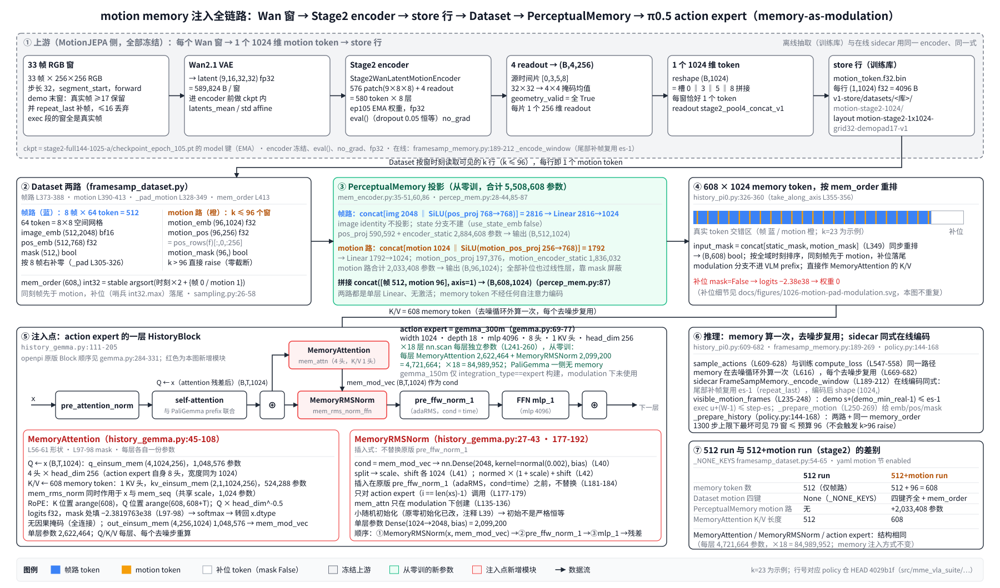
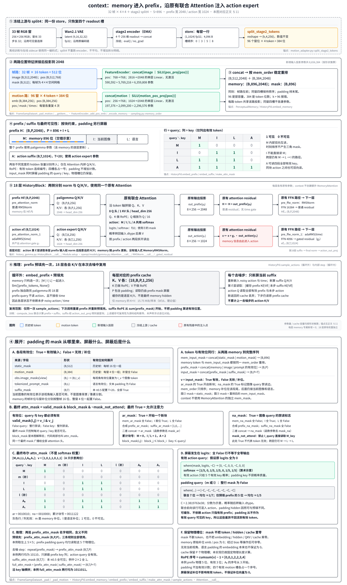

# 1027-motion-memory-injection.md — motion memory 是怎么注入 π0.5 的（memory-as-modulation / context）

**一句话结论（modulation，第 1–10 节）**：每个 33 帧窗经冻结的 stage2 encoder（EMA）变成 1 个 1024 维 motion token，与 512 个帧路 token 一起投影成 608 个 1024 维 memory token、按时刻排序；它们**不经任何自注意力编码**，直接在 action expert 的 18 层里各被一个 `MemoryAttention`（Q 来自 action token，4 头×256，1 KV 头）读取，读出的 `mem_mod_vec` 经插入式 `MemoryRMSNorm` 对 FFN 输入做 scale/shift 调制；paligemma 一侧完全不见 memory。

**一句话结论（context，第 11 节）**：memory 投影到 paligemma 的 2048 维，放在「当前图像、语言」之前组成 prefix；memory token 在 paligemma 的 18 层中逐层做自注意力与 FFN，action token 在各层**原有联合 Attention** 中读取同层的 memory K/V，注意力结果经原有输出投影与 gated residual 进入 action 残差流；推理时包含 memory 的 prefix 各层 K/V 在去噪循环外算一次并缓存。下文 context 采用已有的 32 帧×4×4、每窗拆成 4×256 的配置，memory 长度为 512+384=896；**608 与 896 是输入配置之差，不是两种注入机制各自固定的长度**。



**阅读指引**：本文件只讲机制（数据怎么流、在哪里注入、算了什么），不讲训练计划、闸门与 run 安排；那些见 `1027-orig16-vla-512-and-stage2-motion-4plus4-plan.md` 与 `docs/root-archive/1026-vla-stage2-memory-1024-train-plan.md`。第 1–10 节保留原 modulation 说明；第 11 节配有 context 全链路图，按同样的「全链路 → 输入与投影 → 注入点 → 公式 → 训练与推理」顺序展开，末尾用同一套输入配置对照两种机制。补位（motion 不满 96 时）的细节见既有图 `docs/figures/1026-motion-pad-modulation.svg`。

**口径**：第 1–10 节代码锚点沿用 policy 仓 `4029b1f`（`commitV11.57`）；新增第 11 节以开发副本 `f2de48b` 为准，使用稳定函数名锚点。两版 `history_pi0.py`、`history_gemma.py`、`percep_mem.py`、`mem_encoder.py` 中本文涉及的注入计算相同；新配置与 split4 输入处理按第 11 节单列，不把新形状套进旧章节。路径省略前缀 `src/`；MotionJEPA 侧事实沿用 1026 计划 §2.2–§2.4。参数量是按权重形状推算的，未实际加载参数树统计（见第 10、11.9 节）。行号与旧计划/旧注释不一致处一律以代码为准（见第 9 节）。

---

## 1. 全链路总览

| # | 输入 | 模块 | 输出（形状 / dtype / 字节） | 可训？ | 代码锚点 |
|---|---|---|---|---|---|
| 1 | 33 帧 256×256 RGB 窗（窗 33、步长 32、segment_start、forward） | Wan2.1 VAE | latent (9,16,32,32) fp32 = 589,824 B/窗 | 冻结（离线缓存） | 1026 计划 §2.2；policy `scripts/dataset/wan/extract_wan.py` |
| 2 | latent | `Stage2WanLatentMotionEncoder.forward`（576 patch + 4 readout，8 层） | (B,4,256) fp32 → reshape (B,1024) | 冻结、`eval()`、`no_grad`、EMA 权重 | MJ `wan_latent_encoder.py` |
| 3 | (1024,) 向量 | 离线 store | 每行 (1,1024) f32 = 4,096 B；layout `motion-stage2-1x1024-grid32-demopad17-v1` | — | `v1-store/datasets/<库>/motion-stage2-1024/motion_token.f32.bin` |
| 4 | 帧特征 + store 行 | `FramesampDataset` | 帧路 512 token；motion 路 96 位；`mem_order` (608,) int32 | — | `mme_vla_suite/training/framesamp_dataset.py:373-413` |
| 5 | 帧路 `static_image_emb` (512,2048) ‖ pos | `pos_proj` + `encoder_static` | (B,512,1024) | 可训，从零 | `mme_vla_suite/models/representation/mem_encoder.py:35-51,60,86` |
| 6 | motion 路 `motion_emb` (96,1024) ‖ pos | `motion_pos_proj` + `motion_encoder_static` | (B,96,1024) | 可训，从零 | `mme_vla_suite/models/representation/percep_mem.py:28-44,85-87` |
| 7 | 两路拼接 | `PerceptualMemory` concat | (B,608,1024) | — | `percep_mem.py:87` |
| 8 | (B,608,1024) + mask | `HistoryPi0.embed_memory` 按 `mem_order` 重排 | `mem_seq` (B,608,1024)、`mem_mask` (B,608) bool | — | `mme_vla_suite/models/integration/history_pi0.py:326-360` |
| 9 | action expert 残差流 x (B,T,1024) + `mem_seq` | 每层 `MemoryAttention` | `mem_mod_vec` (B,T,1024) | 可训，每层独立 | `mme_vla_suite/models/integration/history_gemma.py:45-108` |
| 10 | x、`mem_mod_vec` | 每层 `MemoryRMSNorm("mem_rms_norm_ffn")` → 原版 `pre_ffw_norm_1` → FFN → gated residual | 调制后的 FFN 输出 | 可训 | `history_gemma.py:177-192` |
| 11 | 18 层后 suffix 输出 | action expert 末端（openpi 原样） | 速度场 / 去噪动作 | — | `history_pi0.py:547-558`（训练）、`609-682`（推理） |

T 为 action expert 的 suffix token 数（π0.5 下即 action 序列长度；本文不展开其取值）。

---

## 2. 上游：motion token 怎么来的

- **窗**：每窗 33 帧、256×256 RGB，步长 32，从段起点（segment_start）正向（forward）枚举；经 Wan2.1 VAE（`Wan-AI/Wan2.1-T2V-1.3B-Diffusers`）得 latent (9,16,32,32) fp32 = 589,824 B。
- **encoder**：`Stage2WanLatentMotionEncoder.forward(latents, geometry_valid=全 True)`：先用 ckpt 内 `latents_mean/std` 做 affine 归一化 → 576 个 patch token（9×8×8）+ 4 个 readout token（源时间片 [0,3,5,8]，32×32 → 4×4 掩码均值）= 580 token，过 8 层 → 取 4 个 readout 得 (B,4,256) fp32 → reshape (B,1024)，即槽 0‖3‖5‖8 首尾拼接，不改数。
- **权重与模式**：encoder 取 `stage2-full144-1025-a/checkpoint_epoch_105.pt` 的 `model` 键（EMA，不是 `model_live`）；冻结、`eval()`（encoder 内 dropout 0.05 在 eval 下恒等）、`no_grad`、fp32。
- **离线与在线同一 encoder**：训练库离线抽取与推理时在线 sidecar 编码用同一份 encoder、同一式。
- **store 行格式**：每窗 1 行 (1,1024) f32 = 4,096 B，文件 `motion_token.f32.bin`，layout `motion-stage2-1x1024-grid32-demopad17-v1`。
- **窗口枚举与 demo 补帧**（1026 计划 §2.3）：`real = min(33, seg_len − off)`；demo 段末窗真实帧 ≥17 保留，并把段末帧 `frames[seg_len−1]` 在像素层重复补到 33 帧（repeat_last，整窗再过 VAE），≤16 丢弃；exec 窗必须 33 帧全真实（exec 需补帧直接 raise）。例：demo 段 len=100 时 stride32 起点为 0/32/64（64 窗 33 帧全真实，96 窗只剩 4 帧 ≤16 不存在）；exec 段 len=100 起点同为 0/32/64，三窗全真实。
- **可见窗条件**：demo 窗起点 s 满足 `s + (demo_min_real − 1) ≤ es − 1`（即 `s+16 ≤ es−1`）；exec 窗起点 u 满足 `u + (W − 1) ≤ step − es`（即 `u+32 ≤ t−es`），es 为 demo 段长、W=33。
- **上限**：`examples/robomme/eval.py` 执行步数上限 1300 下，最坏 demo（VideoPlaceOrder 1247 帧）39 窗 + exec 40 窗 = **79**，motion 预算 96，余量 17。

**代码锚点**：MJ `wan_latent_encoder.py`（encoder 与 dropout）；policy `scripts/dataset/wan/extract_wan.py`（离线补帧）；`mme_vla_suite/policies/framesamp_memory.py:189-212`（在线 `_encode_window`，尾部补帧复用 `es-1`）、`:235-248`（`visible_motion_frames`）；`examples/robomme/eval.py`（1300 步）。

---

## 3. Dataset 侧两路输入

**帧路（512 token）**：`max_frames = budget // (token_per_image × num_views) = 512 // 64 = 8`（`framesamp_dataset.py:199`），`tokens_per_frame = 64`（`:200`）；「8×8」指每帧 64 个 token 的 8×8 空间网格（在线键 `image_emb_8x8`）。

| 字段 | 形状 / dtype | 每样本字节（按形状推算） | 说明 |
|---|---|---|---|
| `static_image_emb` | (512,2048) bf16 | 2,097,152 | 8 帧 × 64 token 的图像特征 |
| `static_pos_emb` | (512,768) f32 | 1,572,864 | 位置编码 |
| `static_state_emb` | (512,8) | — | 每帧 state 重复 64 次、已归一化；本配置 `use_state_emb false`，不进投影 |
| `static_mask` | (512,) bool | 512 | 不足 8 帧时 `_pad`（`:305-326`）右补零、mask False |

**motion 路（96 位，仅 `motion.enabled`）**：

| 字段 | 形状 / dtype | 每样本字节（按形状推算） | 说明 |
|---|---|---|---|
| `motion_emb` | (96,1024) f32 | 393,216 | `_pad_motion`（`:328-349`）；stage2 时 `:402` reshape 成 (k,1024) |
| `motion_pos` | (96,256) f32 | 98,304 | `pos_rows(f)[:,0,:256]`（`:405-406`），取窗时刻的位置编码前 256 维 |
| `motion_mask` | (96,) bool | 96 | 前 k 位 True |
| `mem_order` | (608,) int32 | 2,432 | `:413`，帧路与 motion 路合并后的重排索引 |

- **零截断**：k > 96 直接 raise（`:334-336`），不静默截断。
- **补位（简述）**：k 个真实窗之后的位 emb/pos 填零、mask False、时刻记哨兵 int32.max；补位也会过两层 Linear（零输入经 bias 得非零向量），但在注意力里被 mask 屏蔽，权重为 0、也不进 softmax 分母。序列长恒为 608，算力不随 k 变。详图见 `docs/figures/1026-motion-pad-modulation.svg`，展开见 1026 计划第二部分 §七。
- **排序键**（`mme_vla_suite/shared/sampling.py`）：`pad_times`（`:26-35`）给补位记哨兵（`:23`）；`memory_order`（`:38-58`）中帧路键 = 帧时刻×2+0（每帧重复 64 次），motion 键 = 窗时刻×2+1，拼接后 `argsort(kind="stable")`。语义：按全域时刻升序；**同一时刻帧在 motion 之前**；哨兵时刻的补位落在最尾。
- **512 run 关闭态**：四个 motion 键（`motion_emb`/`motion_pos`/`motion_mask`/`mem_order`）为 None（`_NONE_KEYS`，`:54-65`），memory 只有 512 个帧路 token，不重排。

**代码锚点**：`mme_vla_suite/training/framesamp_dataset.py:54-65,199-200,305-349,373-413`；`mme_vla_suite/shared/sampling.py:23,26-35,38-58`。

---

## 4. PerceptualMemory 投影（两路分别投到 1024）

| 路 | 模块 | 计算 | 参数量 |
|---|---|---|---|
| 帧路 | `pos_proj` | Linear(768→768, bias) + SiLU | 590,592 |
| 帧路 | image | identity（2048 不投影） | 0 |
| 帧路 | `encoder_static` | concat[img 2048 ‖ pos 768] = 2816 → Linear(2816→1024, bias)，无激活 | 2,884,608 |
| 帧路 | state 分支 | `use_state_emb false`，不建 | 0 |
| motion 路 | `motion_pos_proj` | Linear(256→768, bias) + SiLU | 197,376 |
| motion 路 | `motion_encoder_static` | concat[motion 1024 ‖ pos 768] = 1792 → Linear(1792→1024, bias) | 1,836,032 |
| **合计** | | 帧路 3,475,200 + motion 路 2,033,408 | **5,508,608** |

- 输出：帧路 (B,512,1024)，motion 路 (B,96,1024)，`concat(axis=1)` → (B,608,1024)（`percep_mem.py:87`）。全部从零训。
- motion 模块只在 `motion.enabled` 时于 `__init__` 中创建（不是在 `__call__` 里跳过），且建在帧路 `feature_encoder` 之后，以免改变帧路初始化的 RNG 序（`percep_mem.py:28-44` 注释）。
- **勘误**：1026 计划 §2.2 写的「新参数 1,836,032」只是 `motion_encoder_static` 一层；motion 路实际合计 2,033,408（再加 `motion_pos_proj` 197,376）。

**代码锚点**：`mme_vla_suite/models/representation/mem_encoder.py:35-41,44-51,60,86`；`mme_vla_suite/models/representation/percep_mem.py:28-44,85-87`。

---

## 5. 进入 action expert

- **`embed_memory`**（`history_pi0.py:326-360`）：开启态先做非 None 与形状闸，`input_mask = concat[static_mask, motion_mask]`（`:349`），再把 tokens 与 mask 一起按 `mem_order` 用 `take_along_axis` 重排（`:355-356`），得 `mem_seq` (B,608,1024)、`mem_mask` (B,608) bool。关闭态早返回，tokens 与 `static_mask` 原样。
- **LLM 组成**：modulation 下 LLM 只含 `[paligemma, action_expert]`，`mem_mods=[False, True]`（`:246-263`）；`gemma_150m`（memory expert）只在 `integration_type=="expert"` 分支构建（`:226-243`），modulation 下未使用。
- **不进 prefix**：context 分支把记忆放进 VLM prefix（`:376-387`）；modulation 不进 prefix，而是以 `mem_seq=[None, mem_seq]`、`mem_mask=[None, mem_mask]` 传给 LLM，只有 action expert 一侧收到。
- **不经自注意力**：memory token 在进入 `MemoryAttention` 前不经过任何 Transformer 层，投影输出直接作为每层 K/V 的来源；`nn.scan` 对 `mem_seq`/`mem_mask` 用 `nn.broadcast`，18 层看到的是同一份 memory。

**代码锚点**：`history_pi0.py:226-263,326-360,376-387`；`history_gemma.py:241-260`（scan 的 `in_axes`）。

---

## 6. 注入点逐层剖析（核心）

### 6.1 一层 HistoryBlock 的顺序

action expert 为 `gemma_300m`：width 1024、depth 18、mlp 4096、8 头、1 KV 头、head_dim 256（`openpi/models/gemma.py:69-77`）。openpi 原版 Block：`pre_attention_norm → Attention → gated residual → pre_ffw_norm → FFN → gated residual`（`gemma.py:284-331`）。

`HistoryBlock`（`history_gemma.py:111-205`）在 modulation 下对 action expert（`i == len(xs)-1`）做：

1. `pre_attention_norm_1`（adaRMS，cond = time）→ 与 paligemma 联合的 `Attention` → gated residual（与原版相同）；
2. **`MemoryAttention`**：以本层残差流 x 为 Q、608 个 memory token 为 K/V，得 `mem_mod_vec` (B,T,1024)（`:177-178`）；
3. **`MemoryRMSNorm("mem_rms_norm_ffn")(x, mem_mod_vec)`**：对 x 做 RMSNorm 后按 `mem_mod_vec` scale/shift（`:179`）；
4. 原版 `pre_ffw_norm_1`（adaRMS，cond = time），产出 FFN 输出门 gate（`:181-184`）；
5. `mlp_1` FFN（`:186-192`）；
6. gated residual：`xs[i] + ffn_out * gate`（`:198-202`）。

与原版对照：**`MemoryRMSNorm` 是插入在 `pre_ffw_norm` 之前的一步，不替换原 norm**；`pre_ffw_norm_1` 与其 time 条件、gate 全部保留。`mem_attn` 只在 `integration_type=="modulation"` 时创建（`:135-136`）；paligemma 一侧（`i==0`）走原版路径，没有任何 memory 计算。

从代码可直接读出的两点（不额外推断效果）：
- 第 6 步的残差加法用的是 `xs[i]`（注意力残差后的流），不是调制后的 x；即 memory 只通过「改变 FFN 的输入」影响残差流，`mem_mod_vec` 本身不直接加到残差流上。
- 第 3 步调制后的 x 紧接着又被第 4 步 `pre_ffw_norm_1` 重新做 RMS 归一化，所以调制作用到 FFN 的是方向/各维相对大小，整体幅值由第 4 步重定。

### 6.2 MemoryAttention（`history_gemma.py:45-108`）

| 项 | 值 |
|---|---|
| 头配置 | `num_heads=4`、`num_kv_heads=1`、`head_dim=256`、`width=1024`（`:56-61`，硬编码）；与 action expert 本身的 8 头不同，宽度相同（4×256=1024） |
| 预归一化 | 内部 `MemoryRMSNorm(name="mem_rms_norm")`，cond=None，即普通 RMSNorm、scale 零初始化；**同一个实例同时作用于 x 与 `mem_seq`**（共享 1,024 个 scale） |
| Q | `q_einsum_mem` (4,1024,256)，来自 action expert token x (B,T,1024)；1,048,576 参数 |
| K/V | `kv_einsum_mem` (2,1,1024,256)，来自 608 个 memory token；524,288 参数 |
| RoPE | Q 位置 `arange(608, 608+T)`，K 位置 `arange(608)`（`mem_len` 取实际长度，512 run 为 512）；即 memory 在前、action token 接在其后编号 |
| 缩放 | RoPE 后 `q *= head_dim**-0.5`（=1/16） |
| logits | `einsum(..., preferred_element_type=float32)`，f32 |
| mask | `jnp.where(mask, logits, -2.3819763e38)`（`:97-98`），mask 形状 (B,1,1,1,S)，只屏蔽 key；无因果掩码，每个 action token 可看全部有效 memory |
| softmax | 在 f32 上做，再 `astype(x.dtype)` |
| 输出 | `out_einsum_mem` (4,256,1024)，1,048,576 参数 → `mem_mod_vec` (B,T,1024) |
| 单层参数 | 1,048,576 + 524,288 + 1,048,576 + 1,024 = **2,622,464** |

4 个 Q 头共用 1 组 K/V（GQA，`K=1, G=4`）。

### 6.3 MemoryRMSNorm（`history_gemma.py:27-43`）

- `cond` 给定时：`nn.Dense(2048, kernel_init=kernel_init_out_proj, bias)(cond)`（`:40`），`kernel_init_out_proj = normal(stddev=0.002)`（`mme_vla_suite/models/representation/utils.py:5`）；split 成 scale、shift 各 1024（`:41`）；`normed*(1+scale)+shift`（`:42`）。
- 注释 `:39` 保留了原零初始化写法，现改为小随机初始化：**初始不是严格恒等**（kernel 非零，bias 默认零初始化）。对比之下 openpi 原版 adaRMS 的 Dense 是 `zeros` 初始化（`gemma.py:128`）。
- 参数：Dense(1024→2048, bias) = 2,099,200 / 层。
- RMS 方差在 f32 计算，eps 1e-6，结果转回输入 dtype。

### 6.4 一层的公式（伪代码，action expert 一侧）

```
# x: (B,T,1024) action expert 残差流；M: (B,608,1024) mem_seq；m: (B,608) mem_mask；c: time 条件
h, g1 = adaRMS_attn(x, c)                    # pre_attention_norm_1
x = x + g1 * Attn([prefix..., h])            # 与 paligemma 联合注意力（原版）

xq, Mk = RMS_s(x), RMS_s(M)                  # mem_rms_norm，共享 scale
q = rope(xq @ Wq, 608..608+T-1) / 16         # (B,T,4,256)
k, v = rope(Mk @ Wk, 0..607), Mk @ Wv        # (B,608,1,256)
p = softmax_f32(where(m, q·kᵀ, -2.38e38))    # 只屏蔽补位 key
u = (p @ v) @ Wo                             # mem_mod_vec (B,T,1024)

s, b = split(Dense_{1024→2048}(u))           # mem_rms_norm_ffn
z = RMS(x) * (1 + s) + b                     # 插入的调制
z, g2 = adaRMS_ffw(z, c)                     # pre_ffw_norm_1（原版）
x = x + g2 * FFN(z)                          # 残差用调制前的 x
```

### 6.5 每层独立、每步重算、参数量

- `nn.scan(variable_axes={"params":0}, length=depth=18)`（`history_gemma.py:241-260`），每层各有一套 `mem_attn` 与 `mem_rms_norm_ffn`，参数不共享。
- Q/K/V 每层、每个去噪步都重算（memory 本身在推理中只算一次，见第 7 节；但它在每层投出的 K/V 不缓存）。块用 `jax.checkpoint` 且 `policy=nothing_saveable`（`:236-240`），训练反传时整块重算。
- 每层新增 2,622,464 + 2,099,200 = **4,721,664**；×18 = **84,989,952**（按形状推算）。全部只在 action expert 一侧（参数名带 `_1` 一侧），paligemma 一侧无 memory 参数。

**代码锚点**：`history_gemma.py:27-43,45-108,111-205,236-260`；`mme_vla_suite/models/representation/utils.py:5`；`openpi/models/gemma.py:69-77,113-131,284-331,453-459`。

---

## 7. 训练与推理同路

- **训练** `compute_loss`（`history_pi0.py:547-558`）：modulation 分支调 `embed_memory`，把 `[prefix_tokens, suffix_tokens]` 与 `mem_seq=[None, mem_seq]`、`mem_mask=[None, mem_mask]` 一次送入 LLM。
- **推理** `sample_actions`（`:609-628`）：先用 prefix 建 KV cache（不含 memory），再在**去噪循环外**算一次 `embed_memory`（`:616`）；循环 `step` 内每个去噪步把同一份 `mem_seq`/`mem_mask` 传入（`:669-682`），由各层 `MemoryAttention` 重新投 K/V。
- **在线构造**：`FrameSampMemory._encode_window`（`framesamp_memory.py:189-212`）尾部补帧复用 `es-1`（repeat_last），编码得 (1024,)；`visible_motion_frames`（`:235-248`）按第 2 节同式判定可见窗；`_prepare_motion`（`:250-269`）给出 emb (B,1024) f32、pos = `pos_emb[f,0,:256]`、mask、times；`policy.py::_prepare_history`（`mme_vla_suite/policies/policy.py:144-168`）组装帧路 + motion 路，并在 `:166` 调用与离线相同的 `memory_order`。
- **增强与 dropout 不作用于 memory**：图像增强只在 `preprocess_observation(train=True)` 对当前帧做（`openpi/models/model.py`），推理传 `train=False`；memory 一直从干净帧离线（或在线同式）抽取，不增强；encoder `eval()` 下 dropout 恒等；`HistoryBlock` 的 dropout 默认 0.0（1026 计划 §2.4）。

**代码锚点**：`history_pi0.py:547-558,609-628,669-682`；`mme_vla_suite/policies/framesamp_memory.py:189-212,235-269`；`mme_vla_suite/policies/policy.py:144-168`；`openpi/models/model.py`。

---

## 8. 「512」与「512+motion」两条 run 的差别

| 项 | 512 | 512+motion（stage2） |
|---|---|---|
| history yaml | 无 `motion` 节 | `motion` 节：enabled、source_shape [1,1024]、readout `stage2_pool4_concat_v1`、num_tokens 1、dim 1024、budget 96、pos_dim 256、demo_min_real_frames 17、demo_tail_pad repeat_last、stride 32、window_frames 33、forward、segment_start、frame_size 256、store_path、source_run、checkpoint_sha256、encoder_kind、online_gpu |
| memory token 数 | 512（帧路） | 512 + 96 = 608 |
| Dataset 键 | 四个 motion 键为 None | `motion_emb`/`motion_pos`/`motion_mask`/`mem_order` 全有 |
| PerceptualMemory 参数 | 3,475,200 | 5,508,608（多 `motion_pos_proj` + `motion_encoder_static` 共 2,033,408） |
| MemoryAttention K/V 长度 | 512 | 608 |
| MemoryAttention / MemoryRMSNorm / action expert | 结构相同（每层 4,721,664，共 84,989,952） | 同左 |
| 共同配置 | budget 512、num_views 1、token_per_image 64、use_pos_emb true、use_state_emb false、integration_type modulation、memory_token_dim 1024、representation perceptual / frame_sampling | 同左 |

**速度**：只有 10-17 同批 4+4 并行实测可引用——同口径（5000→75000 平均）512 为 1.7183 s/步、512+motion 为 1.7346 s/步，慢约 0.95%（`docs/training-doc/mixed8-200-m8x8-modul-motion-b128-80k/result.md:66`）。注意那条 motion run 是旧的 160×768 motion，不是本文的 96×1024 stage2 motion；stage2 版的步时本文不推断。

**代码锚点**：`mme_vla_suite/models/config/robomme/perceptual-framesamp-modul-8frame-8x8-motion-stage2-mixed8.yaml`；`framesamp_dataset.py:54-65`；`percep_mem.py:28-44`。

---

## 9. 已知口径差异与旧注释勘误（以代码为准）

1. 帧路投影输入是 2816（image 2048 + pos 768）→ 1024，不是 2048 → 1024。
2. motion 路参数 2,033,408；1026 计划写的 1,836,032 只是 `motion_encoder_static`。
3. `MemoryRMSNorm` 是插入在 `pre_ffw_norm` 之前，不是替换 `pre_ffw_norm`。
4. `MemoryAttention` 是 4 头（×256，1 KV 头），不是 action expert 的 8 头。
5. `gemma_150m` 在 modulation 下未构建、未使用。
6. 多处旧注释仍写 768 维，实际 1024：`history_observation.py:26-29`、`robomme_policy.py:68`、`training/config.py:314`、`framesamp_memory.py:252`。
7. （本文核对补充）`percep_mem.py:42` 注释写「1536 → memory_token_dim」，stage2 配置下实际输入为 1024+768 = 1792。
8. yaml 里 `streaming_obs_horizon` 与 `pool_type` 两个键未被传入使用：`pool_type` 作为构造参数出现在 `mme_vla_suite/dataset_builder/mem_buffer.py:37,45`，但 yaml 的值没传进去；`streaming_obs_horizon` 只出现在 yaml。
9. `MemoryRMSNorm` 注释 `:39` 说明已由零初始化改为 `normal(0.002)`，初始非严格恒等；不要按「零初始化恒等」理解。

---

## 10. 未核实项

- 训练侧 `visible_motion_rows`（`motion_store.py`）与在线 `visible_motion_frames` 同式，目前**仅依据注释与 1026 计划描述**，本文未逐行对拍两侧实现（1026 计划 §2.3 曾指出训练侧步长写死在 `GRID_STRIDE`、需按 layout 参数化）。
- 补位位置经 bias 得到的「right padding token」向量在离线与在线两侧数值是否逐位一致，未核实。
- 第 4、6、8 节全部参数量（5,508,608、4,721,664、84,989,952 等）均按权重形状推算，未实际加载模型统计参数树。
- 第 3 节各字段的每样本字节为按形状 × dtype 推算，未在 dataloader 上实测。
- suffix 长度 T 的具体取值本文未核对。
- 第 6.1 节关于「残差用调制前的 x」「pre_ffw_norm 重新归一化」两点是对代码的直接读取，未做数值实验验证其对训练的影响。
- stage2 96×1024 motion run 的步时未在本文引用任何实测（第 8 节只引用旧 160×768 版本）。

---

## 11. context：memory 放进 prefix 后，怎么进入 action expert



图中沿用帧路蓝、motion 路橙、投影绿、冻结上游灰；示例为本节的 **512+384=896** 配置。⑤ 展开一层的注入点，⑥ 单列推理时各层 K/V 的缓存方式；两者按层对应，不是把最后一层 memory 输出重复送给所有 action 层。

### 11.1 全链路总览

**本节配置**：`mme_vla_suite/models/config/robomme/perceptual-framesamp-ctx-32frame-4x4-motion-stage2-4x256-orig16.yaml`：`integration_type: context`、`memory_token_dim: 2048`；帧路 `budget: 512`、`token_per_image: 16`、`num_views: 1`；motion 路 `source_shape: [1,1024]`、`readout: stage2_pool4_split_v1`、`num_tokens: 4`、`dim: 256`、`budget: 384`。这是已有配置，不是把旧 608-token modulation run 改名为 context。

| # | 输入 | 模块 | 输出（形状 / dtype） | 是否新增参数？ | 代码锚点 |
|---|---|---|---|---|---|
| 1 | 每窗 stage2 encoder 的 4 个 256 维 readout | 沿用第 2 节的冻结 encoder 与 concat store | 每窗 (1,1024) f32，仍为 4,096 B | 否，encoder 冻结 | `datastore/motion_adapter.py::split_stage2_tokens` 的输入契约 |
| 2 | k 行 (k,1,1024) store 数据 | `split_stage2_tokens`，按原槽顺序 reshape | (k,4,256) f32，不改数 | 否 | 同上 |
| 3 | 帧特征 + 拆开的 motion | `FrameSampDataset`，96 窗补位后展开 | 帧路 512 位；motion 路 384 位；`mem_order` (896,) int32 | 否 | `training/framesamp_dataset.py::FrameSampDataset.__getitem__`、`_pad_motion` |
| 4 | 帧路 image (B,512,2048) ‖ pos | `FeatureEncoder` | (B,512,2048) | 是，从零训 | `models/representation/mem_encoder.py::FeatureEncoder` |
| 5 | motion (B,384,256) ‖ pos | `motion_pos_proj` + `motion_encoder_static` | (B,384,2048) | 是，从零训 | `models/representation/percep_mem.py::PerceptualMemory` |
| 6 | 两路投影 + mask | concat，再按 `mem_order` 重排 | memory (B,896,2048)、mask (B,896) bool | 否 | `models/integration/history_pi0.py::HistoryPi0.embed_memory` |
| 7 | memory + 当前图像 + 语言 | `embed_prefix`，按此顺序拼接 | prefix (B,P,2048)；LLM 入口转 `embed_dtype` | 否 | `HistoryPi0.embed_prefix`；`history_gemma.py::Module.__call__` |
| 8 | prefix (2048 维) + action suffix (1024 维) | 18 层 `HistoryBlock`，两侧分别投 Q/K/V 后做联合 `Attention` | 每层 action 输出 (B,T,1024)；prefix 同时逐层更新 | 沿用两侧原有层参数 | `history_gemma.py::HistoryBlock.__call__`；`openpi/models/gemma.py::Attention.__call__` |
| 9 | 第 18 层 suffix → final norm | `action_out_proj` | 速度场 / 去噪动作 | 沿用原有输出头 | `HistoryPi0.compute_loss`、`sample_actions` |

本节锚点中的 `datastore/`、`training/`、`shared/`、`models/` 均位于 `mme_vla_suite/` 下；`history_pi0.py`、`history_gemma.py` 位于其 `models/integration/` 下。本节记 memory 位数为 S=896，当前图像 token 数为 I，语言 token 数为 L，故 **P=S+I+L**；T 是 action suffix 长度，所用训练配置 `mme_vla_suite_orig16_b128_60k` 的 `action_horizon=20`，即 T=20。896 只算 memory，不能当成整个 prefix 的长度。

### 11.2 Dataset 与 PerceptualMemory（两路分别投到 2048）

**帧路（512 token）**：`max_frames = 512 // (16 × 1) = 32`；「4×4」指每帧 16 个空间 token，32 帧仍共 512 位。相比第 3 节的 8 帧×8×8，改变的是采样帧数与每帧空间网格，不改变 `static_image_emb` (512,2048)、`static_pos_emb` (512,768)、`static_mask` (512,) 的形状；`use_state_emb false` 仍不走 state 投影。

**motion 路（384 位）**：同一个 store 行原来是槽 0‖3‖5‖8 的 1024 维拼接，现在只 reshape 回 4×256，按原顺序变成四个独立 token；**没有再跑 encoder，没有平均、配对或新增拆分网络**。

| 字段 | 每样本形状 / dtype | 说明 |
|---|---|---|
| `motion_emb` | (384,256) f32 | 96 个窗位 × 每窗 4 token；k 个真实窗占前 4k 位 |
| `motion_pos` | (384,256) f32 | 每窗起点的 `pos_rows(f)[:,0,:256]` 重复 4 次 |
| `motion_mask` | (384,) bool | 窗级 mask 重复 4 次；不足 96 窗的部分为 False |
| `mem_order` | (896,) int32 | 合并帧路 512 位与 motion 路 384 位，按时间稳定排序 |

- **同窗四个 token 的位置编码**：重复的是同一个**窗口起点**的位置编码与排序时刻，不分别赋成 readout 槽 [0,3,5,8] 的时刻。稳定排序保留同窗四槽的原顺序；同一时刻的帧路 token 仍在 motion token 前面。
- **补位单位**：`_pad_motion` 先以 96 个完整窗为容量补位，再展开为 384 个 token；k>96 仍直接报错。每个补窗的四个位一起无效，不能把 384 当成可容纳 384 个窗。
- **注意力位置另算**：上述 `motion_pos` 是投影输入里的位置特征；进入 LLM 后，四个有效 token 各自占一个 RoPE 序号（见第 11.3 节），两者不是同一种位置编号。

| 路 | 模块 | 计算 | 参数量 |
|---|---|---|---|
| 帧路 | `pos_proj` | Linear(768→768, bias) + SiLU | 590,592 |
| 帧路 | image | identity（2048 不投影） | 0 |
| 帧路 | `encoder_static` | concat[img 2048 ‖ pos 768] = 2816 → Linear(2816→2048, bias)，无激活 | 5,769,216 |
| 帧路 | state 分支 | `use_state_emb false`，不建 | 0 |
| motion 路 | `motion_pos_proj` | Linear(256→768, bias) + SiLU | 197,376 |
| motion 路 | `motion_encoder_static` | concat[motion 256 ‖ pos 768] = 1024 → Linear(1024→2048, bias)，无激活 | 2,099,200 |
| **合计** | | 帧路 6,359,808 + motion 路 2,296,576 | **8,656,384** |

输出：帧路 (B,512,2048)、motion 路 (B,384,2048)，concat 后重排，得到 (B,896,2048)。同一路的所有 token 共享投影参数，同窗四槽也共用同一套 motion 投影；不是每槽各建一套。**context 的目标宽度是 paligemma 的 2048，不是 action expert 的 1024**；memory 后续如何被 1024 维的 action 读取，见第 11.4 节。

**代码锚点**：`mme_vla_suite/datastore/motion_adapter.py::split_stage2_tokens`；`training/framesamp_dataset.py::FrameSampDataset.__init__`、`_pad_motion`、`__getitem__`；`shared/sampling.py::memory_order`；`models/representation/mem_encoder.py::FeatureEncoder.__init__`、`_add_pos_emb`、`_encode_memory`；`models/representation/percep_mem.py::PerceptualMemory.__call__`；`training/config.py` 的 `mme_vla_suite_orig16_b128_60k`。

### 11.3 进入 prefix：拼接顺序、mask 与位置

- **拼接顺序**：`embed_prefix` 首先调用 `embed_memory`，再遍历 `obs.images` 加入当前图像 token，最后加入 `tokenized_prompt`。即 **[按时刻排序的 memory ‖ 当前图像 ‖ 语言]**；这里的「当前图像」与 memory 帧路里的历史图像特征是两段不同输入。
- **LLM 组成**：与 modulation 一样只含 `[paligemma, action_expert]`；context 下 `mem_mods=[False, False]`，不构建 `MemoryAttention`、`mem_rms_norm_ffn` 或第三个 memory expert。整个 prefix 都走 paligemma 参数，suffix 走 action expert 参数。
- **宽度与 dtype**：prefix 为 (B,P,2048)，suffix 为 (B,T,1024)，不是先把两者在 hidden 维度统一后拼成一个张量；LLM 接收两个张量的列表，在 `Module.__call__` 内各转成 `embed_dtype`（本配置链的默认值为 bf16），再在 Attention 内拼各自投影出的 Q/K/V。

**mask 的三部分**（`make_attn_mask`）：

| token 段 | `ar_mask` | `na_mask` | 作用 |
|---|---|---|---|
| memory | 全 False | 全 False | 属于最前面的块，块内可双向读 |
| 当前图像 | 第一张图首 token 为 True，其余 False | 全 True | 开始第二个块；额外屏蔽图像 query 直接读 memory key |
| 语言 | 全 False | 全 False | 与当前图像在同一块，可读 memory |
| action suffix（π0.5） | 首 token 为 True，其余 False | 全 False | 开始第三个块，可读整个有效 prefix 和同块 action |

先按 `cumsum(ar_mask)` 实现「只能读自身及更早的块」，再叠加 `na_mask` 与 `input_mask`。对**有效 token**，最终直接可见性如下（行是 query，列是 key）：

| query ＼ key | memory | 当前图像 | 语言 | action |
|---|---|---|---|---|
| memory | 可见 | 不可见 | 不可见 | 不可见 |
| 当前图像 | **不可见** | 可见 | 可见 | 不可见 |
| 语言 | 可见 | 可见 | 可见 | 不可见 |
| action | **可见** | 可见 | 可见 | 可见 |

- **memory 内部不是时间因果注意力**：按时刻排序只决定序列顺序，所有有效 memory token 都在同一块，帧路与 motion 路可以双向互读。上游可见窗选择已限制输入中有哪些历史窗；这里不会再做「早 memory 不能读晚 memory」的三角 mask。
- **图像直接边与间接影响要分开**：图像 query 不能直接读 memory key，但语言可读 memory，图像又可读语言；跨层仍可有 memory → 语言 → 图像的信息传播。不能写成「图像残差流始终不受 memory 影响」。
- **补位**：`input_mask` 同时约束 query 与 key；padding 在 mask 中无有效行/列，其他有效 token 不能读取它。实现用有限大负数填 logits，不能据此断言「全被屏蔽的 padding query 行，softmax 后或层输出必然为零」；机制依赖的是这些位置不会成为有效 key。
- **RoPE 序号**：训练与 prefix 预填充用 `positions = cumsum(input_mask, axis=-1)-1`。有效 token 按 memory → 当前图像 → 语言 → action 连续编号，padding 不增加有效计数；它们仍占物理序列位置与 cache 槽位。若本样本有效 memory 数为 Sᵥ，则首个有效当前图像 token 的位置从 Sᵥ 开始，而不是固定从 896 开始。去噪时 suffix 接在有效 prefix 数之后（见第 11.6 节）。

**代码锚点**：`mme_vla_suite/models/integration/history_pi0.py::HistoryPi0.__init__`、`embed_memory`、`embed_prefix`、`embed_suffix`、`make_attn_mask`、`compute_loss`；`history_gemma.py::Module.__call__`。

### 11.4 注入点逐层剖析（核心）

paligemma 为 `gemma_2b`：width 2048、depth 18、mlp 16384；action expert 为 `gemma_300m`：width 1024、depth 18、mlp 4096。**两侧原有 Attention 都是 8 个 Q 头、1 个 KV 头、head_dim 256**，不是第 6.2 节额外 `MemoryAttention` 的 4 头。

一层 `HistoryBlock` 在 context 下的顺序：

1. prefix（含 memory）走 `pre_attention_norm`，普通 RMSNorm；action 走 `pre_attention_norm_1`，adaRMS，cond=time，同时产出 action attention 的 gate。
2. prefix 用 paligemma 的 Q/K/V 权重，action 用 action expert 的 Q/K/V 权重；各自投影后，沿 token 轴拼 Q、K、V，用第 11.3 节的 mask 做**同一个联合 Attention**。
3. 把注意力读出按 prefix / action 分段，分别经各自输出投影，回到 2048 / 1024 维；prefix 做普通 residual，action 做原有 gated residual。**memory 对 action 的直接影响就在这次 attention residual 中进入**。
4. prefix 走原有 `pre_ffw_norm → FFN → residual`；action 走原有 `pre_ffw_norm_1`（adaRMS，cond=time）→ FFN → gated residual。
5. 更新后的 prefix 与 action 分别进入下一层；memory token 是 prefix 残差流的一部分，也随这 18 层逐层更新。

| 项 | prefix 一侧（含 memory） | action 一侧 |
|---|---|---|
| norm 后输入 | (B,P,2048) | (B,T,1024) |
| Q 权重 / 输出 | (8,2048,256) → (B,P,8,256) | (8,1024,256) → (B,T,8,256) |
| K/V 权重 / 各自输出 | (2,1,2048,256) → 各 (B,P,1,256) | (2,1,1024,256) → 各 (B,T,1,256) |
| Q/K 位置 | 第 11.3 节的有效 token 序号，做 RoPE | 接在有效 prefix 之后，做 RoPE |
| 注意力缩放 / 计算 | Q 乘 1/16；logits 与 softmax 在 f32，概率转回输入 dtype | 同左 |
| 输出投影 | (8,256,2048) → (B,P,2048) | (8,256,1024) → (B,T,1024) |

8 个 Q 头共用 1 组 K/V（GQA，K=1、G=8）。action query 可同时读 memory、当前图像、语言与 action 的有效 key，**四段共用一次 softmax 的分母**；不存在只在 memory 段上单独归一化的一次额外注意力。

这里不需要一层额外的「memory 2048→action 1024」适配器：memory 用 paligemma 权重投成 head_dim=256 的 K/V，action 用自己的权重投成同样 head_dim=256 的 Q；读出后由 action 原有输出投影回 1024。memory 在 prefix 内与当前图像、语言共享 paligemma 层参数，不另建 memory 专属 Transformer。

**逐层含义**：action 第 ℓ 层读的是 prefix 的**本层输入残差流经 `pre_attention_norm`、再经本层 K/V 权重投影的结果**（K 另做 RoPE）。第一层的 memory 来自 `PerceptualMemory` 投影；后续层的 memory 已经过前面层的残差更新。不是先取 memory 第 18 层输出，再把这同一份最终输出送给 action 的所有层。

**代码锚点**：`mme_vla_suite/models/integration/utils.py::get_config`（由 `history_gemma.py` 导入）；`openpi/models/gemma.py::RMSNorm.__call__`、`Attention.__call__`、`_gated_residual`；`mme_vla_suite/models/integration/history_gemma.py::HistoryBlock.__call__`、`Module.setup`。

### 11.5 一层的公式（伪代码，context）

```
# H: (B,P,2048) prefix 残差流，开头 S 位为 memory
# x: (B,T,1024) action 残差流；c: time 条件；A: 第 11.3 节的完整 attention mask
h = RMS_prefix_attn(H)
a, g1 = adaRMS_action_attn(x, c)

q0, k0, v0 = proj_prefix(h)                # Q: 8×256，K/V: 1×256，paligemma 权重
q1, k1, v1 = proj_action(a)                # Q: 8×256，K/V: 1×256，action 权重
q = rope(concat_tokens[q0, q1], positions) / 16
k = rope(concat_tokens[k0, k1], positions)
v = concat_tokens[v0, v1]
p = softmax_f32(where(A, q·kᵀ, -2.38e38)).astype(v.dtype)
y0, y1 = split_prefix_action(p @ v)        # action 的 y1 已混合 memory 与其余可见段

H = H + out_prefix(y0)                    # 回到 2048 维；prefix 无 time gate
x = x + g1 * out_action(y1)               # 回到 1024 维；memory 影响经这里进入 action
H = H + FFN_prefix(RMS_prefix_ffw(H))
z, g2 = adaRMS_action_ffw(x, c)
x = x + g2 * FFN_action(z)                # 原有 FFN 路径，无插入式 MemoryRMSNorm
```

Q/K 的 RoPE 与 head 维运算按第 11.4 节；伪代码省略 batch/head 广播和默认 0.0 的 dropout。memory 在 H 内逐层更新，action 的 time 条件仍只进入 action 一侧的 adaRMS。

### 11.6 训练与推理同路：context 缓存的是什么

- **训练** `compute_loss`：`embed_prefix` 已把 memory 放进 prefix；与 suffix 一起构造 mask 与 positions，一次调用 `llm([prefix_tokens, suffix_tokens], adarms_cond=[None, time_cond])`。context 不另外传 `mem_seq` / `mem_mask`。逐层计算遵循第 11.4 节；损失仍由 suffix 经 `action_out_proj` 得到的速度场计算，memory 没有单独的预测头或损失。
- **推理预填充** `sample_actions`：去噪循环外，先 `embed_prefix`（含一次 `embed_memory`），然后 `llm([prefix_tokens, None], mask=prefix_attn_mask, positions=...)`。memory、当前图像、语言一起跑完 paligemma 的 18 层，得到**每层各自的 prefix K/V**。
- **cache 形状**：K 与 V 各为 (18,B,P,1,256)，不是 (B,S,2048) 的最终 memory hidden state；K 已做 RoPE，V 不做 RoPE。物理长度 P 包含 padding 槽位，读取时靠 prefix mask 屏蔽。bf16 下，仅 S=896 个 memory 槽位对应的 K+V 理论存储为 `18 × B × 896 × 1 × 256 × 2 × 2 = 16,515,072 × B` B（15.75 MiB/样本），不含图像/语言部分与其他运行内存。
- **每个去噪步**：只重新嵌入 noisy action 与 time，调用 `llm([None, suffix_tokens], kv_cache=kv_cache, adarms_cond=[None, time_cond])`。每层只新算 suffix 的 Q/K/V，把缓存的 prefix K/V 接在当前 suffix K/V 前面；action 可见全部有效 prefix 和全部 suffix。新返回的 cache 被丢弃，下一去噪步仍读取循环外同一份 prefix cache，不累计前一步 action 的 K/V。
- **suffix 位置**：`positions = sum(prefix_mask, axis=-1)[:,None] + cumsum(suffix_mask, axis=-1)-1`；因此与训练时完整序列的有效 token 编号一致，不按物理 P 把 padding 算进去。
- **为什么能缓存**：第 11.3 节中所有 prefix query 都不能看 action，且 prefix 没有 action time 条件；所以 prefix 各层状态不依赖当前去噪步的 noisy action / time。这个结构支持一次预填充、多步复用；它本身不是训练与推理浮点结果逐位一致的实测证据。
- **缓存范围**：只在一次 `sample_actions` 调用内的多个去噪步之间复用；下次调用会重新构造 prefix 并预填充，代码没有跨环境步直接沿用旧 prefix cache。
- **在线构造**：`MME_VLA_Policy._prepare_history` 对在线得到的 (96,1024) 窗级向量调用同一个 `split_stage2_tokens`，再把 pos、mask、times 各重复 4 次；随后按与离线相同的 `memory_order` 排序。进入 `embed_memory` 后，使用相同的两路投影与 context prefix 路径。

与第 7 节 modulation 的区别发生在缓存内容上：modulation 缓存的 prefix 不含 memory，每个去噪步仍由各层额外 `MemoryAttention` 重投 memory K/V；context 的 memory 已在 prefix cache 中，各去噪步直接复用其对应层的 K/V。

**代码锚点**：`mme_vla_suite/models/integration/history_pi0.py::HistoryPi0.compute_loss`、`sample_actions`（含内部 `step`）；`history_gemma.py::Module.setup`、`Module.__call__`；`openpi/models/gemma.py::Attention.__call__`、`KVCache`；`mme_vla_suite/policies/policy.py::MME_VLA_Policy._prepare_history`。

### 11.7 每层参数与总参数量

- **memory 输入投影**：第 11.2 节共 **8,656,384** 个新增参数，属于 `mem_encoder`，从零训。
- **每层新增 memory 专属参数**：**0**。context 复用 paligemma / action expert 原有的 Q/K/V、输出投影、norm 与 FFN，不创建第 6 节每层 4,721,664 参数的额外 attention / modulation 模块。
- **每层仍各有自己的原有权重**：`nn.scan(variable_axes={"params":0}, length=18)` 没变；「不新增每层模块」不等于「18 层共享一套参数」，也不等于「原有模型参数被冻结」。这里仅统计 memory 新增部分。
- **没有额外参数不等于没有计算开销**：896 个 memory token 要走 paligemma 的 18 层 Attention 与 FFN，训练时参与前向与反传；推理时此部分在 prefix 预填充中完成。实际显存与步时不能由新增参数少直接推出。

**代码锚点**：`mme_vla_suite/models/integration/history_pi0.py::HistoryPi0.__init__`；`history_gemma.py::HistoryBlock.__call__`、`Module.setup`；`models/representation/percep_mem.py::PerceptualMemory.__init__`。

### 11.8 同一套输入下，context 与 modulation 的差别

这里使用已有的两份 **32frame-4x4-motion-stage2-4x256-orig16** yaml 作对照：`perceptual-framesamp-ctx-...yaml` 与 `perceptual-framesamp-modul-...yaml`。两份配置只差 `integration_type` 与 `memory_token_dim`；因此下表两侧都是 **512 帧路 + 384 motion = 896 个 memory token**，不混用第 1–10 节的 608 配置。

| 项 | context | modulation |
|---|---|---|
| 输入（共同） | 32 帧×16 token；96 窗×4 token；拆分后每个 motion token 的输入宽度 256 | 同左 |
| memory 投影目标宽度 | 2048（paligemma） | 1024（action expert） |
| `mem_encoder` 参数 | 8,656,384 | 4,722,176（帧路 3,475,200 + motion 路 1,246,976） |
| memory 是否进 prefix | 是，放在当前图像与语言之前 | 否，通过独立 `mem_seq` / `mem_mask` 参数传入 |
| memory 是否逐层自注意力 / FFN | 是，在 paligemma 残差流中逐层更新 | 否，各层读取同一份投影后的 memory |
| action 读取 memory 的模块 | 原有联合 Attention，8 Q 头、1 KV 头、head_dim 256 | 额外 `MemoryAttention`，4 Q 头、1 KV 头、head_dim 256 |
| 读取时 softmax 的 key 范围 | memory、当前图像、语言、action 的全部有效位 | 仅 memory 的有效位 |
| 进入 action 残差流的位置 | 原有 attention 输出投影 → gated residual；随后原有 FFN | 额外读出 → `MemoryRMSNorm` 调制 FFN 输入 → 原有 FFN gated residual |
| 每层 memory 专属新增参数 | 0 | 4,721,664；18 层合计 84,989,952 |
| memory 新增参数合计 | **8,656,384** | **89,712,128**（含输入投影与 18 层额外模块） |
| 推理时 memory 的 K/V | prefix 预填充时逐层计算一次，随 cache 复用 | 每层、每个去噪步重算，不进入 prefix cache |
| paligemma 一侧与 memory 的关系 | memory 本身由其编码，语言可直接读 memory | 不接收 memory |

**回到原文的 1×1024 读法**：当前仓库也有 `perceptual-framesamp-ctx-8frame-8x8-motion-stage2-1x1024-orig16.yaml`，它与第 1–10 节具有相同的输入形状：512+96=608，motion 每 token 1024 维；context 投影后为 (B,608,2048)，motion 最后一层输入为 1024+768=1792，`mem_encoder` 合计 **10,229,248** 参数。把本节 S=896 换成 S=608、换回对应投影尺寸，后续 prefix、mask、逐层 Attention 与 cache 机制完全相同。这只是输入形状对照，不表示两份配置的数据源或训练结果相同。

**版本边界**：原锚点 `4029b1f` 中现成的 stage2 96×1024 yaml 是 modulation；当时的旧 context motion yaml 仍为 160×768。上面引用的 orig16 context yaml 来自新增章节锚点 `f2de48b`，不能据此声称旧版本已存在一条 stage2 context 实跑结果。

**代码锚点**：`mme_vla_suite/models/config/robomme/perceptual-framesamp-ctx-32frame-4x4-motion-stage2-4x256-orig16.yaml`、`perceptual-framesamp-modul-32frame-4x4-motion-stage2-4x256-orig16.yaml`、`perceptual-framesamp-ctx-8frame-8x8-motion-stage2-1x1024-orig16.yaml`；投影与注入代码见第 11.2、11.4、11.7 节。

### 11.9 本节未核实项

- 新增参数量与 cache 字节量均按形状推算，未加载完整模型统计参数树或实测显存。
- mask 矩阵、位置编号及 prefix cache 的可复用性均根据源码静态推导；本文未完成最小掩码数值测试，也未做完整模型逐位数值对拍。
- mask 所允许的 memory → 语言 → 图像跨层路径是结构事实；本文未测量该路径实际传递的信息量或对动作的影响。
- 本节不引用 context / modulation 的实际训练步时、推理延迟或成功率，不用参数量与 cache 方式推断哪一种效果更好或一定更快。
