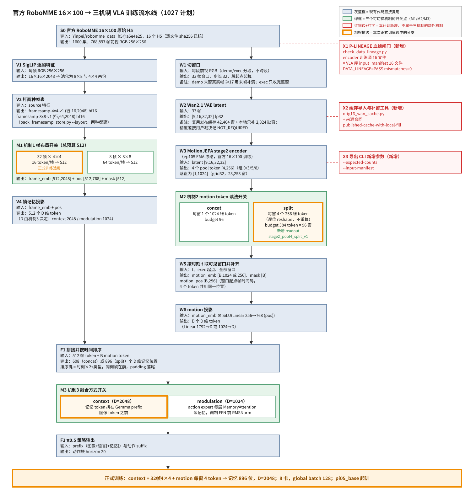

# 官方 RoboMME 16×100：三机制可切换 + 8 卡单条 context／32帧4×4／motion 4 token 训练计划（只写改动）

> **授权**：只规划，未实施；开工需用户另行明确指令。代码锚点 policy `v4-256concat1@ae9d64c`；MJ 抽取 CLI `v12-3decoder-memexport@b5d23a5`（`/scratch/hongze/worktrees/vla-s2-memexport-20261026`）。
>
> **固定外部锚点（用户 10-28：encoder 与数据集固定用官方 16×100 及其训练完的 encoder）**：encoder `MotionJEPA/runs/stage2-full144-1025-a/checkpoint_epoch_105.pt`（sha256 `27daa8320c9a392616778a7cd3e3a2041f9b52a440181f51df7e996352716035`，取 `model` 键 EMA）；其训练源 `config.yaml::data.data_root=/scratch/hongze/dataset-rgb-gtxyz-16views-stride2-v1`，`control/build_spec.json::identity.source_pin.files[]` 16 个 H5；源 H5 `/scratch/hongze/dataset-original-robomme-16x100-wan21-v1/source/h5/`（`Yinpei/robomme_data_h5@a5e4e25`）；Wan 缓存 `HongzeFu/robomme-original-16x100-wan21-front-33f-dense-v1@384d5db`。2026-10-28 预核：encoder 训练源 16 个 H5 与缓存 `source_manifest.json` 的 sha256＋字节数逐文件相同（`PRELIM_LINEAGE files=16 diff_lines=0`）；VLA 库清单建好后再跑正式 `DATA_LINEAGE`。
>
> **用户原话**：①「修改这个计划 改为只用gpu0123 只跑512+motion 且是 32frame4*4」②「Wan 的抽取不是已经有缓存了吗」③「不考虑精度的额外不一致 只要输入是一样的就不考虑 之前有一个根目录md已经讨论过这个问题了」④「修改这个计划 只说修改的部分 dataset怎么构造 model的训练配置是什么 32frame4*4+motion 需要改什么 你现在很多不改动的地方也在说」⑤（10-28）「我需要支持三个机制 32frame44 8frame88 这个是第一个机制 第二个机制 256变成44token和 1024变为1token 第三个机制context和modulation 然后画图写清楚流水线 一张图即可 每一步都写清楚 没有需要添加的额外机制额外用红色注明 然后现在的encoder和数据集都固定必须用16*100官方的和官方训练完的 wan尽可能用已经缓存的 缓存的精度的一致性已经有过裁决 你要引用一下 画图用fable 然后你还要写现在数据集还缺什么怎么构造」⑥「机制都实现 然后我训context 32frame44 然后4个token」⑦「用8卡 batch size和现在一致」。
>
> 原话①的「只用 gpu0123」已被⑦取代为 8 卡；原话⑤「256变成44token」按⑥理解为「每窗 4 个 256 维 token」。本文只列本次要新建或改动的东西；未提到的代码、旧 mixed8 路径一律不动。

# 第一部分（给人看）

## 一、三个机制与本次正式训练

三个机制都实现成 history yaml 里的开关，八种组合都能起训；正式只训一条：**context + 32帧4×4 + motion 每窗 4 token**。

| 机制 | 选项 A | 选项 B | 现状 | 要改什么 |
|---|---|---|---|---|
| M1 帧布局（总预算 512） | 32 帧 × 4×4＝16 token/帧（`token_per_image=16`，`framesamp-4x4-v1`）**← 正式** | 8 帧 × 8×8＝64 token/帧（`token_per_image=64`，`framesamp-8x8-v1`） | 模型与 loader 已支持两种；`pack_framesamp_store.py --layout` 已支持两种表 | 新库两种表都建；启动契约与在线/恢复检查按 yaml 核对应 layout |
| M2 motion 读法（同一张 `[1,1024]` 表） | concat：每窗 1 个 1024 维 token，`budget=96`（现有 `stage2_pool4_concat_v1`） | split：每窗 4 个 256 维 token（pool 组 0/3/5/8），`budget=384` token＝96 窗 **← 正式** | 只有 concat；`motion_adapter.py::motion_policy_spec` 硬性要求 `[1,1024]`/`num_tokens=1` | 新 readout `stage2_pool4_split_v1`：落盘不变，读出时逐位 reshape 成 `[4,256]`，4 个 token 共用窗口起点时间码；投影层 `Linear(256+768→D)` |
| M3 融合方式 | context：记忆 token（D＝2048）拼在 Gemma prefix 图像 token 之前（`history_pi0.py` context 分支）**← 正式** | modulation：action expert 每层 `MemoryAttention` 读记忆（D＝1024），调制 FFN 前 `MemoryRMSNorm` | 两种都有，`history_pi0.py` 已允许 context/modulation + motion | 新 yaml 矩阵；契约放开 `integration_type` 与 `memory_token_dim` 配对（2048/1024） |

记忆总长：concat 时 512＋96＝608 位，split 时 512＋384＝896 位。split 是 `[1,1024]` 的逐位 reshape（stage2 encoder 本就是 4 个 256 维 pool 输出按组 0/3/5/8 首尾相接），所以不用重抽、不用新表。

**流水线图**（每步输入/输出；绿＝三机制开关，红＝本计划新增但不属于三机制的额外机制，橙＝正式训练所选分支）：



三机制以外需要新增的机制共四项，都是「官方 16×100 + 复用缓存」这条数据来源本身需要的：图中红框 X1 血缘闸门 `check_data_lineage.py`（P-LINEAGE 强制）、X2 Wan 缓存导入/补窗工具与来源合同 `published-cache-with-local-fill`、X3 MJ 导出 CLI 的 `--expected-counts`/`--input-manifest`；另有 X4 上传驱动不在训练流水线上，未入图。模型侧不加任何三机制以外的东西：不给 4 个 motion token 各配不同时间码，不改 mem_order 规则，不改 loss/精度。

## 二、数据集：现在有什么、缺什么、怎么构造

| 产物 | 现状（2026-10-28 核） | 缺口 | 怎么构造 |
|---|---|---|---|
| 源 H5 16×100 | 有，`…/source/h5/` 478 G，sha 已在 `source_manifest.json` | — | 直接用 |
| encoder ep105 | 有，训练源与上行同 16 个 H5（预核通过） | 正式血缘判定行 | 建库清单后跑 `DATA_LINEAGE`（L1） |
| VLA 库清单 | **无**（`v1-store/datasets/` 只有 mixed8 与 4task 库） | `meta/episode_manifest.json`、`meta/input_manifest.json` | `scan_manifest.py build` + `finalize_checks.py hash-inputs` |
| SigLIP 帧特征 `source/` | **无** | 768,897 帧 × 每帧 4×4 与 8×8 两份，约 465 G | `run_local.py --stage siglip`，8 卡各 2 worker |
| 帧表 | **无** | `framesamp-4x4/`（约 50 G）＋ `framesamp-8x8/`（约 202 G） | `pack_framesamp_store.py pack --layout framesamp-4x4-v1` 和 `--layout framesamp-8x8-v1` 各一遍，全量 verify |
| norm stats | **无** | `train-assets/mme_vla_suite/<库名>/` | `compute_norm_stats.py` |
| Wan latent（grid16，raw `float32[9,16,32,32]`） | 本机只有缓存的索引与 `SHA256SUMS`（2,495 行），**latent 块本体不在本机**；发布缓存是 stride 1 密集窗、demo 不补帧、exec 截到首个 completed | 45,228 窗：缓存可直接复制 42,404；缺 2,824（demo 尾补帧 900 + exec 越过 completed 1,924） | `orig16_wan_cache.py fetch` 按固定 revision 整文件拉取并核 SHA → `import` 复制命中窗、只对缺窗跑 VAE → 删临时缓存 |
| motion token | **无** | grid32 23,253 窗，每窗 `[1,1024]` | MJ `stage2_memory_export.py --grid-subsample 2`，ep105 EMA 冻结 |
| motion 表 | **无** | `motion-stage2-1024/` | `pack_motion_store.py pack --layout stage2`；M2 两种读法共用这一张表 |

窗口规则不变：33 帧、步长 32、每 segment 从 0 起算；demo 末窗真实帧≥17 重复末帧补满，<17 丢弃；exec 只收完整 33 帧并到原始 T。计数是索引推算，正式以新 manifest 为准。

**磁盘**：`/scratch` 现余 1.3 T。峰值约 465（source）＋252（两种帧表）＋388（缓存拉取临时）＋25（latent）≈ 1.13 T，余量不足 0.2 T。所以顺序定为先拉缓存→导入→删临时缓存，再跑 SigLIP；并建议先做第七节第 2 项清理。

**Wan 精度（引用既有裁决，不再讨论）**：发布缓存的数值口径见其 `provenance.json::numeric_mode`（FP32 权重/输入/输出、B＝1、卷积 TF32 开、matmul TF32 关）；补窗走现有 sidecar 口径（FP32、TF32 关）。用户已裁决「不考虑精度的额外不一致 只要输入是一样的就不考虑」（原话③，记于提交 `f76e5bd` body），此前 `1026-official-benchmark-stage2-eval-plan.html` 已「采用用户取消跨硬件数值一致的决定」。据此记 `NUMERIC_EQUIVALENCE=NOT_REQUIRED reason=user_decision_same_input`；输入身份（源 H5、帧号、像素 SHA、补帧来源）、权重、shape/finite、文件 SHA 仍硬核。

## 三、正式训练配置

| 项 | 值 |
|---|---|
| 基础配置 | `mme_vla_suite_b128_80k`，`pi05_base` 初始化，action_horizon 20，EMA 0.999，每 5000 步存 |
| history yaml | `perceptual-framesamp-ctx-32frame-4x4-motion-stage2-4x256-orig16.yaml` |
| 帧记忆（M1） | `budget=512`、`token_per_image=16`、`num_views=1` → 32 帧；`streaming_obs_horizon=16` |
| motion（M2） | `readout=stage2_pool4_split_v1`、`source_shape=[1,1024]`、`num_tokens=4`、`dim=256`、`budget=384`（96 窗）、`stride=32`、`window_frames=33`、ep105 EMA 冻结 |
| 融合（M3） | `integration_type=context`、`memory_token_dim=2048`，记忆 896 位 |
| 资源 | 8 卡 `CUDA_VISIBLE_DEVICES=0..7`，单进程 mesh (1,8)，worker 与 `run_mixed8_stage2_1024_80k.sh` 相同；**global batch 128**（与现有 run 一致） |
| 数据 | `--dataset-path $LIB/framesamp-4x4`，`MMEVLA_FRAMESAMP_SOURCE=$LIB/source`，assets 指向新库 norm |
| 步数 | 推荐 80k（≈21.5 epoch），待裁决 |
| run 名 | `orig100-ctx32x4x4-motion-s2split4x256-b128-80k` |

context 把记忆放进 prefix，896 个 2048 维 token 的步时与显存未实测，G7 短测回填（上限 72 GiB/卡）。

## 四、要改什么（按工作块）

| 工作块 | 改什么 | 文件 |
|---|---|---|
| M2 split readout | `motion_policy_spec` 增 `stage2_pool4_split_v1`；loader 把 `(W,1,1024)` reshape 成 `(4W,256)`、`motion_times` 每窗重复 4 次（复用 paired 路径做法）；在线 policy 同一 reshape；投影层输入维随 `dim` | `datastore/motion_adapter.py`、`training/framesamp_dataset.py`、`policies/policy.py`、`models/…/percep_mem.py`（只核维度来自配置） |
| M1/M3 yaml 与契约 | 8 份 yaml（2×2×2）；新启动入口与契约按 yaml 核 layout、`token_per_image`、`integration_type`↔`memory_token_dim`、总位数 608/896、8 卡、batch 128、血缘 | 新 yaml、`run_orig16_stage2_80k.sh`、`check_orig16_stage2_launch.py` |
| 在线与恢复验证 | G4/恢复支持两种帧表、两种读法、两种融合；原版 H5 读 demo 帧；`--delivery-step 79999` | `check_stage2_online.py`、`check_stage2_checkpoint.py` |
| X1 血缘（红） | 新 `check_data_lineage.py`；G0 支持原版 H5＋MJ 索引＋缓存收据 | `check_data_lineage.py`（新）、`check_stage2_validation_inputs.py` |
| X2 缓存复用（红） | 新工具 plan/fetch/import/check；来源合同 `published-cache-with-local-fill` | `wan_stage2/orig16_wan_cache.py`（新）、`pack_motion_store.py`、`motion_store.py`、`motion_client.py`、`train.py`、`validate_stage2.py`、`compare_stage2.py` |
| X3 MJ 抽取（红） | `--expected-counts`、`--input-manifest` | MJ `scripts/stage2_memory_export.py` |
| X4 上传（红） | 训练库／ckpt 导出驱动；`pack_and_hash.py` 认两种帧表 | `hf_export/` |

## 五、验收（只列新增判定行）

| 编号 | 判定行 |
|---|---|
| L0/L1/L2 | `DATA_LINEAGE=PASS encoder_ckpt=27daa832 encoder_source_pin=<sha> vla_input_pin=<sha> files=16 mismatches=0` |
| C0 | `WAN_CACHE_AUDIT=PASS candidates=<n> route=published-cache-with-local-fill`（copy 42404 + fill 2824 = 45228） |
| B4 | `VERIFY_PACK=PASS layout=framesamp-4x4-v1 scanned=768897 mismatches=0`、`VERIFY_PACK=PASS layout=framesamp-8x8-v1 scanned=768897 mismatches=0` |
| M1 | `FRAME_LAYOUT=PASS layout=<4x4|8x8> frames=<32|8> tokens_per_frame=<16|64> budget=512` |
| M2 | `MOTION_SPLIT_BITWISE=PASS windows=23253 mismatches=0`（split 4×256 逐位等于 concat 的四段）；`MOTION_LAYOUT=PASS readout=<concat|split> tokens_per_window=<1|4> budget=<96|384> total_tokens=<608|896>` |
| M3 | `FUSION=PASS integration=<context|modulation> memory_token_dim=<2048|1024>` |
| MATRIX | `MECH_MATRIX=PASS combos=8 contract_ok=8 forward_ok=8`（8 份 yaml 各过 DRY_RUN 契约与 1 batch CPU 前向） |
| B6/B7 | `WAN_CACHE_IMPORT=PASS copied=<n> filled=<n> total=<n> input_mismatches=0 nonfinite=0`、`WAN_INPUT_COVERAGE=PASS windows=<n> missing=0 duplicate=0 mismatches=0` |
| G2 | `G2_INPUT_IDENTITY=PASS windows=64 mismatches=0`、`G2_NUMERICS=NOT_REQUIRED reason=user_decision_same_input` |
| G4 | `ONLINE_INPUT_IDENTITY=PASS windows=64 handshake=1 input_sha_mismatch=0 nonfinite=0`（正式组合） |
| G6 | `TRAIN_ES_BOUND=PASS episodes=1600 tasks=16 max_windows=<n> window_budget=96 headroom=<≥0>` |
| G7 | `GPU_SCOPE=PASS allowed=0-7`、`LAUNCH_CONTRACT=PASS checks=<n> failed=0`、`SMOKE_8GPU=PASS steps=20 batch=128`、`SAVE_LOAD=PASS` |
| G8/G9/G12 | 训练 `EXIT_CODE=0`；`CKPT_UPLOAD=PASS steps=16`；`CKPT_DELIVERY_READY=PASS step=79999` |

## 六、步骤

| 阶段 | 内容 | 判据 |
|---|---|---|
| 1 代码 | S6→S1→S2→S3→S4→S7→S5 实现并合入 | 各块定向测试、合前/合后审查、MATRIX |
| 2 建库 | 清单 → 缓存拉取/导入/删临时 → SigLIP → 两种帧表 → norm | L1、C0、B1–B9 |
| 3 motion | G0 → ep105 抽取 → G2/G3 → pack/verify → M2 逐位 → G4/G6 → 回填契约常量 | G0–G6、M2 |
| 4 短测 | DRY_RUN 契约 + 8 卡 20 步（正式组合）+ 保存恢复 | L2、G7 |
| 5 正式 | 唯一 run，增量上传 | G8 |
| 6 收尾 | 导出回读、79999 恢复验证、档案、handoff | G9、G12 |

## 七、子代理分工与合并（简述）

七块写入型子代理各在独立 worktree：S6 MJ 计数与源核；S1 血缘与 G0；S2 缓存来源合同；S3 缓存工具；S4 M2 split readout（adapter/loader/在线 policy/测试）；S7 M1/M3 yaml 矩阵、入口、契约、在线与恢复检查；S5 上传驱动。S7 依赖 S2（`check_stage2_online.py`、`check_stage2_checkpoint.py`）与 S4（readout 名称与 spec），从二者合入后的 HEAD 续做。按 S6→S1→S2→S3→S4→S7→S5 逐个 `--no-ff` 合入，每次合前 sonnet 审固定 BASE/TIP，合后跑定向测试再 push。

## 八、待用户裁决

| # | 事项 | 推荐 |
|---|---|---|
| 1 | 训练步数 80k / 60k / 40k | 80k |
| 2 | 旧产物清理：重复导出与恢复副本 227 GB / 再加 70k ckpt 共 382 GB / 全保留（现余 1.3 T，峰值约 1.13 T） | 清 227 GB 副本，保留 70k ckpt |
| 3 | 分支与状态机登记：新 `v5-orig16` 并登记 / 沿用现分支 / 不登记 | 新分支并登记 |
| 4 | 非正式的 7 种组合验证深度：只做契约＋CPU 前向（MATRIX）/ 另加 3 条单开关翻转的 8 卡 20 步 GPU 短测（约 +40 分钟） | 只做 MATRIX |

# 第二部分（技术细节，供 agent 追踪）

## 〇、本次新增红线

- **R1 GPU 0–7**：正式训练与短测 `CUDA_VISIBLE_DEVICES=0,1,2,3,4,5,6,7`；建库 GPU 步骤同样用 0–7；CPU 步骤 `CUDA_VISIBLE_DEVICES='' JAX_PLATFORMS=cpu`。起跑前 `nvidia-smi` 确认 8 卡空闲，有他人进程即停。
- **R2 P-LINEAGE**：`DATA_LINEAGE` 在 L0/L1/L2 三处跑，FAIL 即停，不 WAIVE。encoder 与数据集固定为第一处引言块所列，不换。
- **R3 数值 NOT_REQUIRED 只覆盖精度差**：源 H5、帧号、像素 SHA、补帧、增强、权重、shape/finite、文件完整性仍硬核。
- **R4 split 不改数**：`stage2_pool4_split_v1` 只允许 `reshape(…,4,256)`，不得重排、重算、归一化；同一张 motion 表服务两种读法。
- **R5 不加三机制以外的模型机制**：不加 per-token 时间码、不改 `sampling.py::memory_order` 键、不改 loss/精度/attention。
- **R6 冻结**：建库 Beta 到 `VERIFY_MOTION=PASS` 不 commit（写 `AGENTMETARULES_HOLD`）；训练 Beta 到导出完成 `src/` 只读。
- **R7 tmux 前缀 `o16-`**，日志根 `v1-store/logs/o16-20261028/`。

## 一、逐文件改动清单

### MotionJEPA（S6，X3）

| 文件 / 锚点 | 改动 | 测试 |
|---|---|---|
| `scripts/stage2_memory_export.py::main` 中 `require_equal(counts, FULL_COUNTS, …)` | full scope 必填 `--expected-counts <segments>,<rows>`，不再回落 mixed8 常量 | 错计数拒绝、正确通过、smoke 不受影响 |
| 同文件读 latent 前 | 必填 `--input-manifest`：读 ckpt 旁 `config.yaml::data.data_root` → `control/build_spec.json::identity.source_pin.files[]`，与 input_manifest 逐文件比 size+sha256；输出 `MJ_CLI_LINEAGE=PASS files=16 mismatches=0`，无跳过开关 | 改 sha / 少文件 / 缺参数均失败 |

### policy

**S1（X1）**
- `scripts/training/check_data_lineage.py`（新）：`check_lineage(encoder_ckpt, expected_ckpt_sha256, vla_input_manifest, mj_source_manifest)`；子命令 `lineage`。encoder 源集合（build_spec `files[]`）= MJ `source_manifest.json::files.<Task>.h5` = VLA `input_manifest.json::files`，按文件名比 size+sha256。退出码 PASS 0 / FAIL 3。测试 `tests/training/test_check_data_lineage.py`。
- `scripts/dataset/check_stage2_validation_inputs.py`：新增 `--h5-root --input-manifest --mj-index --cache-import-receipt`（四项须齐全）。demo 帧从 `h5[f"episode_{n}/timestep_{t}/obs/front_rgb"]` 读并核 H5 sha；从 `episodes.parquet` 取 `demo_end`/`completed_index`，断言 `exec_start_idx == D`；`start+33≤C` 为 copy，越过 C 到 T 为 fill；样本 64 窗、16 任务、≥16 demo 尾窗，copy/demo-fill/exec-fill 各≥1。测试 `tests/dataset/test_check_stage2_validation_h5.py`。

**S2（X2 来源合同 `published-cache-with-local-fill`）**

| 文件 / 符号 | 改动 |
|---|---|
| `pack_motion_store.py::cmd_pack` 等 | 新增 `--latents-origin published-cache-with-local-fill --cache-import-receipt <json>`；按 copy/fill 分别记录数值环境 |
| `motion_store.py::validate_stage2_provenance/validate_stage2_g2_evidence` | 新 kind 证据集 `G0/G2/G3/wan_cache_import/SOURCE_PIN`；G2 只核输入、shape、finite |
| `motion_client.py::validate_stage2_evidence` | 同步新证据集，不因数值配置差异拒绝 |
| `train.py::write_stage2_motion_snapshot`、`check_stage2_checkpoint.py::verify_snapshot` | 保存/恢复同一证据集 |
| `validate_stage2.py::gate_g2/gate_g3/reference_g4` | 新增 `--cache-import-receipt`；G3 跨路径输出相等改 NOT_REQUIRED |
| `check_stage2_online.py::reference_subprocess/run` | 新 kind 去掉 `encoder_max_abs=0`/`e2e≤1e-5` 准入 |
| `compare_stage2.py` | 固定 65419 改 `--expect-rows` |
| `pack_motion_store.py::cmd_verify`、`motion_store.validate_stage2_encoder_validation` | 新 kind 消费完整性证据（packed 全量 memcmp + SHA + finite） |

收据字段：repo+revision、SHA256SUMS 自身 SHA、整文件 SHA/字节、源 H5 清单、目标 manifest、importer 源码 SHA、逐窗 copy/fill 映射与源 row/offset、33 帧输入 SHA、实际精度配置（缓存取自 `provenance.json::numeric_mode`）、最终文件 SHA。测试 `tests/dataset/test_pack_motion_stage2_cached.py`：仅精度不同通过并标 NOT_REQUIRED；换帧/换 H5/增强/错轴/缺映射/篡改/NaN 均 FAIL。

**S3（X2 工具）`scripts/dataset/wan_stage2/orig16_wan_cache.py`（新）**
- `plan --manifest --input-manifest --published-index --out`：列全 grid16 窗与 copy/fill、恢复文件清单与字节；参考 42404+2824=45228，grid32 23253。
- `fetch --plan --revision 384d5db… --out`：固定 revision 整文件恢复，逐文件核发布 `SHA256SUMS`。
- `import --plan --cache-root --raw-dir --out --receipt --gpus 0,1,2,3,4,5,6,7`：copy 只做可逆轴序重排；fill 调 `wan_motion_infer.py::encode_chunk` 只算缺窗；输出 589,824 B/窗，核 SHA/finite/无缺重越界。
- `check --samples --receipt --raw-dir --out`：64 窗原 RGB/帧序/补帧 SHA 重算，产出 G2。
- 测试 `wan_stage2/tests/test_orig16_wan_cache.py`、`tests/dataset/test_orig16_cache_validator_compat.py`（S2 合入后续跑）。

**S4（M2 split readout）**
- `src/mme_vla_suite/datastore/motion_adapter.py`：新增常量 `STAGE2_SPLIT_READOUT="stage2_pool4_split_v1"`、`STAGE2_SPLIT_SHAPE=(4,256)`；`motion_policy_spec` 对该 readout 要求 `source_shape=[1,1024]`、`num_tokens=4`、`dim=256`、`budget>0 且 %4==0`，返回 `MotionPolicySpec(STAGE2_SHAPE, STAGE2_SPLIT_READOUT, 4, 256, budget, budget//4, (STAGE2_LAYOUT,))`；新函数 `split_stage2_tokens(raw)`：校验 float32、末两维 `(1,1024)`，返回 `np.ascontiguousarray(raw).reshape(raw.shape[:-2]+(4,256))`。concat 分支不动。
- `src/mme_vla_suite/training/framesamp_dataset.py`：模块级 provenance 校验（现 `if spec.readout == STAGE2_READOUT:`）改为认 concat 与 split 两种 stage2 readout；读表处（现 `if self._motion_readout == STAGE2_READOUT: memb = memb.reshape(k, 1024)`）并列加 split 分支 `memb = split_stage2_tokens(memb.reshape(k,1,1024))`。之后 `_pad_motion` 已有的 `num_tokens>1` 通用分支照旧完成补齐与 `np.repeat`（pos/mask/times 每窗重复 4 次），窗口超限仍按 `window_budget=96` 报错不截断，不改 `_pad_motion`。
- `src/mme_vla_suite/policies/policy.py`：在线组包同一分支；`memory_order(frame_times, token_per_image*num_views, motion_times)` 入参即重复后的 `motion_times`，函数本身不改。
- `percep_mem.py`：只核 `motion_dim` 来自 `motion.dim`、`motion_encoder_static` 输入 `dim+pos_hidden`、输出 `memory_token_dim`；如已由配置决定则不改。
- 第三方评估侧（`third_party/robomme_benchmark` 服务端调用 policy）若有 `[1,1024]` 断言，按第 24 条走专用分支，S4 只列出不改，交主会话裁决。
- 测试 `tests/datastore/test_motion_split.py`：split 与 concat 四段逐位相等；budget 非 4 倍数拒绝；窗口 >96 报错；`mem_order[896]` 是置换且同窗 4 token 相邻、同刻帧在前；loader 与在线 policy 同一样本逐位相等。

**S7（M1/M3 yaml 矩阵、入口、契约、在线/恢复；基于 S2+S4 合入后 HEAD）**
- yaml 8 份，命名 `perceptual-framesamp-{ctx|modul}-{32frame-4x4|8frame-8x8}-motion-stage2-{1x1024|4x256}-orig16.yaml`：ctx 用 `integration_type: context`、`memory_token_dim: 2048`；modul 用 `modulation`、`1024`；帧键按 M1；motion 节按 M2；`store_path=v1-store/datasets/16task-orig100-1600ep-<pin8>/motion-stage2-1024`；`online_gpu=1`（仅恢复验证用）。正式文件即 `ctx-32frame-4x4-…-4x256`。
- 新入口 `scripts/training/run_orig16_stage2_80k.sh`：参数 `HISTORY=<yaml 名>`；固定 8 卡，其余与 `run_mixed8_stage2_1024_80k.sh` 相同（单进程 mesh (1,8)、默认 workers、b128）；`--dataset-path` 按 yaml 选 `$LIB/framesamp-4x4` 或 `$LIB/framesamp-8x8`；`DRY_RUN=1` 只打印 `TRAIN_CMD=` 并跑契约；短测前缀 `o16-smoke-`。
- 新契约 `scripts/training/check_orig16_stage2_launch.py`：dataset 目录 `store_meta.json::layout` 与 yaml `token_per_image` 对应（16↔4x4，64↔8x8）；`budget=512`；`integration_type`↔`memory_token_dim`（context 2048／modulation 1024）；readout↔`num_tokens/dim/budget`；总位数 608/896；global batch 128；`GPU_SCOPE=PASS allowed=0-7`；`CHECK_ENCODER_DATA_LINEAGE`、`CHECK_INPUT_EQUIVALENCE`；库路径、norm/manifest 哈希、motion_rows、train_max 先填 `__FILL_AFTER_BUILD__`（出现即 FAIL），阶段 3 回填单独提交。
- `check_stage2_online.py::prepare_restore_inputs`：新增 `--framesamp-store --h5-root --input-manifest`；按 yaml 校验对应 layout；demo 帧从源 H5 读；状态机首包 D+1、后续每次 ≤16 帧。
- `check_stage2_checkpoint.py`：`run_online` 适配；`--delivery-step` 增加 79999。
- MATRIX 驱动 `scripts/training/tests/mech_matrix.py`：8 份 yaml 各跑 DRY_RUN 契约（夹具库）＋1 batch CPU 前向，输出 `MECH_MATRIX=`。
- 测试：`tests/training/test_check_orig16_stage2_launch.py`（layout 错配/融合维度错配/readout 错配/错 GPU/占位符/G2 缺失/血缘不符均 FAIL）；`test_framesamp_motion_stage2.py` 增 16 token 矩阵、32 帧边界、`mem_order[896]`；`test_stage2_restore.py` 增 4×4 状态来源、D+1、79999、context 分支。

**S5（X4 上传）**
- 新 `hf_export/run_orig100_trainset_export.sh`（bucket `HongzeFu/robomme-16task-orig100-1600ep-trainset-20261028-v1`）+ README + allowlist；范围 source、framesamp 4×4 与 8×8、norm、wan-latents、motion 两表、缓存导入证明。
- 新 `_stage2_orig16_vla_ckpt_export_common.sh`、`run_orig16_stage2_ckpt_inc.sh`、`run_orig16_ctx32x4x4_split_80k_ckpt_export.sh`（bucket `HongzeFu/robomme-vla-orig100-ctx32x4x4-motion-s2split-80k-v1`，STEPS 5000…75000+79999，证据集同 S2）+ README + allowlist。
- `pack_and_hash.py::build_jobs` 认两种 layout。
- 测试 `hf_export/test_orig16_export_drivers.py`。

## 二、子代理分配表

| 编号 | 可写集合 | 依赖 / 合并序 | 验收 | 资源 |
|---|---|---|---|---|
| S6 | MJ `stage2_memory_export.py` 及其测试 | 1 | 计数与源错配负例 | CPU |
| S1 | `check_data_lineage.py`、`check_stage2_validation_inputs.py` 及测试 | 2 | 血缘与 G0 用例 | CPU |
| S2 | 一节 S2 表内文件及测试 | 3 | 新 kind 正负例 + 旧测试全绿 | CPU |
| S3 | `orig16_wan_cache.py` 及两份测试 | 4（兼容测试待 S2） | copy/fill、SHA、S2 兼容 | CPU |
| S4 | `motion_adapter.py`、`framesamp_dataset.py`、`policy.py`、`percep_mem.py`（仅必要时）、`test_motion_split.py` | 5 | split 逐位、896 置换、旧 concat/paired 测试全绿 | CPU |
| S7 | 8 份 yaml、新入口、新契约、`check_stage2_online.py`、`check_stage2_checkpoint.py`、`mech_matrix.py`、列出测试 | 6（基于 S2+S4 合入后 HEAD） | MATRIX、契约负例、79999 | CPU |
| S5 | 新导出驱动、`pack_and_hash.py` 分支及测试 | 7 | 双 layout 夹具打包回读 | CPU |
| X1–X4 运行 | 新库 / motion / run / 导出产物与日志（运行型，不改代码） | 代码全合入后 | B/G 闸门 | GPU 0–7 |
| 主会话 | Beta、HOLD、契约常量回填、删除裁决、档案、handoff | — | — | CPU |

共享文件归属：`check_stage2_online.py`、`check_stage2_checkpoint.py` 由 S2 先改证据集部分，S7 在其合入后续改；`train.py` 只归 S2。

## 三、runbook（开工后模板）

```bash
P=/scratch/hongze/robomme_policy_learning_MotionJEPA; cd $P; source scripts/dataset/paths.sh
RAW=/scratch/hongze/dataset-original-robomme-16x100-wan21-v1/source/h5
MJIDX=/scratch/hongze/dataset-original-robomme-16x100-wan21-v1/dataset/index
MJSRC=/scratch/hongze/dataset-original-robomme-16x100-wan21-v1/dataset/source_manifest.json
MJW=/scratch/hongze/worktrees/vla-s2-memexport-20261026
NAME=16task-orig100-1600ep-<pin8>; LIB=$V1_STORE/datasets/$NAME
MANI=$LIB/meta/episode_manifest.json; INMANI=$LIB/meta/input_manifest.json
VALID=$V1_STORE/validation/orig16-stage2; CACHE_PLAN=$VALID/wan-cache-plan.json; CACHE_RECEIPT=$VALID/wan-cache-import.json
CKPT=/scratch/hongze/MotionJEPA/runs/stage2-full144-1025-a/checkpoint_epoch_105.pt; CKPT_SHA=27daa8320c9a392616778a7cd3e3a2041f9b52a440181f51df7e996352716035
G8=0,1,2,3,4,5,6,7; CPU="CUDA_VISIBLE_DEVICES= JAX_PLATFORMS=cpu"
HC=src/mme_vla_suite/models/config/robomme/perceptual-framesamp-ctx-32frame-4x4-motion-stage2-4x256-orig16.yaml
lineage() { uv run --no-sync python scripts/training/check_data_lineage.py lineage --encoder-ckpt "$CKPT" --expected-ckpt-sha256 "$CKPT_SHA" --vla-input-manifest "$1" --mj-source-manifest "$MJSRC"; }

# 1 清单
env $CPU uv run --no-sync python scripts/dataset/scan_manifest.py build --raw_dir "$RAW" --episodes-per-task 100 --num_shards 1 --out "$MANI"
env $CPU uv run --no-sync python scripts/dataset/finalize_checks.py hash-inputs --raw_dir "$RAW" --out "$INMANI"
lineage "$INMANI"
env $CPU uv run --no-sync python scripts/dataset/wan_stage2/orig16_wan_cache.py plan --manifest "$MANI" --input-manifest "$INMANI" --published-index "$MJIDX" --out "$CACHE_PLAN"
# 2 Wan：先拉缓存、导入、删临时（腾盘），再做视觉
HF_HUB_OFFLINE=0 CUDA_VISIBLE_DEVICES= uv run --no-sync python scripts/dataset/wan_stage2/orig16_wan_cache.py fetch --plan "$CACHE_PLAN" --revision 384d5db410be713a49357bf3f55ca4f4d2f559a0 --out "$LIB/cache-source/official-wan"
CUDA_VISIBLE_DEVICES=$G8 UV_PROJECT_ENVIRONMENT="$V1_STORE/venvs/wan-stage2" uv run --project scripts/dataset/wan_stage2 --no-sync python scripts/dataset/wan_stage2/orig16_wan_cache.py import --plan "$CACHE_PLAN" --cache-root "$LIB/cache-source/official-wan" --raw-dir "$RAW" --out "$LIB/wan-latents" --receipt "$CACHE_RECEIPT" --gpus $G8
# 删 $LIB/cache-source/official-wan 前先 ls -ld 并核 WAN_CACHE_IMPORT=PASS；只删该确切目录
# 3 视觉：SigLIP + 两种帧表 + norm
CUDA_VISIBLE_DEVICES=$G8 uv run --no-sync python scripts/dataset/run_local.py --stage siglip --lib "$LIB" --gpus 0,0,1,1,2,2,3,3,4,4,5,5,6,6,7,7 --raw-dir "$RAW" --require-free-mib 70000
CUDA_VISIBLE_DEVICES=7 uv run --no-sync python scripts/dataset/finalize_checks.py check --manifest "$MANI" --out "$LIB/source" --raw_dir "$RAW" --input_manifest "$INMANI" --input_level sha256 --spot_check 1024
for L in 4x4 8x8; do  # 两条分别起 tmux，不放同一条命令
  env $CPU uv run --no-sync python scripts/dataset/pack_framesamp_store.py pack --layout framesamp-$L-v1 --source "$LIB/source" --manifest "$MANI" --out "$LIB/framesamp-$L" --procs 48
  env $CPU uv run --no-sync python scripts/dataset/pack_framesamp_store.py verify --layout framesamp-$L-v1 --store "$LIB/framesamp-$L" --resume --procs 48
done
env $CPU uv run --no-sync python scripts/training/compute_norm_stats.py --output-dir "$V1_STORE/train-assets/mme_vla_suite/$NAME" --config-name mme_vla_suite --repo-id robomme --dataset-path "$LIB/source"
# 4 motion
env $CPU uv run --no-sync python scripts/dataset/check_stage2_validation_inputs.py --manifest "$MANI" --latents "$LIB/wan-latents" --source "$LIB/source" --h5-root "$RAW" --input-manifest "$INMANI" --mj-index "$MJIDX" --cache-import-receipt "$CACHE_RECEIPT" --out "$VALID/G0.json"
CUDA_VISIBLE_DEVICES=0 uv run --project "$MJW" --no-sync python "$MJW/scripts/stage2_memory_export.py" --ckpt "$CKPT" --expected-sha256 "$CKPT_SHA" --latents "$LIB/wan-latents" --manifest "$MANI" --out "$LIB/motion-tokens-stage2" --grid-subsample 2 --batch 1 --check-dropout 64 --expected-counts <段数>,<grid32行数> --input-manifest "$INMANI"
CUDA_VISIBLE_DEVICES= uv run --no-sync python scripts/dataset/wan_stage2/orig16_wan_cache.py check --samples "$VALID/G0.json" --receipt "$CACHE_RECEIPT" --raw-dir "$RAW" --out "$VALID/G2.json"
env $CPU uv run --no-sync python scripts/dataset/pack_motion_store.py pack --layout stage2 --latent-grid-subsample 2 --latents-origin published-cache-with-local-fill --cache-import-receipt "$CACHE_RECEIPT" --manifest "$MANI" --tokens "$LIB/motion-tokens-stage2" --latents "$LIB/wan-latents" --out "$LIB/motion-stage2-1024" --encoder-run-dir "$V1_STORE/external/motionjepa/stage2-full144-1025-a" --raw-dir "$RAW" --expected-ckpt-sha256 "$CKPT_SHA" --stage2-validation "$VALID" --stage2-source-pin scripts/dataset/wan_stage2/SOURCE_PIN.json
env $CPU uv run --no-sync python scripts/dataset/pack_motion_store.py verify --store "$LIB/motion-stage2-1024" --resume --check-padding
env $CPU uv run --no-sync python -m pytest tests/datastore/test_motion_split.py -q   # 并对全表跑 MOTION_SPLIT_BITWISE
CUDA_VISIBLE_DEVICES=0 uv run --no-sync python scripts/training/check_stage2_online.py --store "$LIB/motion-stage2-1024" --samples "$VALID/G0.json" --history "$P/$HC" --framesamp-store "$LIB/framesamp-4x4" --h5-root "$RAW" --input-manifest "$INMANI" --online-gpu 1 --out "$VALID/G4.json"
uv run --no-sync python scripts/training/tests/train_es_bound.py --manifest "$MANI" --layout motion-stage2-1x1024-grid32-demopad17-v1 --budget 96
env $CPU uv run --no-sync python scripts/training/tests/mech_matrix.py --lib "$LIB"
# 5 短测与正式
CUDA_VISIBLE_DEVICES=$G8 DRY_RUN=1 HISTORY=$(basename "$HC") RUN_NAME=o16-smoke-<美东MMDDHHMM> MAX_STEPS=20 TRAIN_HEAD=<sha> FINAL_RECORD_DIR="$VALID/smoke/final-record" bash scripts/training/run_orig16_stage2_80k.sh
CUDA_VISIBLE_DEVICES=$G8 HISTORY=$(basename "$HC") RUN_NAME=orig100-ctx32x4x4-motion-s2split4x256-b128-80k TRAIN_HEAD=<训练Beta sha> FINAL_RECORD_DIR="$VALID/orig100-ctx32x4x4-motion-s2split4x256-b128-80k/final-record" bash scripts/training/run_orig16_stage2_80k.sh
```

G3（`validate_stage2.py --gate G3 --cache-import-receipt`）、保存恢复（`check_stage2_checkpoint.py --mode smoke`）、G12（`--mode delivery --delivery-step 79999`）命令同上式样，GPU 父 0 / sidecar 1。tmux 名：`o16-cache-fetch`、`o16-cache-import`、`o16-siglip`、`o16-finalize`、`o16-pack4`、`o16-pack8`、`o16-s2export`、`o16-s2pack`、`o16-g0/g2/g3/g4`、`o16-smoke`、`o16-train`、`o16-inc`、`o16-trainset-up`、`o16-ups`、`o16-g12`。

## 四、风险与未验证

- 缺窗计数（2824 物理 / 1439 消费）是索引推算，正式 manifest 不符须先解释，不改补帧或截尾规则凑数。
- 磁盘峰值约 1.13 T 对现余 1.3 T，余量小；顺序已改为缓存先行并删临时，仍建议先清理。
- context 896 位 × 2048 维在 8 卡 b128 的步时、显存未实测；79999 恢复未实测；发布缓存逐文件 SHA 未下载核验。
- split 的 4 个 token 共用窗口起点时间码，组 3/5/8 实际对应窗口内更晚的帧；这是按 R5 不加机制的取舍，不另设时间码。
- 第三方评估侧是否有 `[1,1024]` 硬断言未核，评估前须查；本计划不改第三方。
- 80k 约 21.5 epoch 可能过拟合，步数待裁决；选定后同步改 run/bucket 名、STEPS 与交付步。

## 五、留档与提交

建库档案 `docs/dataset-build-doc/16task-orig100-1600ep-<pin8>/`，训练档案 `docs/training-doc/orig100-ctx32x4x4-motion-s2split4x256-b128-80k/`。建库 Beta、训练 Beta 各自配对结论提交；状态机任务 id `orig16-vla-build`、`orig16-vla-train-ctx32x4x4-split4`，是否登记按第一部分第八节第 3 项。流水线图 `docs/figures/1027-orig16-three-mech-pipeline.svg` 由 fable 画图子代理绘制；主会话 2026-10-28 用 Noto Sans CJK SC 经 cairosvg 渲染为 1500 px 位图目视复查：正交走线无交叉、框无重叠、文字无溢出、图例与三处选中分支一致，未改图。
