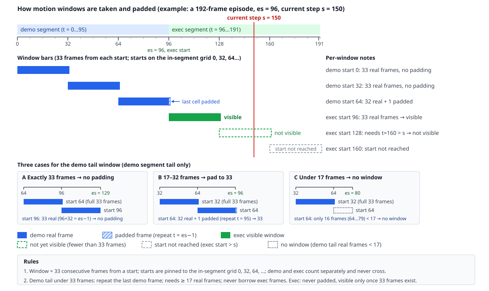

# How we add motion memory to pi0.5: how the memory is assembled, how motion tokens are obtained, and how windows are padded

> Subject: the `context 512 + motion 1×1024 (concat)` model (trained on AWS 8×A100; official 800-episode benchmark, three seeds, 37.33 ± 0.59%). This document only describes what we did.

## 0. Resources at a glance

| Resource | Location | Anonymous access |
|---|---|---|
| Encoder checkpoint | HF bucket `HongzeFu/motionjepa-stage2-pool4-3decoder-1025-v1`: `stage2-full144-1025-a/checkpoint_epoch_105.pt` (sha256 `27daa832…6035`) and `config.yaml` | ✅ |
| Preprocessed training set (motion table, frame table, Wan latents) | HF bucket `HongzeFu/robomme-16task-orig100-1600ep-trainset-20261028-v1`; start from `delivery_manifest.json`; the motion table is under `motion-stage2-1024/` | ✅ |
| Raw H5 (16 tasks × 100 episodes) | HF dataset `Yinpei/robomme_data_h5` | ✅ |
| Trained VLA checkpoint (12 steps) | HF bucket `HongzeFu/robomme-vla-orig100-ctx32x4x4-motion-s2concat1x1024-60k-v1` | ✅ |
| VLA repository (all paths in this document are relative to its root) | `github.com/hongzefu/robomme_policy_learning_MotionJEPA`, training branch `v4-256concat1` | ✅ |
| Encoder repository | `github.com/hongzefu/MotionJEPA`, commit `b5d23a5` | ❌ **Private**; `scripts/dataset/wan_stage2/pyproject.toml` pins it as a git dependency, so the environment cannot be installed without access |
| Wan VAE | the `vae` of HF `Wan-AI/Wan2.1-T2V-1.3B-Diffusers` | ✅ |

Tested on 2026-11-03 (US Eastern) without a token: downloading from a bucket via `https://huggingface.co/buckets/<name>/resolve/<path>` works; the web tree view returns 404 anonymously, which does not matter.

## 1. How the memory is assembled

The input of pi0.5 is `[current-frame image | text]`. We prepend a **memory region** made of two streams of tokens:

| Stream | What one token represents | How it is obtained | Number of slots |
|---|---|---|---|
| Frame stream | "what a past frame looks like" | sample 32 frames evenly over `[0, current step]`; each frame goes through SigLIP and is pooled to 4×4 = 16 tokens | 32 × 16 = 512 |
| Motion stream | "what motion happened" over a span of 33 consecutive frames | the window goes through the Wan2.1 VAE and then the MotionJEPA stage-2 encoder; the (4,256) output is flattened into one 1024-d vector | up to 96 windows × 1 |

The assembly has four steps:

1. **Project, and encode the time code.** Each token is concatenated with a time code and projected to the backbone width 2048 by one Linear layer. The time code is `PosEmb3D`: 768-d fixed sin/cos, no parameters. A frame token uses the full 768 dimensions, concatenated with the 2048-d visual feature before projection; a motion token uses only the 256-d temporal part (the `t` of the window's start frame), concatenated with the 1024-d motion vector before projection. `t` is the global frame index including the demo segment, so every memory token carries its **absolute time**. Both encoders are frozen; only these Linear layers and the pi0.5 body are trained.
2. **Interleave by time.** The two streams are merged and stably sorted by time; at the same time step the frame token comes before the motion token. The permutation `mem_order` is computed on the data side and travels with the sample into the model. The reason is RoPE: Gemma has no absolute position vectors, position exists only through RoPE in every attention layer, and the position index is a dense rank like `cumsum(input_mask) − 1`, which knows only "which one in order", not the frame index. If the 96 motion tokens were placed as a block after the 512 frame tokens, a frame and the motion at the same time step would be several hundred positions apart in every layer; after interleaving, position indices increase monotonically with time, and a frame token and a motion token that are adjacent in time are adjacent in position as well. How many steps apart two frames are can only be read from the time code of step 1.
3. **Fixed shape + mask.** The frame stream is padded to 512 slots and the motion stream to 96 slots; missing entries are zero vectors with the mask set to False, and padding is placed at the end of the memory region and does not consume position indices. 96 is set from the full 16-task set; measured, a single episode has at most 44 windows (mean 14.5), and the error raised above 96 is only a guard.
4. **Put it into the prefix.** The sequence becomes `[memory region 608 | current-frame image 512 | text 64]`, followed by 20 action tokens. The memory is computed once in the prefix and stored in the KV cache; the multi-step denoising only recomputes the action segment. The effective visibility (row = who is looking, column = what is seen; padding is neither seen nor produces output):

   | sees → is seen | Memory 608 | Current image 512 | Text 64 | Action 20 |
   |---|---|---|---|---|
   | Memory | ✅ bidirectional | ❌ | ❌ | ❌ |
   | Current image | ❌ | ✅ | ✅ | ❌ |
   | Text | ✅ | ✅ | ✅ | ❌ |
   | Action | ✅ | ✅ | ✅ | ✅ |

   This is implemented by the three mask layers ar / na / input in `make_attn_mask`, identical character for character to upstream RoboMME/robomme_policy_learning, except that the memory region grows from 512 to 608. **This step is the pi0.5 implementation (PaliGemma prefix + action expert); where to place it and who may attend to whom when moving to Qwen needs a separate discussion and is out of scope here.**

**Code map** (`robomme_policy_learning_MotionJEPA`):

| Step | Location |
|---|---|
| Projection | `src/mme_vla_suite/models/representation/percep_mem.py::PerceptualMemory` |
| Interleaving order | `src/mme_vla_suite/shared/sampling.py::memory_order` |
| Padding and the 8 data-side keys | `src/mme_vla_suite/training/framesamp_dataset.py::FrameSampDataset.__getitem__` (training); `src/mme_vla_suite/policies/framesamp_memory.py::FrameSampMemory._prepare_motion` (online) |
| Prefix insertion, attention mask | `src/mme_vla_suite/models/integration/history_pi0.py::HistoryPi0.embed_prefix / make_attn_mask` |
| Config | `src/mme_vla_suite/models/config/robomme/perceptual-framesamp-ctx-32frame-4x4-motion-stage2-1x1024-orig16.yaml` (branch `v4-256concat1`) |

## 2. How motion tokens are obtained

Same encoder, same entry function. Get one window working first; the rest is just "precompute and store a table at training time, compute on the fly at inference time".

### 2.1 Environment

| Item | Where to get it |
|---|---|
| torch environment | `scripts/dataset/wan_stage2/pyproject.toml` (torch 2.9.0, diffusers 0.39.0, `motion-jepa` pinned to `b5d23a5`): `UV_PROJECT_ENVIRONMENT=v1-store/venvs/wan-stage2 uv sync --project scripts/dataset/wan_stage2` |
| VAE adapter functions | `scripts/dataset/wan/wan_motion_infer.py::load_vae / encode_chunk` |

### 2.2 Running one window

```python
import torch
from motion_jepa.export.stage2_memory import load_ema_encoder, encode_windows   # MotionJEPA b5d23a5
import wan_motion_infer as W                                                   # scripts/dataset/wan/

W.check_env(); W.pin_numerics()                                                # fp32, TF32 off
dev = torch.device("cuda:0")
vae, _ = W.load_vae("Wan-AI/Wan2.1-T2V-1.3B-Diffusers", dev)
encoder, einfo = load_ema_encoder("<…>/checkpoint_epoch_105.pt", device="cuda:0",
                                  expected_sha256="27daa832…6035")
frames = ...                                   # (33, 256, 256, 3) uint8 raw frames, windowed as in Section 3
latent = W.encode_chunk(vae, frames, dev)      # (9, 16, 32, 32) f32
token  = encode_windows(encoder, latent.unsqueeze(0))[0]   # (1024,) f32 ← one motion token
```

One window takes about 1 s, almost all of it in the VAE. Store `encoder_state_sha256` and `numerics` from `einfo` and compare them between the training and inference sides.

### 2.3 Training: build the table in advance

Too slow to compute online. Run Section 2.2 over every window of the training set and store the result as a `(rows, 1024)` f32 table; at training time, look up the visible windows by (episode, current step) (Section 3). Scripts: `scripts/dataset/wan/extract_wan.py` (frames → latents) → MotionJEPA `scripts/stage2_memory_export.py` (latents → tokens) → `scripts/dataset/pack_motion_store.py` (packing, verification); the table format is in `src/mme_vla_suite/datastore/motion_store.py`. The table for 1600 episodes has 23,253 rows, about 95 MB.

#### Already preprocessed: `motion-stage2-1024/` in the public bucket `HongzeFu/robomme-16task-orig100-1600ep-trainset-20261028-v1`

The table is a single raw file `motion_token.f32.bin` (row r = the 1024 f32 values starting at byte `r*4096`); the mapping between rows and frames comes from two JSON files:

- `meta/episode_manifest.json`: episode order; each entry records `h5_file`, `raw_ep_idx`, `num_timesteps`, `exec_start_idx`. The global frame index `t` is exactly the H5 `timestep_{t}`.
- `motion-stage2-1024/meta/motion_index.json`: for each episode, the demo and exec segments each give `row_base` and `num_grid`; within a segment, window m = row `row_base + m`, with start = segment start + 32·m.

### 2.4 Inference: compute on the fly

The frames are new, so they must be computed on the fly. A torch subprocess is started and stays resident on one GPU; whenever a new window is complete, its 33 frames are sent over and a (1024,) vector is returned. Each start point is encoded only once and cached until the episode ends. Implementation: the subprocess `scripts/dataset/wan_stage2/stage2_sidecar.py`, the protocol and client `src/mme_vla_suite/policies/{motion_protocol,motion_client}.py`, and the window state machine `src/mme_vla_suite/policies/framesamp_memory.py::FrameSampMemory` (the first batch sends the whole demo segment to be encoded at once; afterwards one batch every 16 frames).

## 3. How windows are taken and padded

A window = 33 consecutive frames starting from a start point; start points are pinned to the **absolute grid within a segment** 0, 32, 64, …; the demo segment and the exec segment are counted separately and never cross; the current time step only decides which start points are already visible.



Padding rules, identical for table building at training time and online computation:

- Demo segment: when the tail window has fewer than 33 frames, repeat the last demo frame (es−1) to fill it; at least 17 real frames are required to form a window; never borrow exec frames.
- Exec segment: never padded; a window becomes visible only once 33 real frames are available.

Visible windows: a demo-segment start `s` satisfies `s + 16 ≤ es − 1` (independent of the current step); an exec-segment start `u` satisfies `u + 32 ≤ current step − es`. Code: `src/mme_vla_suite/datastore/motion_store.py::visible_motion_rows` (contract), `src/mme_vla_suite/policies/framesamp_memory.py::FrameSampMemory._encode_window` (online padding).
