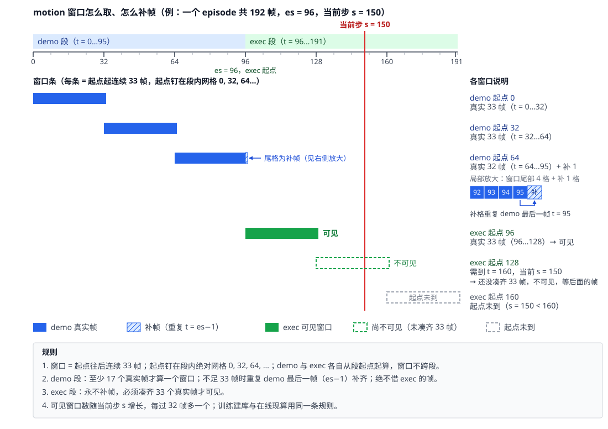

# 我们是怎么在 pi0.5 上加 motion memory 的：memory 怎么拼、motion token 怎么拿、窗口怎么补帧

> 对象：`context 512 + motion 1×1024（concat）` 模型（AWS 8×A100 训练，官方 800 局三 seed 37.33 ± 0.59%）。只写我们做了什么。

## 0. 资源一览

| 资源 | 地址 | 匿名可达 |
|---|---|---|
| encoder checkpoint | HF bucket `HongzeFu/motionjepa-stage2-pool4-3decoder-1025-v1`：`stage2-full144-1025-a/checkpoint_epoch_105.pt`（sha256 `27daa832…6035`）与 `config.yaml` | ✅ |
| 预处理好的训练数据集（motion 表、帧表、Wan latent） | HF bucket `HongzeFu/robomme-16task-orig100-1600ep-trainset-20261028-v1`，先看 `delivery_manifest.json`；motion 表在 `motion-stage2-1024/` | ✅ |
| 原始 H5（16 任务 × 100 集） | HF dataset `Yinpei/robomme_data_h5` | ✅ |
| 训好的 VLA checkpoint（12 步） | HF bucket `HongzeFu/robomme-vla-orig100-ctx32x4x4-motion-s2concat1x1024-60k-v1` | ✅ |
| VLA 仓库（本文路径相对其仓库根） | `github.com/hongzefu/robomme_policy_learning_MotionJEPA`，训练分支 `v4-256concat1` | ✅ |
| encoder 仓库 | `github.com/hongzefu/MotionJEPA`，commit `b5d23a5` | ❌ **私有**；`scripts/dataset/wan_stage2/pyproject.toml` 以 git 依赖钉它，没权限装不了环境 |
| Wan VAE | HF `Wan-AI/Wan2.1-T2V-1.3B-Diffusers` 的 `vae` | ✅ |

2026-11-03 美东不带 token 实测：bucket 用 `https://huggingface.co/buckets/<名>/resolve/<路径>` 下载正常，网页 tree 视图匿名 404 不影响。

## 1. memory 怎么拼接

pi0.5 的输入是 `[当前帧图像 | 文本]`。我们在最前面多放一段 **记忆区**，由两路 token 组成：

| 路 | 一个 token 代表什么 | 怎么得到 | 位置数 |
|---|---|---|---|
| 帧路 | 某一历史帧「长什么样」 | 在 `[0, 当前步]` 上等距取 32 帧，每帧过 SigLIP 后池化到 4×4 = 16 个 token | 32 × 16 = 512 |
| 运动路 | 某段连续 33 帧「发生了什么运动」 | 窗口过 Wan2.1 VAE 再过 MotionJEPA 阶段二 encoder，输出 (4,256) 展平成一个 1024 维向量 | 最多 96 个窗口 × 1 |

拼接分四步：

1. **投影，并把时间码编进去**。每个 token 拼上时间码，过一层 Linear 投到主干宽度 2048。时间码是 `PosEmb3D`：768 维固定 sin/cos，无参数。帧 token 用完整 768 维，与 2048 维视觉特征 concat 后投影；motion token 只用其中 256 维时间部分（窗口起点帧的 `t`），与 1024 维 motion concat 后投影。`t` 是含 demo 段的全域帧号，所以每个记忆 token 自带**绝对时间**。两个 encoder 冻结，只训这几个 Linear 和 pi0.5 本体。
2. **按时刻交错**。两路 token 合在一起按时刻稳定排序，同一时刻帧 token 在 motion token 前；置换 `mem_order` 在数据侧算好、随样本进模型。原因在 RoPE：Gemma 没有绝对位置向量，位置只靠每一层 attention 的 RoPE，位置号是 `cumsum(input_mask) − 1` 这样的稠密排名，只知道「第几个」、不知道帧号。若把 96 个 motion token 整段放在 512 个帧 token 之后，同一时刻的帧与运动在每一层里都相隔几百个位置；交错后位置号随时间单调，时间上相邻的帧 token 与 motion token 在位置上也相邻。帧与帧隔多少步，只能从第 1 步的时间码读。
3. **固定形状 + mask**。帧路填满 512 位、运动路填满 96 位，不够的填零向量、mask 置 False，padding 排到记忆区尾部、不占位置号。96 按 16 任务全集定，实测单 episode 最多 44 窗、均值 14.5，超过 96 报错只是守卫。
4. **放进前缀**。序列变成 `[记忆区 608 | 当前帧图像 512 | 文本 64]`，再接 20 个动作 token；记忆在前缀里算一次进 KV cache，去噪多步只重算动作段。实际生效的可见关系（行 = 谁在看，列 = 看到什么；padding 既不被看也不产生输出）：

   | 看 → 被看 | 记忆区 608 | 当前图像 512 | 文本 64 | 动作 20 |
   |---|---|---|---|---|
   | 记忆区 | ✅ 双向 | ❌ | ❌ | ❌ |
   | 当前图像 | ❌ | ✅ | ✅ | ❌ |
   | 文本 | ✅ | ✅ | ✅ | ❌ |
   | 动作 | ✅ | ✅ | ✅ | ✅ |

   实现是 `make_attn_mask` 的 ar / na / input 三层 mask，与上游 RoboMME/robomme_policy_learning 逐字相同，只是记忆区 512 → 608。**这一步是 pi0.5（PaliGemma 前缀 + 动作专家）的实现；换到 Qwen 时放哪里、谁能看谁要单独讨论，不在本文范围。**

**代码范围**（`robomme_policy_learning_MotionJEPA`）：

| 步 | 位置 |
|---|---|
| 投影 | `src/mme_vla_suite/models/representation/percep_mem.py::PerceptualMemory` |
| 交错排序 | `src/mme_vla_suite/shared/sampling.py::memory_order` |
| 填充与数据侧 8 个键 | `src/mme_vla_suite/training/framesamp_dataset.py::FrameSampDataset.__getitem__`（训练）；`src/mme_vla_suite/policies/framesamp_memory.py::FrameSampMemory._prepare_motion`（在线） |
| 放进前缀、attention mask | `src/mme_vla_suite/models/integration/history_pi0.py::HistoryPi0.embed_prefix / make_attn_mask` |
| 配置 | `src/mme_vla_suite/models/config/robomme/perceptual-framesamp-ctx-32frame-4x4-motion-stage2-1x1024-orig16.yaml`（分支 `v4-256concat1`） |

## 2. motion token 怎么拿

同一个 encoder、同一个入口函数。先跑通一个窗口，剩下的只是「训练时提前算好存表，推理时现算」。

### 2.1 环境

| 东西 | 从哪拿 |
|---|---|
| torch 环境 | `scripts/dataset/wan_stage2/pyproject.toml`（torch 2.9.0、diffusers 0.39.0、`motion-jepa` 钉 `b5d23a5`）：`UV_PROJECT_ENVIRONMENT=v1-store/venvs/wan-stage2 uv sync --project scripts/dataset/wan_stage2` |
| VAE 适配函数 | `scripts/dataset/wan/wan_motion_infer.py::load_vae / encode_chunk` |

### 2.2 跑通一个窗口

```python
import torch
from motion_jepa.export.stage2_memory import load_ema_encoder, encode_windows   # MotionJEPA b5d23a5
import wan_motion_infer as W                                                   # scripts/dataset/wan/

W.check_env(); W.pin_numerics()                                                # fp32、关 TF32
dev = torch.device("cuda:0")
vae, _ = W.load_vae("Wan-AI/Wan2.1-T2V-1.3B-Diffusers", dev)
encoder, einfo = load_ema_encoder("<…>/checkpoint_epoch_105.pt", device="cuda:0",
                                  expected_sha256="27daa832…6035")
frames = ...                                   # (33, 256, 256, 3) uint8 原图，按第 3 节取窗
latent = W.encode_chunk(vae, frames, dev)      # (9, 16, 32, 32) f32
token  = encode_windows(encoder, latent.unsqueeze(0))[0]   # (1024,) f32 ← 一个 motion token
```

一窗约 1 s，几乎全在 VAE。`einfo` 里的 `encoder_state_sha256` 与 `numerics` 存下来，训练与推理两侧比对。

### 2.3 训练：提前建库

太慢，不能在线算。对训练集所有窗口跑一遍 2.2，存成一张 `(rows, 1024)` f32 表，训练时按 (episode, 当前步) 查可见窗口（第 3 节）。脚本：`scripts/dataset/wan/extract_wan.py`（帧→latent）→ MotionJEPA `scripts/stage2_memory_export.py`（latent→token）→ `scripts/dataset/pack_motion_store.py`（打包、校验）；表格式见 `src/mme_vla_suite/datastore/motion_store.py`。1600 集的表 23,253 行、约 95 MB。

#### 已经有预先处理好的：公开 bucket `HongzeFu/robomme-16task-orig100-1600ep-trainset-20261028-v1` 的 `motion-stage2-1024/`

表只有一个裸文件 `motion_token.f32.bin`（第 r 行 = 字节 `r*4096` 起的 1024 个 f32），行与帧的对应靠两份 JSON：

- `meta/episode_manifest.json`：episode 顺序，每条记 `h5_file`、`raw_ep_idx`、`num_timesteps`、`exec_start_idx`；全域帧号 `t` 就是 H5 的 `timestep_{t}`。
- `motion-stage2-1024/meta/motion_index.json`：每个 episode 的 demo、exec 两段各给 `row_base` 与 `num_grid`；段内第 m 窗 = 第 `row_base + m` 行，起点 = 段起点 + 32·m。

### 2.4 推理：在线现算

帧是新的，只能现算。起一个 torch 子进程常驻一张卡，每凑齐一个新窗口就送 33 帧过去、收回 (1024,)；一个起点只编一次，缓存到 episode 结束。实现：子进程 `scripts/dataset/wan_stage2/stage2_sidecar.py`，协议与客户端 `src/mme_vla_suite/policies/{motion_protocol,motion_client}.py`，窗口状态机 `src/mme_vla_suite/policies/framesamp_memory.py::FrameSampMemory`（首批送整段 demo 一次编完，之后每 16 帧一批）。

## 3. 窗口怎么取、怎么补帧

窗口 = 从起点往后连续 33 帧，起点钉在**段内绝对网格** 0, 32, 64, …，demo 段与 exec 段各自起算、不跨段；当前时刻只决定哪些起点已经可见。



补帧规则，训练建库与在线现算一字不差：

- demo 段：尾窗不足 33 帧时用 demo 最后一帧（es−1）重复补齐；至少 17 个真实帧才成窗；绝不借 exec 的帧。
- exec 段：永不补帧，凑齐 33 个真实帧才可见。

可见窗口：demo 段起点 `s` 满足 `s + 16 ≤ es − 1`（与当前步无关），exec 段起点 `u` 满足 `u + 32 ≤ 当前步 − es`。代码：`src/mme_vla_suite/datastore/motion_store.py::visible_motion_rows`（契约）、`src/mme_vla_suite/policies/framesamp_memory.py::FrameSampMemory._encode_window`（在线补帧）。
