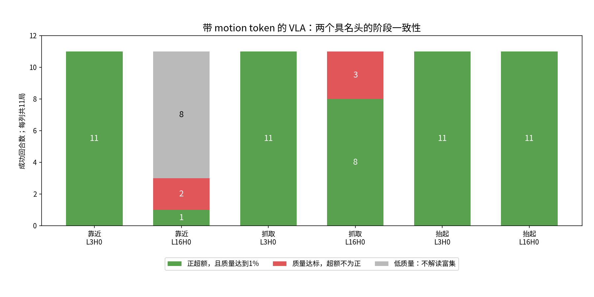
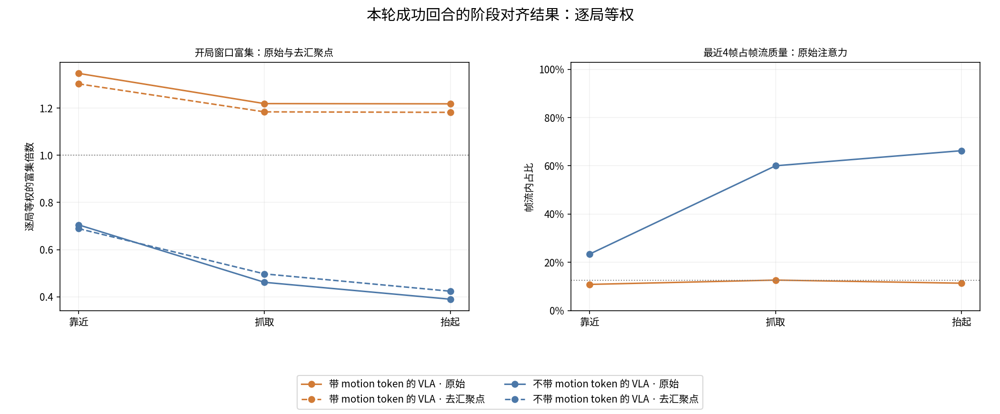
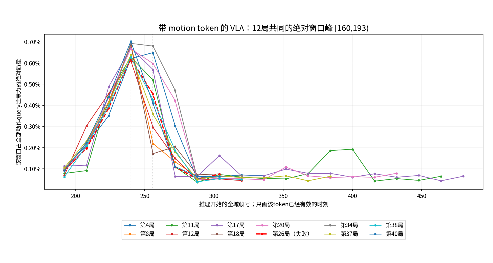
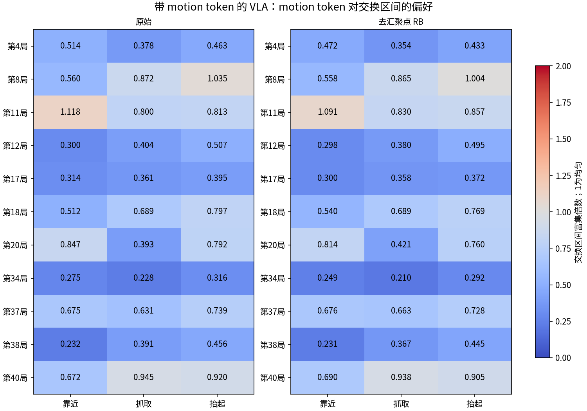

# ButtonUnmaskSwap：成功回合的注意力共通模式

> 美东 2026-11-04；模型 seed=42；仅一个任务 `ButtonUnmaskSwap`。采集与完整离线计算均已完成，本文及归档数值待最后一轮独立内容核验回写。
> 模型名称始终为**带 motion token 的 VLA**、**不带 motion token 的 VLA**；motion token 是输入编码，不代称模型。

## ① 结论与指标速览

最一致的观察有两类：**带 motion token 的 VLA 的 L3H0 持续回看开局窗口，L16H0 的开局偏好在抬起阶段更一致；其 motion token 注意力还存在一个跨全部12局的固定绝对窗口峰 `[160,193)`，主要由 L17H1 承担。** 这个固定峰与“交换区间”不是同一个概念，也出现在本轮失败局，不能直接解释为追踪交换或成功原因。

| 本轮真实结果 | 带 motion token 的 VLA | 不带 motion token 的 VLA |
|---|---:|---:|
| 历史成功入选、实际完整执行 | 12/12 | 10/10 |
| 本次任务成功 | 11/12 | 5/10 |
| 正常失败局号 | 26 | 14、16、20、26、34 |
| 原始 attention／prefix | 279／279 | 224／224 |
| 视频 | 12 | 10 |
| motion 编码记录 | 12份，130次编码调用 | 不适用 |
| 策略采集基础设施错误／重试 | 0／0 | 0／0 |

22条是“模型与回合组合”，覆盖15个去重环境局号；`seed=42` 不是42个任务。两组分别使用自己的历史成功集合，不能拿11/12与5/10当作同一测试集上的模型性能比较。全部22条均分析，后文成功模式默认只统计本轮实际成功的11局／5局；失败原样保留在[逐局索引](cases.md)，没有为了成功重试。

## ②—⑥ 版本、对象、配置与硬件

| 项目 | 固定口径 |
|---|---|
| 计划与授权 | [完整计划](../../../1103-buttonunmaskswap-success-attention-plan.md)；用户在保存推送后明确说「开始实现」 |
| 采集代码 | `e56bbceca5fe1c734c2553e83b8b6de1db71ca08`，干净采集工作树 |
| 分析代码 | `c55700b63b89de451adfc0c459bd99ecefce8443`，另一份干净分析工作树；没有中途切换在跑的采集代码 |
| 带 motion token 的 VLA | `orig100-ctx32x4x4-motion-s2concat1x1024-b128-60k/59999`，配置 `mme_vla_suite_orig16_b128_60k` |
| 不带 motion token 的 VLA | 官方 `perceptual-framesamp-context/79999`，配置 `mme_vla_suite_b128` |
| 推理结构 | 18层、每层8个query头；10个去噪步、20个动作query；实际每次最多执行前16个动作，终局可提前截断 |
| 历史输入 | 帧路512槽＝32帧×每帧16个token；带 motion token 的 VLA另有96个motion槽，前缀长度1184，另一组为1088 |
| 运行条件 | 本机 Aspen，2×RTX A6000；本机 `/data` 数据；模型seed42，环境seed与难度逐局取官方test元数据 |
| 真实采集耗时 | 美东18:11:20开始冒烟；两条剩余列表18:20:13开始，分别18:53:05／18:42:03结束 |
| 完整分析耗时 | 美东19:10:53—19:43:40，约32分46秒；4个单线程CPU进程，不使用GPU |

权重身份、依赖、清单来源、每局环境seed、所有启动命令和覆盖项见[启动档案](launch.md)、[运行版本固定记录](records/runtime-fixed.json)、[采集回执](records/run-capture-execution-receipt-1104.json)。两份权重已做全量内容读回核对；不把文件存在当作资产同源证明。

## ⑦ 实际执行、完整性与验证

以下判定分别表示内容、计算或采集通过，不代替独立任务成功字段：

```text
PLAN_CONSISTENCY_REVIEW=PASS base=b7ad0560e4315a8b1ecb669a86cb584e0eff68d7 findings=0 blocking=0
MOTION_CAPTURE_CPU=PASS tests=75 elapsed_seconds=155.75
CAPTURE_SMOKE=PASS expected=2 completed=2 seconds=59.4
ATTN_COVERAGE=PASS expected=22 completed=22 infers=503 prefixes=503
MOTION_TOKEN_COVERAGE=PASS episodes=12 generated=130 uses=1531 missing=0
PHASE_ANNOTATIONS=PASS episodes=22 pickups=25 annotations=75
SUCCESS_ATTENTION=PASS episodes=22 complete=1 r3_six_families=1 diagnostic=0 workers=4 seconds=1966.14
EXIT_CODE=0
```

主会话逐次读回全部503份动作／文本attention、503份prefix，核对有限性、维度、行和、padding、时间与key映射、终局身份及视频帧数。两侧第8局的20次动作均与旧同硬件采集记录逐位一致，最大差为0；该验证说明本次记录扩展未改变这两条受测轨迹，不扩大成所有版本或跨硬件逐位等价结论。

阶段使用实际执行的闭合指令、CPU关节状态回放和视频核实，覆盖25次取物尝试；双目标局分别保留 `pickup_index`。75个代表性查询用于阶段比较，其余查询保留在完整时间线，不强行贴阶段标签。原始注意力仍平均全部20个预测query；阶段定位只用实际执行部分，两者用途不同。字段“阶段未核实”表示未人工分类，不表示该次原始记录没有通过内容验收。

## ⑧ 细致注意力结果

### 8.1 所有模型共同使用的统计定义

| 指标 | 定义与分母 |
|---|---|
| 帧流／motion token流总质量 M | 占该动作query全部key注意力的比例；先平均去噪步与动作query，流统计再合并层头 |
| 开局占比 S | 帧流中落在 `VIS=[0,32)` 的质量／全部有效帧流质量；第0帧另列 |
| 开局均匀期望 U | 本次实际有效采样帧中落在VIS的帧数／全部有效帧数，不固定成12.5% |
| 富集 E、超额 X | `E=S/U`；`X=M×(S−U)`。头级解释沿用流质量至少1%的限制，低质量斜线不是丢弃数据 |
| motion窗口归属 | 窗 `[t,t+33)` 对区间 `[a,b)` 的权重为 `max(0,min(t+33,b)−max(t,a))/33`；区间占比按此加权，均匀期望只用有效窗口 |
| 交换区间 | 第j次为 `[64+50(j−1),64+50j)`；按各局真实交换次数取并集，包含三次交换局 |
| 阶段与跨局汇总 | 每局、每阶段先在已核代表查询间平均；双目标在局内合并，再跨局等权。富集先逐次算S/U，不拿两列均值再相除 |
| 去汇聚点 | 沿用R3的20倍／6层／至少50%有效出现／跨族规则；主口径RB，额外记忆族剔除为压力口径RC。剔列后逐query行归一，保留原残余质量阈值和敏感性版本 |

六个query族中的目标词族使用实际提示里的全部已核目标色行，双目标为这些行的均值，仍是一个族；模型输入与原始 `probs_text` 没有被合并或改变。完整计算复用 `split_streams`、X1逐头方法、R2记忆内分流、R3稳健性、R4间接通路；完整数值在[总汇总](records/success_attention_summary.json)和[报告逐局数值](records/report-metrics.json)。

时间线保留全部推理；单局头图的均值使用step≥32，避免开局只有一帧时S=U=1的平凡情形。R2保留其整局query加权定义，案例R4层图保留整局时间均值；主文的阶段R4表另按已核阶段查询计算。不同查询对象和统计范围分别标注，两模型始终使用相同算法。

原始attention沿用既有落盘精度 `float16`，保留去噪步、层、头、动作query和key全部维度；实际motion输入按原 `float32` 保存。保存时不平均，以上平均仅发生在离线统计。

### 8.2 L3H0稳定回看开局；L16H0在后段更一致

以下仅为**带 motion token 的 VLA 的11个本轮成功局**。正偏好要求阶段平均头质量≥1%且VIS超额为正；富集是原始头级描述，不将流级去汇聚点结果冒称为头级因果证明。

| 阶段 | L3H0：正偏好／可解读局 | L3H0平均富集 | L16H0：正偏好／可解读局 | L16H0限制与反例 |
|---|---:|---:|---:|---|
| 靠近 | 11/11 | 3.89× | 1/3 | 另8局质量低，不解读；可解读反例为8、40 |
| 抓取 | 11/11 | 3.63× | 8/11 | 反例为11、12、37；平均富集1.48× |
| 抬起 | 11/11 | 3.42× | 11/11 | 平均富集1.65× |

L16H0单头帧流质量的阶段均值从靠近约1.59%，增到抓取27.46%、抬起68.88%。靠近的平均质量由少数局拉高，不能据此把8个低质量局当作可解释样本。更准确的共通描述是：L3H0贯穿这三个阶段呈现开局偏好，L16H0的开局偏好在抬起阶段最一致；不把它们命名成已证实的“记忆模块”或“决策模块”。



图中红色是**注意力偏好的反例**，不是任务失败；这张图的11局均为当前任务成功。灰色表示不满足头质量解释限制。

附录的原始总热图按“可解读局”作逐格分母，颜色为1不代表标题中的全部局都达标；应同时读JSON中的 `computable`。主图将低质量局明确画成灰色，避免把1/1误读成11/11。

### 8.3 全流开局偏好大体保留，但有反例

| 模型／阶段 | 原始VIS富集 | RB去汇聚点 | RC压力口径 | RB高于均匀的局数 |
|---|---:|---:|---:|---:|
| 带 motion token 的 VLA／靠近 | 1.347× | 1.303× | 1.285× | 10/11 |
| 带 motion token 的 VLA／抓取 | 1.219× | 1.184× | 1.176× | 9/11 |
| 带 motion token 的 VLA／抬起 | 1.218× | 1.182× | 1.162× | 10/11 |
| 不带 motion token 的 VLA／靠近 | 0.705× | 0.689× | 见逐局数值 | 0/5 |
| 不带 motion token 的 VLA／抓取 | 0.462× | 0.497× | 见逐局数值 | 0/5 |
| 不带 motion token 的 VLA／抬起 | 0.390× | 0.424× | 见逐局数值 | 0/5 |

带 motion token 的 VLA 的RB反例：靠近与抬起为第20局，抓取为20、37；RC下抓取再增加第12局。因此是多数局和群体均值的方向保留，并非每局、每个时刻都稳健高于均匀。

抓取时，带 motion token 的 VLA 的帧流占全部注意力约1.47%，motion token流约0.39%；VIS帧实际占全部注意力约0.206%。不带 motion token 的 VLA 对应帧流约0.70%、VIS约0.039%。**帧流内占比不是模型全部注意力占比**，其余图像、文本和动作仍占主体。

不带 motion token 的 VLA 的最近4帧占帧流质量：靠近23.4%、抓取60.0%、抬起66.3%；带 motion token 的 VLA 为10.8%、12.6%、11.3%。这支持“前者在抓取／抬起更偏近期帧”，不把单个最强头的近100%误写成整个模型只看最近帧。



### 8.4 探索性新发现：12/12局的最大motion窗口峰固定在160

对每局**全部推理、全部有效motion窗口**搜索原始绝对注意力质量最大值后，12/12的窗口都是 `[160,193)`；11局在step240达到峰值，只有第4局在step256。它不随一、二、三次交换而平移。

峰时，这个窗口占motion token流的62.7%—77.3%；最大头全部都是 **L17H1**，它将自身75.8%—85.6%的注意力给该窗。在各头给该窗的质量之和里，L17H1占80.8%—89.7%；这些比例是注意力质量拆分，不是动作因果贡献。

| 交换次数 | 本批局数 | 固定峰窗口与交换并集的重叠／33 |
|---|---:|---:|
| 1 | 6 | 0 |
| 2 | 5 | 4/33，约12.1% |
| 3 | 1 | 33/33 |

同一个强峰在一次交换局里已经位于交换之后，在两次交换局里也只覆盖交换尾部4帧；只有三次交换局与交换并集完全重叠。因此不能因为该token叫motion、或窗口与交换沾边，就把峰读成“追踪交换”。这也是坚持重叠／33口径的具体理由。



该窗口还在12/12局符合R3的 **q_mem记忆query族内汇聚点**判据，不是跨所有query族的全局汇聚点。来源为[逐局峰值记录](records/motion-peak-windows.json)。失败的第26局同样有这个峰；固定峰本身不是任务成功的充分条件。绝对位置、共同动作时序和具体编码内容在这里没有被分离，需后续控制内容／位置的干预才能解释其功能。

### 8.5 motion token对交换区间的偏好没有同样的跨局一致性

仍用当前成功的11局，按原重叠／33口径统计阶段代表查询：

| 阶段 | 原始平均富集 | RB中高于1的局 | RC中高于1的局 |
|---|---:|---|---|
| 靠近 | 0.547× | 11：1/11 | 4：1/11 |
| 抓取 | 0.554× | 无：0/11 | 40：1/11 |
| 抬起 | 0.658× | 8：1/11 | 4、38、40：3/11 |

第8局抬起的RB值只有 **1.003644×**，非常接近均匀；图保留三位小数，避免显示成1.00后与判定行看似矛盾。RC额外剔除记忆族内汇聚点后，阳性局号改变，平均富集仍低于1。这里缺少的是这些代表阶段上的稳定交换偏好证据，不能据此排除其他时刻、单头或value通路使用了运动信息。



### 8.6 前缀内汇聚与间接通路

整局R2先按query数量加权、再跨局等权：带 motion token 的 VLA 的帧query平均将41.2%的记忆内注意力给motion token，相对其均匀期望的平均富集为37.9×。这是**前缀记忆query**的分流，不能与动作query的0.39%等比例比较；它与160窗的族内汇聚现象相符，仍不证明其内容决定了动作。

R4的抓取阶段，带 motion token 的 VLA 的VIS直接／均匀比为1.093×，一跳间接／均匀比为0.472×；不带 motion token 的 VLA 为0.462×、0.153×。该近似忽略MLP、残差强度和value范数；直接与间接路径不能直接当作真实贡献相加解释。逐层曲线和R2完整矩阵均在[逐局图](cases.md)及[完整汇总](records/success_attention_summary.json)。

### 8.7 同局及全部入选集合的敏感性检查

两侧都在本轮成功的同局交集为 **8、12、18、38**，不是重跑挑出来的新数据。它们的RB开局富集按靠近／抓取／抬起分别为：带 motion token 的 VLA **1.358／1.212／1.155×**，不带 motion token 的 VLA **0.657／0.487／0.387×**；方向一致，但只有4对，且仍不能消除训练协议差异。

将本次失败也纳入全部历史入选集合，抓取RB均值为带 motion token 的 VLA **1.194×（12局）**、不带 motion token 的 VLA **0.526×（10局）**，方向也保留。另一方面，失败第26局的L3H0抓取富集仍有3.283×，并有同样的160窗峰：回看模式不是成功的充分条件。

## ⑨ 用户决定与命名

用户要求沿用既有方法、只关注开局帧窗口和motion token、保存全部编码供后续比较；带 motion token 的 VLA 用既有seed42的12局，不带 motion token 的 VLA用它自己的历史成功集合。模型名称、完整原话和开工令已逐条写入[启动档案](launch.md)。本轮没有登记 `current.json`，不修改其他任务的状态机。

`L3H0+L16H0` 是旧实验同时遮两个层头的条件名：从0编号，分别为第4层第1个query头、第17层第1个query头；不是两个motion token。旧实现对prefill与去噪阶段都遮对应头。本轮全部 `ablate=none`，只观察它们跨局的读取模式。新发现的L17H1是第18层第2个query头；160窗则是motion槽5（第6个窗口），层头与输入槽位是不同维度。

## ⑩ 实施中的意外与处置

| 事项 | 处置及证据边界 |
|---|---|
| 用户未跟踪HTML使主检出不干净 | 不读不动，采集与分析各在固定干净工作树执行，产物仍在主检出本机v1-store |
| 旧测试夹具缺新增实际输入字段 | 补三份假观测及精确键／shape／dtype断言，不加生产回退；完整CPU回归75项通过 |
| 分析初审发现fail／timeout被写未核实 | 最小修正，未知和基础设施状态仍空值；真实终局及8种状态验证通过 |
| 开局空motion窗会污染R2整局期望 | 带motion预算的空窗U保0，只有真正无motion才不适用；真实0窗＋9窗及旧缓存逐元素对拍通过 |
| 双目标提示漏第六query族 | 全部目标色先核实再均值，仍六族，阈值不变；真实ep11两行及单目标、重复／缺行测试通过 |
| CPU关节回放隐藏CUDA导致渲染回退并段错误139 | 保留失败日志；审查后恢复原GPU渲染可见性，原CPU物理回放通过；不重跑策略 |
| 辅助执行目录、解释器与日志读取问题 | 正式内容验收修正到固定工作树；正式分析显式主解释器；日志读取退出143后接续，detached任务未受影响 |
| 离线改为4CPU进程 | 原函数逐局独立、原清单顺序归约；独立同规模审查通过，不改变指标与任务数量 |

全部同规模调整均独立审查后继续，源码修复也经过固定提交复审。细节见[计划追加记录](../../../1103-buttonunmaskswap-success-attention-plan.md)和[审查记录](records/preflight-review.json)。

## ⑪ 结论边界与后续输入

本轮支持的共通模式是头级的开局读取分工，以及固定160窗的强读取／族内汇聚；交换段偏好没有同样的一致性。仍有以下边界：

- 单任务、单模型seed、历史成功条件下选局；两模型使用不同集合，复现成功子集还有二次选择，不能作为总体性能或跨任务泛化结论。
- 两模型训练来源与步数不同，差异不能全部归因于motion token；采集采用既有展开适配器，旧自检已记录其与生产scan版bf16存在约3e−3的相对差异，本轮没有重测或宣称生产逐位等价。
- 阶段使用代表性查询，完整时间线上仍可能有瞬时或子交换偏好；双目标的两个目标词离线等权汇聚，不代表模型输入被合并。
- 注意力不等于贡献。保存的 `motion_emb` 是输入编码，不是每层attention的V向量；本轮没有给出因果必要性或充分性证明。
- 时间窗口偏好不等于正确的对象身份或位置表示；第26局同时具有强开局头和固定160窗峰，仍揭出了错误颜色。

后续比较所需的全部motion token已保存：130个窗口、279次实际输入快照、1531次有效使用及逐次槽位／prefix映射，详见[数据说明](motion-tokens.md)和[完整索引](records/motion-token-inventory.json)。可以据此按局号与窗口起点选择供体；本轮没有提前执行新的替换实验。

## ⑫ 归档与复现

原始NPZ、视频及逐次完整JSON在本机 `v1-store/evaluation/attn-buttonunmaskswap-success-seed42-1103/`，约218GiB，没有提交大数组或权重进Git。Git内保存轻量数值、索引、96张已由主会话目视的PNG（67张分析图、4张概览、25张阶段证据）及以下入口：

- [逐局结果与全部图](cases.md)、[完整motion token说明](motion-tokens.md)。
- [总数值](records/success_attention_summary.json)、[阶段与配对数值](records/report-metrics.json)、[固定峰记录](records/motion-peak-windows.json)。
- [采集完整性](records/capture-validation-all.json)、[运动向量索引](records/motion-token-inventory.json)、[图目视记录](records/figure-visual-review.json)。
- [完整启动档案](launch.md)、[固定分析清单](records/analysis-manifest.json)、[版本与并行规格](records/analysis-dispatch.json)。

在包含固定分析提交的干净检出中，用既有uv环境按启动档案设置本机输入路径，原生串行等价入口为：

```bash
UV_CACHE_DIR=/data/hongzefu/robomme_policy_learning_MotionJEPA/v1-store/cache/uv \
UV_PROJECT_ENVIRONMENT=/data/hongzefu/robomme_policy_learning_MotionJEPA/.venv \
PYTHONPATH="$PWD:$PWD/src:$PWD/packages/openpi-client/src" \
MPLCONFIGDIR=/data/hongzefu/robomme_policy_learning_MotionJEPA/v1-store/cache/matplotlib \
OPENBLAS_NUM_THREADS=1 OMP_NUM_THREADS=1 MKL_NUM_THREADS=1 \
uv run --frozen --no-sync python -m scripts.interpret.analysis.success_attention \
  --manifest /data/hongzefu/robomme_policy_learning_MotionJEPA/v1-store/evaluation/attn-buttonunmaskswap-success-seed42-1103/analysis-manifest.json \
  --out '<全新输出目录>'
```

本轮实际四进程命令、脚本指纹及路径已固定在启动档案；原始数据文件保留，临时代码工作树可按提交恢复。最终独立内容核验与会话清理结果在完成后回写，不用程序PASS替代这一步。
