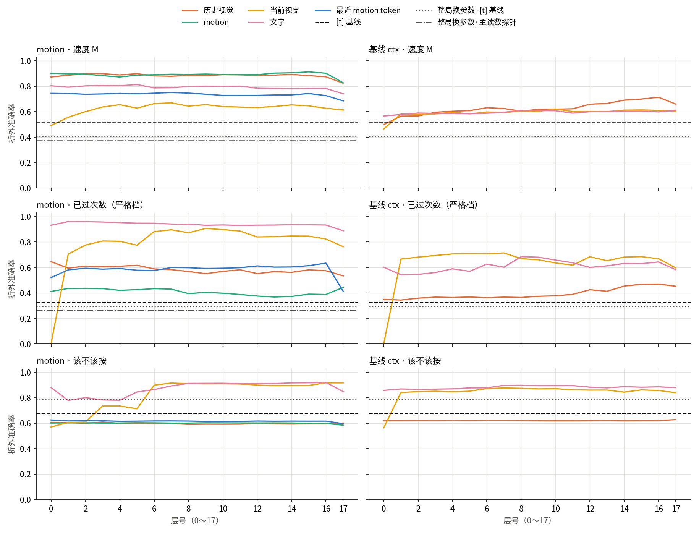
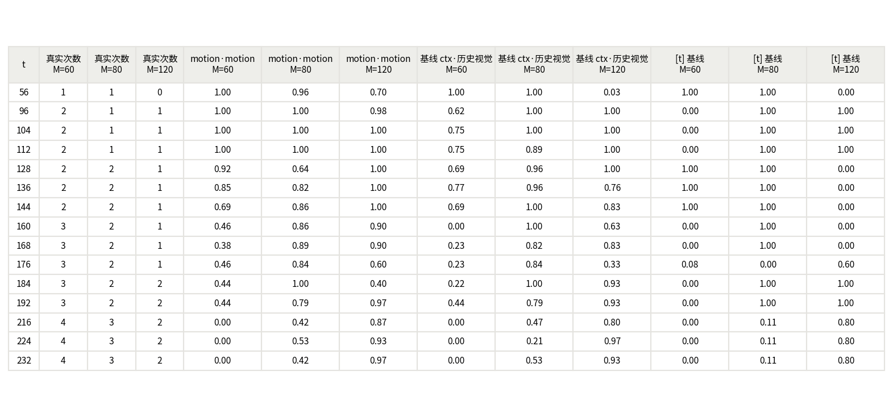
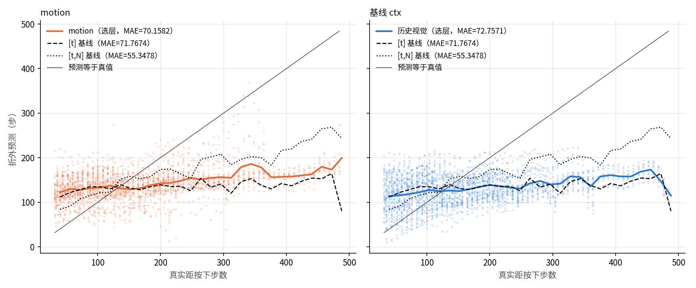
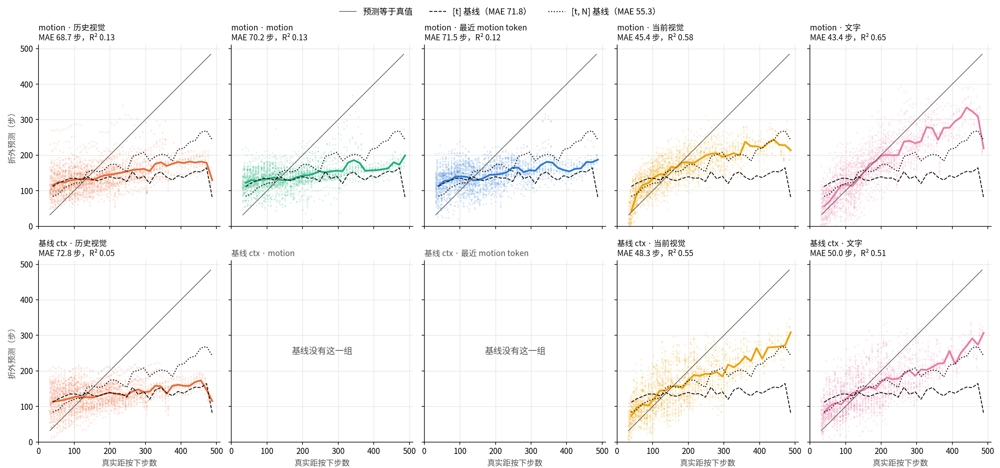

# StopCube 悬停期逐层探针：结果

在官方 StopCube 示教 100 局上回放两个模型，取悬停期 2344 个点（98 局有点），用线性探针逐层读隐状态。motion 模型的最近一个 motion token 能读出速度 M，准确率 0.753，比只用时间高 0.232，区间 [0.171, 0.290]。motion 组均值读已过次数严格档只有 0.446，比时间高 0.118，区间 [0.014, 0.234]，下限接近 0，算弱信号。两个主读数的学习曲线都没有走平。基线的正对照没过（R² 0.688，要求 0.8），已如实记录，判据没改。这些都只说明可解码，不说明模型用了这些信息，而且这些局两个模型训练时都见过。

判定行见 [records/verification.summary.txt](records/verification.summary.txt)，起跑信息见 [launch.md](launch.md)。

## 主读数

这两个读数是预先写死的，都只在 motion 模型上有。层在训练折内选。

| 主读数 | 探针 | `[t]` 基线 | 探针减基线 | 打乱对照 | 学习曲线 25% / 50% / 100% |
| --- | ---: | ---: | --- | ---: | --- |
| 最近 motion token 读速度 M | 0.753 | 0.521 | +0.232 [0.171, 0.290] | 0.372 | 0.596 / 0.681 / 0.753 |
| motion 组均值读已过次数严格档 | 0.446 | 0.328 | +0.118 [0.014, 0.234] | 0.265 | 0.301 / 0.347 / 0.446 |

- **速度 M：** 只在三种速度都有点的 18 个 t 上算是 0.748，时间基线 0.468，所以不是靠「t 大的多为 M=120」。按速度分：M=60 为 0.758，M=80 为 0.486，M=120 为 0.959。M=80 明显最差。
- **已过次数严格档：** 608 对配对，只来自 50 局。相对 `[t, N]` 基线差 +0.094，区间 [-0.019, 0.209]，含 0。
- **两条学习曲线都还在升：** 100 局不够让探针饱和，这些数字是下限性质的估计，模型差异也不能按收敛后的值读。

## 逐层图

以下都是探索性读数，没有校正多重比较。

| 读数（训练折内选层） | motion：历史 | motion：motion 组 | motion：当前 | motion：文字 | 基线：历史 | 基线：当前 | 基线：文字 | `[t]` | `[t, N]` |
| --- | ---: | ---: | ---: | ---: | ---: | ---: | ---: | ---: | ---: |
| 速度 M | 0.891 | 0.898 | 0.660 | 0.807 | 0.710 | 0.574 | 0.599 | 0.521 | 0.536 |
| 已过次数严格档 | 0.648 | 0.446 | 0.915 | 0.951 | 0.467 | 0.683 | 0.647 | 0.328 | 0.352 |
| 已过次数全量档 | 0.882 | 0.829 | 0.944 | 0.955 | 0.823 | 0.873 | 0.885 | 0.726 | 0.773 |
| 该不该按 | 0.586 | 0.594 | 0.908 | 0.915 | 0.620 | 0.861 | 0.899 | 0.675 | 0.871 |
| 剩余次数 | 0.461 | 0.451 | 0.747 | 0.671 | 0.407 | 0.694 | 0.748 | 0.418 | 0.703 |
| 距按下步数 MAE（步） | 68.7 | 70.2 | 45.4 | 43.4 | 72.8 | 48.3 | 50.0 | 71.8 | 55.3 |

- **速度在 motion 模型里很早就有：** 输入级 motion 组已是 0.927，最近 token 0.776。历史组输入级只有 0.474（比时间基线还低），但第 0 层输出就到 0.873。基线的历史组输入级 0.508，第 0 层 0.499，要到后面的层才升到 0.71。这与「记忆里的 motion 把速度带给了历史帧 token」相容，但没有测信息流量。
- **motion 输入级比隐藏层更能读已过次数：** 严格档 motion 组输入级 0.715，最近 token 输入级 0.805，都高于各自第 0～17 层的所有值（motion 组最高 0.444，最近 token 最高 0.634）。模型输入里有时间码 `motion_pos`，所以这一项可能混了时间，这里没有拆开。
- **文字组和当前画面组最能读历史相关量：** motion 模型严格档 0.951、0.915，基线 0.647、0.683。跨模型只作描述。
- **该不该按、剩余次数、距按下步数要和 `[t, N]` 比：** 该不该按，motion 文字组 +0.043 [0.013, 0.071]，motion 当前组 +0.037 [0.011, 0.062]，基线文字组 +0.027 [0.010, 0.045]，基线当前组 -0.011 [-0.035, 0.010]。距按下步数，motion 文字组比 `[t, N]` 少错 12.0 步 [5.9, 18.0]，基线当前组少错 7.1 步 [3.9, 10.6]。超出的幅度都不大。

### 和计划预期不符的一处

计划写当前画面组是对照，应读不出历史。实际只在输入级和第 0 层成立：严格档正好是 0.000，因为配对两帧画面几乎相同，探针给不出两个不同答案（所以这一档的下限是 0，不是计划写的「机会水平」）。从第 1 层起就升到约 0.7（两个模型都是）。

这和注意力掩码相容：图像 token 不能直接读记忆（`embed_prefix` 的 `na_mask`），但能读文字 token，而文字 token 能读记忆。信息要走两跳，所以第 0 层读不出、第 1 层能读出。这里没有测流量，只是结构上说得通。结论是：**第 1 层以后的当前画面组不能当成「只有画面」的对照。**

## 同时刻对比

固定 t 时次数由 M 决定，所以这张表排除了时间，没有排除速度。motion 列是 motion 组，基线列是历史组，都在训练折内选层，跨模型只作描述。第 216～232 步的 M=60 都是 0.00，时间基线同样是 0.00：这些 t 上 M=60 只有 9 局，已过次数是 4，这三行的 M=60 不解读。

## 进度曲线

图里两个模型用的都是不擅长这个量的组（motion 组、基线历史组），和时间基线差不多。真正优于 `[t, N]` 的是上表的文字组和当前组。

下图是用户后来要求补的全部组（同一批折外预测，MAE 与上表核对相同，`PROGRESS_MAE_MATCH=PASS`）。历史组、motion 组、最近 token 的线都接近水平，和 `[t]` 基线差不多；当前组和文字组才随真值上升，motion 模型文字组最接近斜线。所有组在真实步数大时都低于斜线，也就是把远的估近了。

## 正对照与精度

| 判定 | 结果 |
| --- | --- |
| motion 正对照（当前组第 17 层读方块位置） | `POSITIVE_CONTROL=PASS r2=0.8256 tol=0.8` |
| 基线正对照 | `POSITIVE_CONTROL=FAIL r2=0.6880 tol=0.8` |

基线第 17 层只有 0.688，但输入级 0.735，最好的层 0.805，说明当前画面组里确实有位置信息，只是第 17 层弱，而且两个模型的输入级都没到 0.8。FAIL 不改判据。它不影响两个主读数（都只在 motion 模型上），但基线当前组的逐层曲线要谨慎读。

`HIDDEN_PRECISION` 两个模型全部 PASS，比值都在 2598 以上。注意这条判据按用户裁决（Q7）比的是 float32 下新路径和全路径，主要证明新路径算的是同一件事，起不到拦截精度问题的作用。

## 解释边界

- **可解码不等于被使用：** 探针只说明线性可读。线性探针也读不出非线性编码。
- **训练见过：** 这 100 局两个模型训练时都见过，读数可能高于未见局。
- **模型差异：** 两个模型训练来源和步数不同（基线 79999，motion 59999），跨模型只作描述。
- **混合精度（Q1）：** 记忆由 bf16 policy 生成，当前画面在 float32 模型内部编码，和实际运行的 bf16 不同。
- **回放不等于评测：** 帧来自 H5，示教局和评测局种子不重叠。`REPLAY_PARITY` 只核对适配器路径。t 除以 16 余 8 的点是模型在评测里没遇到过的推理时刻。
- **选层：** 每折选的层可以不同，判定行写的是最常见的层（M 第 0 层，严格档第 1 层），每折的层见 `records/hover-summary.json` 的 `layer_by_fold`。
- **统计单位是局：** 相邻点高度相关。短局点少（11 局不超过 2 个点，都是 M=60、N=2），每局等权时权重大。严格档只有 50 局。
- **打乱水平线：** 「该不该按」那一行打乱后的 `[t]` 基线（0.785）高于真实 `[t]` 基线（0.675），因为换参数后正类比例从 0.297 降到约 0.216，猜负类就能得高分。这条线不能当下限读。
- **腕部画面差异：** 配对里有 43 对腕部差异超过 8，已排除，原因没查。

## 运行与验证

全量回放两个模型都是 2344 点，非有限值 0，和标签表逐局 t 相同。第 5 列 token 数恒为 1。按局 5 折泄漏 0。基线回放约 21 分钟，motion 约 38 分钟，分析 192 秒。

## 实施中调整

| 调整 | 旧→新 | 依据 |
| --- | --- | --- |
| 回放入口传运行契约 | 没传 → `--eval-target-contract`（同上一轮 rollout） | 真实握手报 numerics 不符。校验没动。计划没写定这一细节，不改口径 |
| 基线 `--selftest` 显存配额 | 0.45 → 0.90（只这一次） | 自检要存完整注意力张量，OOM；不是新路径的问题 |
| 打乱范围 | 主读数和时间基线 → 另加「该不该按」的 `[t]` 基线 | A9 要求逐层图每行都有打乱水平线；只影响基线 |
| 第二轮冒烟前的版本 | `87b45d0` → `84a6fe1` | 基线的 `check` 和单局回放在修复前跑过，修复只加 motion 用的参数，没有重跑；全量都在 `84a6fe1` 上 |

审查里记下、没有改的：`test_pca_ignores_test_fold` 恒真，测不到泄漏（代码经审查确认 PCA 只用训练行）；`REPLAY_PARITY` 和 `HIDDEN_PRECISION` 可能空过，冒烟时人工核对了比较点数 21 和判定行数（基线 3 条、motion 5 条）。

## 下一步

第二批动作 token、历史反事实、RouteStick 都在待办，是否继续待用户决定。

## 人工交接

本轮 tmux 会话全部自然退出，没有在跑的模型进程，没有操作其他用户的进程或会话。隐状态库和中间产物留在 `v1-store/evaluation/stopcube-hover-probe-1105/`。干净执行树 `v1-store/worktrees/stopcube-hover-run` 保留，供原命令复现。按用户裁决未写状态机。
