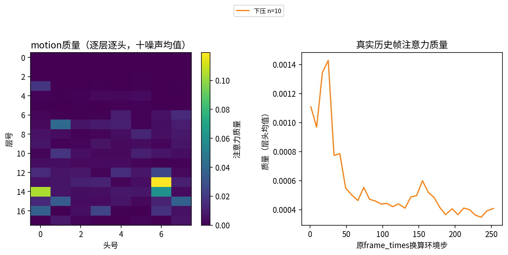

# StopCube Oracle 下压与同输入机制分析

两阶段计算、科学表述与归档复核均已完成：全部50局询问、200点原输入重放、12局74次真实校准、100次固定放手，以及三局16份原输入、160份原噪声预测的机制分析。固定放手成功率为motion 58%、基线36%；机制数据呈现有选择性的motion读取，但尚不能证明计数头或因果必要性。固定放手、校准与询问分别报告，不作为官方标准整局评估成绩；全部具名验收通过，原始产物与复现版本已留存。

## 全50局固定放手

Oracle先控制机器人悬停，再按预定时点交还模型，直至官方终局。100次运行的交还点、控制权、首次真实预测、动作与持久终态均通过验证，正常失败没有重试。基线成功18/50（36%），motion成功29/50（58%）；配对为共同成功16局、motion独有成功13局、基线独有成功2局、共同失败19局。

成功差为22个百分点，固定50局的配对局级重采样区间为[8,36]个百分点；这只描述本批次，不包含训练随机性或新分布保证。独立复核读回100份收据、100份持久终态及25912条逐步记录，重复与缺失均为0。

| 周期M | 基线79999 | motion59999 |
| --- | ---: | ---: |
| 60 | 2/12 | 3/12 |
| 80 | 5/22 | 10/22 |
| 120 | 11/16 | 16/16 |

按Oracle几何窗口分类，基线为未触发12、偏早11、区间内19、偏晚8；motion为未触发6、偏早4、区间内29、偏晚11。motion更少未按或偏早，同时偏晚更多；这些是所选检查点在该协议下的描述，不能把改善单独归因于motion。M=120的任务成功率提升与该组离线P分离度差的方向不同，也说明单一下压比例指标不能替代实际成功。

灰带仅表示Oracle悬停轨迹的几何窗口；空心点是官方失败，未出现对应颜色点表示未触发。第9局基线虽触发步532落在Oracle窗口532～548，官方仍失败：终态方块离目标约0.066994米，超出官方0.06米阈值，且`stop_timestep=null`。motion同局触发537、距离约0.022481米并成功。因此几何窗口分类与官方成功字段不能互相替代，也没有据此改判。

## 全50局的询问结果

主判据为十份预测各自前16行中是否出现目标高度低于本局悬停高度2厘米。两个模型各3730点，共7460点、74600份预测，完整字段、形状、dtype与有限性检查通过。全程动作、7臂关节、TCP、方块同步端点和两模型原始状态最大差均为0，噪声逐位一致。全部7460个原始状态的运动学高度误差为0，目标高度共换算1492000行。

| motion减基线 | 配对局数 | 均值差 | 95%局级重采样区间 |
| --- | ---: | ---: | --- |
| 决策段下压比例 | 50 | +0.06683 | [−0.00151, +0.13551] |
| 较早经过窗口下压比例 | 37 | −0.01689 | [−0.03682, −0.00068] |
| 决策段减较早窗口的分离度 | 37 | +0.13591 | [+0.06386, +0.20904] |

在具备较早窗口的37局上，motion的时间分离度更大；50局决策段比例差的区间仍跨零。前两行分母不同，不能直接相减得到第三行。1/2/3厘米、16/20行六组附指标的总体方向相同，但它们复用同一批预测，并非六次独立实验。按M分层存在异质性，M=120的主分离度差为−0.04576、区间跨零，不能说每种周期都改善。

完整曲线显示，M=60在目标前21步已有明显下压峰，两模型该点各12局，motion/基线均值为0.733/0.600；目标实际经过窗口内比例却接近0。因此经过窗口内的低值不能替代对提前准备的分析。M=120基线目标前287步的0.371峰值只有7局可用，不泛化到该周期全部16局。图中相对时刻的可用局数随位置变化，见逐点区间JSON。

汇总、局级分母及全部六组附指标见`records/query50-summary.json`、`records/sensitivity-summary.json`。完整50局的两张图已由主会话目视检查，无遮挡、重叠或缺字；大数组及完整逐点汇总留在产物根。

## 分层12局校准

| 指标 | 官方ctx512基线79999 | motion59999 |
| --- | ---: | ---: |
| 高比例点交还48步内触发 | 10/12 | 12/12 |
| 低比例点交还48步内触发 | 5/12 | 3/12 |
| 固定放手最终任务成功 | 2/12 | 6/12 |
| 早按实际校准 | 2次，其中1次48步内触发 | 0次，按规则跳过 |

`PRESS_CALIBRATION=PASS models=2 episodes=12 planned=74 completed=74 valid=74 skipped=22`。每项均核对固定交还点、Oracle前缀、模型控制权、首次预测、合法停止及同nonce持久终态。正常任务失败没有重试；22个早按项分别记录无候选或P全0原因。

低比例组在首次至多16个模型动作内，实测TCP均未比Oracle悬停高度低2cm；部分随后重新推理后才触发。高比例组对应首次动作块下压数为基线10/12、motion12/12。这支持将原判据理解为初始下压意图，不能将其直接解释为正确触发或最终成功概率。高、低及早按试验触发即停止，原始`task_success=0`不作为完整任务失败率；只有固定放手运行到官方终局。

独立只读复核逐项核对74份轨迹、收据与持久终态。低点实际触发分别在交还后37～46步（基线5次）、41～48步（motion3次），均已经执行第三次推理的动作块；高点触发也都晚于16步。固定放手配对成功为共同2局、motion独有4局、基线独有0局。这些是按M分层取最小局号的12局描述，不是随机抽样得到的全50局总体保证。

## 同输入机制分析

按预定规则选择每种M最早存在有效固定放手成功的局：M60第3局、M80第0局、M120第6局。第0局仅motion的固定放手成功，另两局两模型均成功。参考模型按身份字典序固定为motion，两个模型配对同一保存时刻；共16份输入、160份原噪声预测。成功只用于选局，分析的是原Oracle询问输入，不是实际成功闭环全过程或实际执行噪声。M60没有更早经过候选，按规则保留缺失，没有补点。

模型计算固定在`8d841cbec00a4e21af5aa96d6c7957ea8608a102`，原路径重放最大差均为0；所选输入的注意力展开路径归一化动作最大差为基线0.00634765625、motion0.005859375。统计先对扩散步和前16动作位平均，再保留层/头；下表总质量进一步平均十噪声及层/头，单token质量除以该组有效token数。分组依据token来源位置，位置表示可能已融合其他上下文。

### 少量motion位置有较高的单token读取密度

motion有效token只有1～8个，总质量约0.0231%～0.6824%；其单token质量在全部8份输入中都高于同模型静态历史视觉，约为9～65倍。总质量小与单token密度较高可以同时成立，不能据此直接量化输出贡献。

| 原参考高比例点 | 有效motion token | motion总质量 | 最大读取头（零起算） | 该头的motion质量 |
| --- | ---: | ---: | --- | ---: |
| 第3局65步 | 2 | 0.4383% | 第13层/第6头 | 33.16% |
| 第0局253步 | 7 | 0.6824% | 第13层/第6头 | 11.92% |
| 第6局273步 | 8 | 0.5120% | 第15层/第1头 | 11.84% |

三个原低→高时刻对的motion单token质量分别提高5.685、1.580、1.228倍。最大头位于第13、15、16层，但第13～17层只占跨层头合计motion质量的42.16%～77.57%，读取并非全部发生在晚层。8点中6点的最大头在十噪声下保持同一位置，另两点为7/3和5/5分裂；这描述选中输入的波动，不证明存在统一计数头。

### 原motion张量不变时，读取分配仍会变化

第0局233→253步，保存的`motion_emb/motion_pos/motion_mask`逐字节相同、有效token均为7，原文字和机器人状态也相同；P由0升到1，motion质量由0.00431838升到0.00682404。同期记忆排列、历史视觉/位置、主视角与噪声发生变化，腕部图像相同。因此，这个转折没有伴随保存的motion输入张量变化，不能仅凭它归因于新增motion窗口；也无法区分其他输入或噪声各自的影响。数组相同不代表已经证明内部缓存没有执行更新。

motion这8点的最大单帧历史质量都出现在原`frame_times`的1～24，换算为环境步2～25；基线另有近期帧成为最大值，例如环境步60、273。这里说的是最大单帧，不是大部分历史质量都集中在早期；读取早期帧也不能直接证明逐次计数。

### 次数词直接注意力没有普遍增加

原有效文字均为19个token，第二/第四/第三对应原位置16。所有16份输入中，最大文字位置质量均为BOS，占文字组质量约71.1%～86.9%；motion在8对输入中的7对，次数词直接质量低于基线。第0局253步，motion的P为1、基线为0，但第四次对应词的质量分别为0.003155、0.007730，没有支持“更关注次数词所以更成功”这一简单解释。

源码`HistoryPi0.embed_prefix`与`make_attn_mask`允许后续层的文字/BOS关注有效memory和其他文字；`sample_actions`先生成前缀KV，再由动作查询读取。因此代码允许motion→文字/BOS→动作的跨层间接路径，当前统计没有测量其实际信息量。BOS质量高不能说明忽略次数词，动作直接指向motion位置的质量也不是motion全部路径或因果贡献；首层KV尚未经过该层融合，不能笼统说每层BOS都包含全部信息。

此外，基线在三局共同低→高时刻上也都出现文字位置质量下降、动作key组（图中“其余”，20个token）质量上升；第0局基线P仍为0→0。该变化不足以作为下压或成功的特异性机制证据。原始位置、id和只读解码见[文字表](records/mechanism/prompt-tokens.html)，完整32图见[逐输入报告](records/mechanism/report.html)。

### 同一输入的按/不按对比仍受样本限制

motion的8点均为十份原预测全按或全不按，没有同一输入内的两组对比；基线只有两点出现9/1、1/9混合，少数组各仅一份。因此，这次能描述跨原时刻的读取变化，不能声称已经得到稳健的同输入、噪声内按/不按机制对比。所有标签仍来自原预测高度，未用展开路径结果重新分组。

## 实际轨迹中的高度阈值与触发间隔

这一附分析仅读取已有100次固定放手轨迹，不新增推理、不改主判据。事件定义为“首次实测TCP低于悬停高度2厘米”，不是开始下降。motion/基线分别有44/38局触发，均无“已跨此高度阈值但最终未触发”的局；从该事件到首次观察触发的端点差均值分别为13.52/13.79步。

双方均触发的34局，motion减基线的端点差为−0.176步，描述性区间[−0.559,+0.176]，不能据此宣称两模型等价，该比较也排除了单侧未触发局。触发端点可能含官方终局额外物理步，因此这不是精确物理控制延迟。

Oracle几何窗口的入出跨度为M60/80/120下的8/10/16步，分别含9/11/17个离散时点。这提示短窗口中跨下探阈值后可能已无足够时间，并不证明“进入窗口才下降必然失败”。第27局同在53步交还，基线在79步跨阈值、94步触发并成功；motion在83步跨阈值、98步触发并失败，两者端点差均15步。本例差异在于到达该高度阈值的时机，不把真正下降启动时间或单一因果写成已证事实。

联合M/N分层也显示局限：M80,N2两模型均0/7，M60,N2为motion1/6、基线2/6，而M120,N2为2/2、1/2。不能泛化为所有“第二次”指令都失败。机制选中的第3局正是M60,N2中motion唯一成功局，其注意力不能代表同组失败局。附分析与分层全表见`records/actual-descent-summary.json`、`records/behavior-breakdown.json`。

## 运行与验证

第一阶段实现固定提交为`48a52f1e083ee11777795e6d6f8dbc86056d0544`，使用干净执行工作树，本机两张A6000，输入与产物均在本机数据盘。完整规格、用户授权、命令和会话见[起跑档案](launch.md)。

50局Oracle悬停表与几何窗口全部有效，无到位过晚；真下压49/50成功。第4局实际有效窗口86～94，按钮与官方停步在95，晚1步，保留原判定、不重试。

分层12局共1480询问点、14800预测，记录无缺失、两模型原噪声逐位相同；执行动作及7臂关节、TCP、方块轨迹与Oracle差0。同期1480个原始状态运动学高度差0，并换算296000行预测目标高度。第16局4/16节奏各30公共点的输入差0、帧号一致。两模型两局首尾共8个离线点，原路径重放误差0，注意力展开路径的差异单独保留。

后续38局于美东2026-11-05约04:00全部完成、两侧退出0；集合核验于04:00:33开始并退出0，完整观测字段与轨迹有限性已经独立复核。04:01:55开始的全量高度换算复用24份已核缓存、新增76份，退出0；新增5980点与原1480点合计7460点。

两模型每局首尾各两点、合计200份原输入均完成十噪声重放，原路径最大差均为0（阈值1e-6）；两个进程均正常退出0。注意力展开路径相对原归一化动作的最大差分别为基线0.043701171875、motion0.01662825047969818，不把展开路径称为原路径逐位等价。其余38局固定放手分别于04:12:05（基线）和04:11:33（motion）起跑并退出0，新增76份与原24份固定放手证据合计100份有效。

## 解释边界与实施中调整

两模型训练来源与训练步数不同，不能把差异全部归因于motion；只有一组模型种子42及固定50个环境局。机制分析又以成功选局，注意力来自同局Oracle询问输入及原十噪声，不代表成功闭环全过程或实际执行噪声。全量询问的统计单位是局，不是7460个独立询问点或74600份独立环境试验。

早按项仅检查到位后、前N−1次实际经过窗口内的保存点，不覆盖窗口之间的提前准备期。在分层12局校准中，两模型各有6局没有此类到位后候选，motion其余6局的窗口内候选P均为0；全50局则有37局可配对、13局缺少该比较窗口。缺失保持缺失，不能据此断言没有提前下压意图；完整悬停时间曲线与窗口内统计须结合阅读。

用户完整方案呈现后原话：「同意开工了，有问题可以现在立刻问，但是之后就尽可能不要问阻塞问题。」已按批准方案完成其余38局、固定放手补跑及限定离线分析，全程不替换motion或任何输入。统一计算截止为美东2026-11-05 08:00，实际模型计算已提前结束，后续为现有数据解析、图审和留档；本任务按人工交接，未登记状态机。

实施中同规模调整有两项：文字总组补充原有效位置/id单token统计；目视发现后修正图的自动配色、遮挡和缺失motion展示。两项均先独立对抗验证通过，再由原S5负责人实施、CPU11项验证、合前合后审查通过并推送，详情在计划附录和起跑档案。原模型输入、原噪声、选例、主判据和调用预算不变。主会话已逐张目视最终32张机制图及3张全量结果图，原问题图仍保留在产物根供追溯。

## 人工交接

美东2026-11-05 05:21现场复核，本轮模型与评估会话均已自然结束、日志退出码为0，已清理仅属于本轮的剩余日志监听，没有在跑的本轮模型进程。未操作其他用户进程；没有取消其他tmux会话。该时刻显存快照为GPU0 1730 MiB、GPU1 1487 MiB，仅作结束状态记录，不是运行峰值或利用率结论。

固定提交`5588e379eecf2f73165dc64849a2e7f8fc163982`的最终科学审查与归档审查均为PASS、发现0、阻塞0；随后只追加验收与交接状态，科学数字未变。五个实施工作树已通过应用可恢复归档，全部子提交已包含于推送主分支；原48a/050/8d三个干净执行工作树保留，供起跑档案的原命令复现。原始数组、轨迹和视频留在`v1-store/evaluation/stopcube-oracle-1104/`，用户原有未跟踪HTML保持未提交。任务按人工交接完成，未写状态机，也不据此自动开启其他任务。
