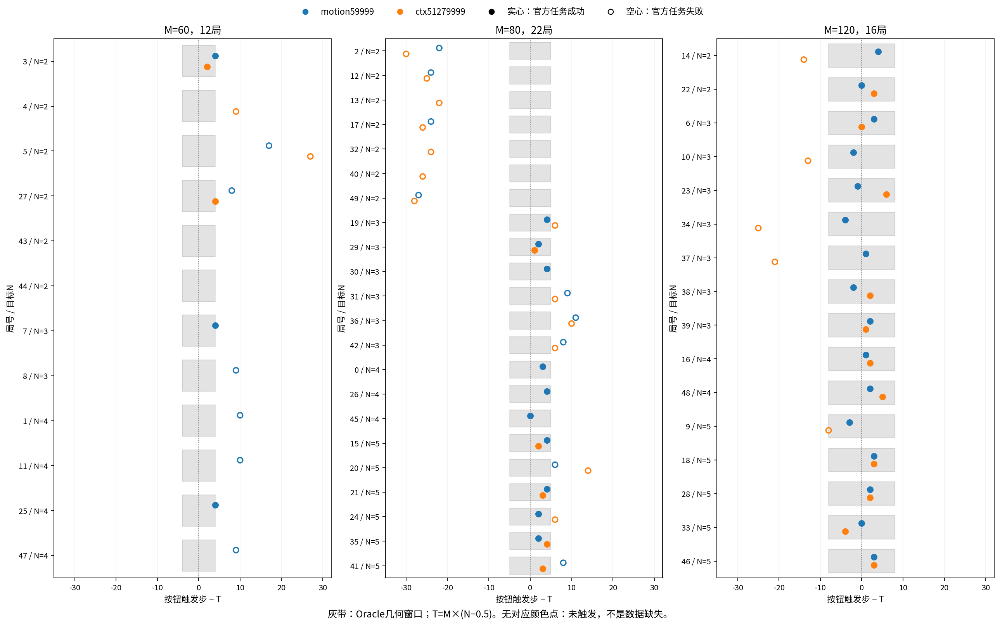
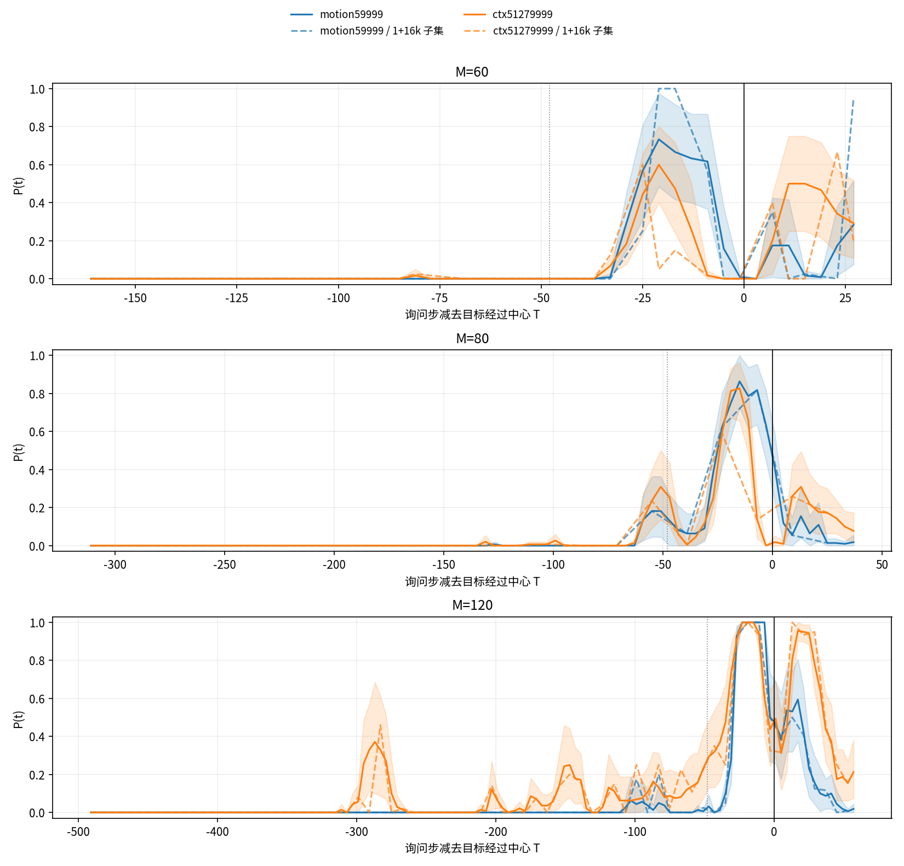

# StopCube Oracle 结果（进行中）

第一阶段已完成：两模型全部50局询问、全量输入与轨迹验收、目标高度换算、200点原输入重放、12局74次真实校准及100次固定放手运行。第二阶段已固定三局16份原输入、160份原噪声预测，正在接续分析。下方固定放手、12局校准与50局询问分别报告，不作为官方标准整局评估成绩。

## 全50局固定放手

Oracle先控制机器人悬停，再按预定时点交还模型，直至官方终局。100次运行的交还点、控制权、首次真实预测、动作与持久终态均通过验证，正常失败没有重试。基线成功18/50（36%），motion成功29/50（58%）；配对为共同成功16局、motion独有成功13局、基线独有成功2局、共同失败19局。

| 周期M | 基线79999 | motion59999 |
| --- | ---: | ---: |
| 60 | 2/12 | 3/12 |
| 80 | 5/22 | 10/22 |
| 120 | 11/16 | 16/16 |

按Oracle几何窗口分类，基线为未触发12、偏早11、区间内19、偏晚8；motion为未触发6、偏早4、区间内29、偏晚11。motion更少未按或偏早，同时偏晚更多；这些是所选检查点在该协议下的描述，不能把改善单独归因于motion。M=120的任务成功率提升与该组离线P分离度差的方向不同，也说明单一下压比例指标不能替代实际成功。

灰带仅表示Oracle悬停轨迹的几何窗口；空心点是官方失败，未出现对应颜色点表示未触发。第9局基线虽触发步532落在Oracle窗口532～548，官方仍失败：终态方块离目标约0.066994米，超出官方0.06米阈值，且`stop_timestep=null`。motion同局触发537、距离约0.022481米并成功。因此几何窗口分类与官方成功字段不能互相替代，也没有据此改判。

## 全50局的询问结果

主判据为十份预测各自前16行中是否出现目标高度低于本局悬停高度2厘米。两个模型各3730点，共7460点、74600份预测，完整字段、形状、dtype与有限性检查通过。全程动作、7臂关节、TCP、方块同步端点和两模型原始状态最大差均为0，噪声逐位一致。全部7460个原始状态的运动学高度误差为0，目标高度共换算1492000行。

| motion减基线 | 配对局数 | 均值差 | 95%局级重采样区间 |
| --- | ---: | ---: | --- |
| 决策段下压比例 | 50 | +0.06683 | [−0.00151, +0.13551] |
| 较早经过窗口下压比例 | 37 | −0.01689 | [−0.03682, −0.00068] |
| 决策段减较早窗口的分离度 | 37 | +0.13591 | [+0.06386, +0.20904] |

在具备较早窗口的37局上，motion的时间分离度更大；50局决策段比例差的区间仍跨零。前两行分母不同，不能直接相减得到第三行。1/2/3厘米、16/20行六组附指标的总体方向相同，但它们复用同一批预测，并非六次独立实验。按M分层存在异质性，M=120的主分离度差为−0.04576、区间跨零，不能说每种周期都改善。

完整曲线显示，M=60在目标前21步已有明显下压峰，两模型该点各12局，motion/基线均值为0.733/0.600；目标实际经过窗口内比例却接近0。因此经过窗口内的低值不能替代对提前准备的分析。M=120基线目标前287步的0.371峰值只有7局可用，不泛化到该周期全部16局。图中相对时刻的可用局数随位置变化，见逐点区间JSON。

汇总、局级分母及全部六组附指标见`records/query50-summary.json`、`records/sensitivity-summary.json`。完整50局的两张图已由主会话目视检查，无遮挡、重叠或缺字；大数组及完整逐点汇总留在产物根。

## 分层12局校准

| 指标 | 官方ctx512基线79999 | motion59999 |
| --- | ---: | ---: |
| 高比例点交还48步内触发 | 10/12 | 12/12 |
| 低比例点交还48步内触发 | 5/12 | 3/12 |
| 固定放手最终任务成功 | 2/12 | 6/12 |
| 早按实际校准 | 2次，其中1次48步内触发 | 0次，按规则跳过 |

`PRESS_CALIBRATION=PASS models=2 episodes=12 planned=74 completed=74 valid=74 skipped=22`。每项均核对固定交还点、Oracle前缀、模型控制权、首次预测、合法停止及同nonce持久终态。正常任务失败没有重试；22个早按项分别记录无候选或P全0原因。

低比例组在首次至多16个模型动作内，实测TCP均未比Oracle悬停高度低2cm；部分随后重新推理后才触发。高比例组对应首次动作块下压数为基线10/12、motion12/12。这支持将原判据理解为初始下压意图，不能将其直接解释为正确触发或最终成功概率。高、低及早按试验触发即停止，原始`task_success=0`不作为完整任务失败率；只有固定放手运行到官方终局。

独立只读复核逐项核对74份轨迹、收据与持久终态。低点实际触发分别在交还后37～46步（基线5次）、41～48步（motion3次），均已经执行第三次推理的动作块；高点触发也都晚于16步。固定放手配对成功为共同2局、motion独有4局、基线独有0局。这些是按M分层取最小局号的12局描述，不是随机抽样得到的全50局总体保证。

## 采集与验证

第一阶段实现固定提交为`48a52f1e083ee11777795e6d6f8dbc86056d0544`，使用干净执行工作树，本机两张A6000，输入与产物均在本机数据盘。完整规格、用户授权、命令和会话见[起跑档案](launch.md)。

50局Oracle悬停表与几何窗口全部有效，无到位过晚；真下压49/50成功。第4局实际有效窗口86～94，按钮与官方停步在95，晚1步，保留原判定、不重试。

分层12局共1480询问点、14800预测，记录无缺失、两模型原噪声逐位相同；执行动作及7臂关节、TCP、方块轨迹与Oracle差0。同期1480个原始状态运动学高度差0，并换算296000行预测目标高度。第16局4/16节奏各30公共点的输入差0、帧号一致。两模型两局首尾共8个离线点，原路径重放误差0，注意力展开路径的差异单独保留。

后续38局于美东2026-11-05约04:00全部完成、两侧退出0；集合核验于04:00:33开始并退出0，完整观测字段与轨迹有限性已经独立复核。04:01:55开始的全量高度换算复用24份已核缓存、新增76份，退出0；新增5980点与原1480点合计7460点。

两模型每局首尾各两点、合计200份原输入均完成十噪声重放，原路径最大差均为0（阈值1e-6）；两个进程均正常退出0。注意力展开路径相对原归一化动作的最大差分别为基线0.043701171875、motion0.01662825047969818，不把展开路径称为原路径逐位等价。其余38局固定放手分别于04:12:05（基线）和04:11:33（motion）起跑并退出0，新增76份与原24份固定放手证据合计100份有效。

## 解释边界与下一步

12局样本只看方向，且两模型训练来源与训练步数不同，不能把差异全部归因于motion。第二阶段将以有效固定放手成功选局，但注意力来自同局保存的Oracle询问输入及原十噪声，不代表成功闭环全过程或实际执行噪声。

早按项仅检查到位后、前N−1次实际经过窗口内的保存点，不覆盖窗口之间的提前准备期。两模型各有6局没有此类到位后候选；motion其余6局的窗口内候选P均为0。缺失保持缺失，不能据此断言没有提前下压意图；完整悬停时间曲线与窗口内统计须结合阅读。

用户完整方案呈现后原话：「同意开工了，有问题可以现在立刻问，但是之后就尽可能不要问阻塞问题。」按已批方案继续其余38局、余量允许的固定放手及限定离线分析，不替换motion或任何输入。统一停止计算时间为美东2026-11-05 08:00，缺失和失败如实报告；本任务按人工交接，未登记状态机。
