# StopCube 真实 rollout：触发时刻、注意力与进度探针

基线 ctx（官方 ctx512 79999）和 motion（59999）各自完整跑官方 StopCube 50 局，全程由模型控制。motion 成功 22/50，基线 7/50；motion 的窗口内比例高 30 个百分点，区间 [14, 44]。下压时分给 motion 的注意力有所升高，但总量只有约 0.6%，单 token 只相当于当前画面的 1.5 倍。线性探针显示，motion 输入单独读不出进度，但与文字或时间次数合用后，「离窗口还有几步」的误差明显下降，说明它带有时间和次数之外的互补信息；这个信息在第 17 层动作 token 上读不出来。这些都是相关性，不能证明因果。

判定行全部 PASS，见 [records/verification.summary.txt](records/verification.summary.txt)。起跑信息见 [launch.md](launch.md)。

## Q1：触发时刻是否在窗口内

| 分类 | 基线 ctx | motion |
| --- | ---: | ---: |
| 窗口内 | 7 | 22 |
| 偏晚 | 5 | 17 |
| 偏早 | 20 | 7 |
| 未按 | 18 | 4 |
| 官方成功 | 7 | 22 |

| 周期 M（局数） | 基线：内 / 晚 / 早 / 未按 | motion：内 / 晚 / 早 / 未按 |
| --- | --- | --- |
| 60（12 局） | 2 / 2 / 0 / 8 | 2 / 8 / 0 / 2 |
| 80（22 局） | 1 / 3 / 8 / 10 | 5 / 9 / 6 / 2 |
| 120（16 局） | 4 / 0 / 12 / 0 | 15 / 0 / 1 / 0 |

两个模型错的方式不同。基线在 M=120 主要提前按（12 局），在 M=60、80 主要不按（18 局）。motion 在 M=120 几乎都按对（15/16），在 M=60、80 主要按晚（17 局）。

配对 50 局，motion 减基线的窗口内比例差为 +0.30，局级重采样区间 [0.14, 0.44]。两边都触发的 30 局，相对窗口中心的差为 +64.7 步，区间 [32.3, 99.4]。这一轮几何窗口和官方判定完全一致，没有不一致的局。

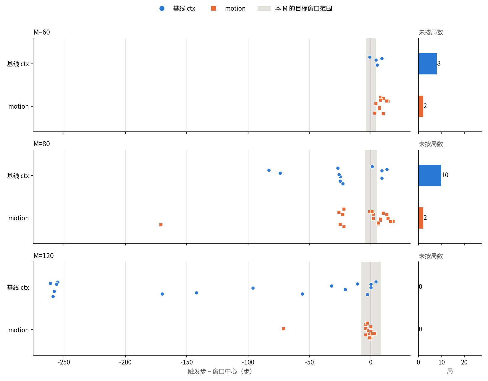

## Q2：按的那一刻有没有看 motion

对齐点按实际动作定：`I_cross` 是动作块内首次出现 TCP 低于悬停 2 cm 的那次推理，`I_trigger` 是发生按钮触发的那次推理。注意力用实际执行的噪声计算，取前 16 个动作位和 10 个去噪步的平均。下表是全部有下压的局（motion 43～46 局）的均值。

| motion 模型 | I_cross−3 | I_cross−1 | I_cross | I_trigger |
| --- | ---: | ---: | ---: | ---: |
| motion 总占比 | 0.34% | 0.41% | 0.59% | 0.74% |
| motion 单 token | 0.053% | 0.067% | 0.093% | 0.109% |
| motion token 数 | 6.0 | 6.7 | 7.2 | 7.5 |
| 实际占比 ÷ 均匀分配 | 0.56 | 0.71 | 0.99 | 1.17 |
| 单 token ÷ 当前画面 | 0.84 | 1.08 | 1.49 | 1.61 |
| 单 token ÷ 历史帧 | 18.0 | 20.9 | 23.7 | 21.4 |
| 单 token ÷ 文字 | 0.027 | 0.035 | 0.051 | 0.065 |
| 历史帧总占比 | 1.43% | 1.64% | 2.05% | 2.70% |
| 文字总占比 | 36.8% | 36.9% | 34.7% | 31.7% |

- **有上升：** 同局 `I_cross` 减 `I_cross−3`，motion 单 token 占比 +0.037 个百分点，区间 [0.022, 0.055]；同期 token 数增加 1.49 个。
- **但量很小：** 下压时 motion 只拿到约 0.6% 的注意力，和按 token 数均分差不多（比值 0.99，区间 [0.83, 1.17]）。
- **不是 motion 独有：** 历史帧也在上升，基线的历史帧同样从 0.24% 升到 0.35%、0.57%；文字占比下降在两个模型里都有。
- **覆盖方块经过时段的窗口：** 这类窗口的单 token 占比高于其他窗口。`I_cross` 处为 0.126% 对 0.064%，差 0.062 个百分点，区间 [0.039, 0.092]。这里没有控制窗口的新旧。
- **看 motion 多不等于按得准：** `I_cross` 处单 token 占比为窗口内 0.081%、偏晚 0.097%、偏早 0.118%；偏早局只有约 2 个 token，token 数差别很大。未按的 4 局 `I_near` 为 0.055%。

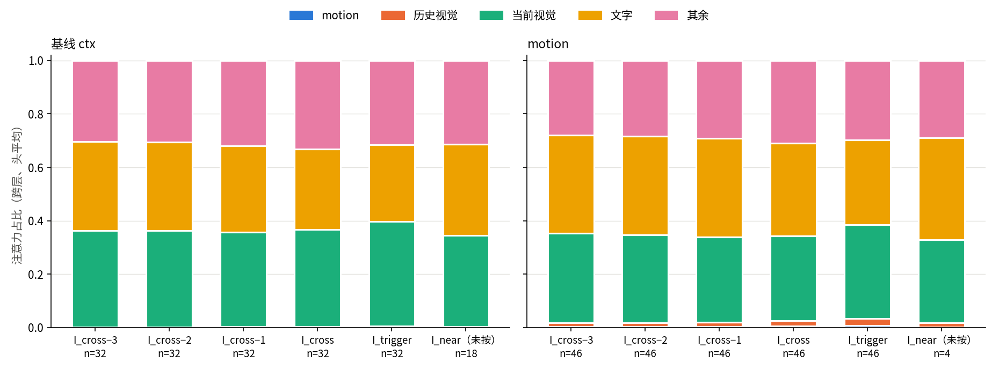

### 头

144 个头都统计了。单头差异小于 0.01 与数值波动同量级，不解读。

| 候选头 | 模型 | 读什么 | I_cross−3 | I_cross−1 | I_cross | I_trigger |
| --- | --- | --- | ---: | ---: | ---: | ---: |
| L13H6 | motion | motion | 0.4% | 3.3% | 5.2% | 0.9% |
| L13H6 | motion | 文字 | 70.6% | 73.0% | 50.4% | 36.1% |
| L13H6 | motion | 动作 token | 10.6% | 7.9% | 36.4% | 55.3% |
| L13H6 | 基线 | 文字 | 74.6% | 70.5% | 46.1% | 52.6% |
| L13H6 | 基线 | 动作 token | 9.9% | 13.6% | 41.9% | 38.2% |
| L15H1 | motion | motion | 4.3% | 4.6% | 5.8% | 3.4% |
| L16H0 | motion | 历史帧 | 45.9% | 59.5% | 73.3% | 70.4% |
| L16H0 | 基线 | 历史帧 | 4.3% | 7.1% | 7.8% | 9.7% |
| L16H0 | 基线 | 当前画面 | 61.3% | 78.6% | 86.5% | 83.4% |

- **没有单一的 motion 头：** `I_cross` 处 motion 占比最大的头，在 46 局里分别是 L13H6 13 局、L15H1 11 局、L14H0 10 局，L16H0 4 局，其余分散。
- **L13H6 读 motion 的量不大：** `I_cross` 均值 5.2%（区间 2.9%～7.9%），到 `I_trigger` 回落到 0.9%。
- **L13H6 从文字转向动作 token，两个模型都有：** 所以这不是 motion 特有的。
- **L16H0 的模型差异最稳定：** motion 这个头以历史帧为主（73%），基线以当前画面为主（87%）。两个模型的同编号头不一定功能相同。

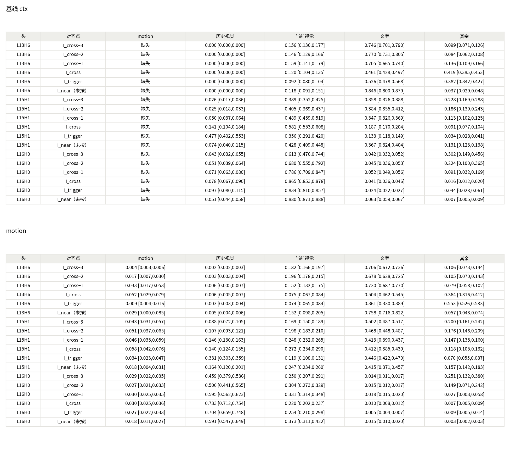

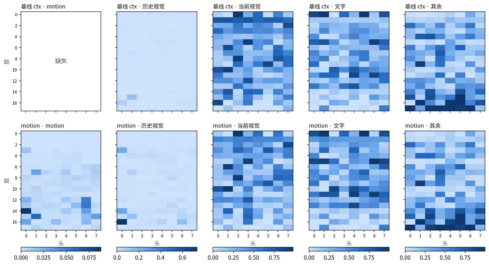

### 想按比例 P

P 是每次推理用 10 份独立噪声走原路径算出的预测里，前 16 行低于悬停 2 cm 的比例，这些预测不执行。下图的相对触发步坐标里，两个模型都是在触发前约 30 步才升高，之前的中位数都是 0。

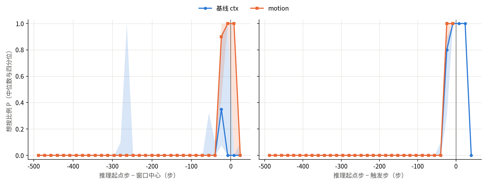

## Q3、Q4：模型知不知道还有几步

第 17 层动作 token 是预先定的主读数。所有数字都是按局 5 折的折外结果，每局等权。

| 模型 | 标签 | 局/样本 | 第 17 层动作 MAE / R² | 时间基线 MAE / R² | 第 0 层拼接 MAE / R² | 主读数−时间基线 MAE 差 |
| --- | --- | --- | --- | --- | --- | --- |
| 基线 | Q3 离自己按 | 32/326 | 35.4 / 0.51 | 41.3 / 0.46 | 33.3 / 0.62 | −5.9 [−11.5, −0.4] |
| 基线 | Q4 离窗口 | 50/561 | 73.3 / 0.40 | 60.6 / 0.62 | 67.0 / 0.51 | +12.8 [2.1, 24.0] |
| motion | Q3 离自己按 | 46/616 | 55.2 / 0.43 | 51.8 / 0.54 | 42.5 / 0.67 | +3.4 [−7.9, 14.6] |
| motion | Q4 离窗口 | 49/640 | 60.5 / 0.34 | 52.3 / 0.55 | 31.7 / 0.83 | +8.2 [−3.2, 20.7] |

- **主读数基本没有超过时间基线：** 只有基线的 Q3 小幅优于时间基线（约 6 步）。其余三项都不优于时间基线，基线 Q4 还明显更差。
- **主读数也不优于第 0 层输入：** 四项的点估计都是第 0 层拼接的 MAE 更小，但只有 motion 两项的区间不含 0：Q3 多错 12.8 步，区间 [0.8, 23.6]；Q4 多错 28.7 步，区间 [21.0, 37.9]。基线两项的区间都含 0。
- **逐层看：** 动作 token 的最小 MAE 出现在中段（基线 Q3 第 4 层 32.9，motion Q3 第 9 层 49.8，motion Q4 第 7 层 51.4），之后不再变好，没有看到越深越准的趋势。这些层是事后在同一批折外结果上挑的，没有区间，不作结论。

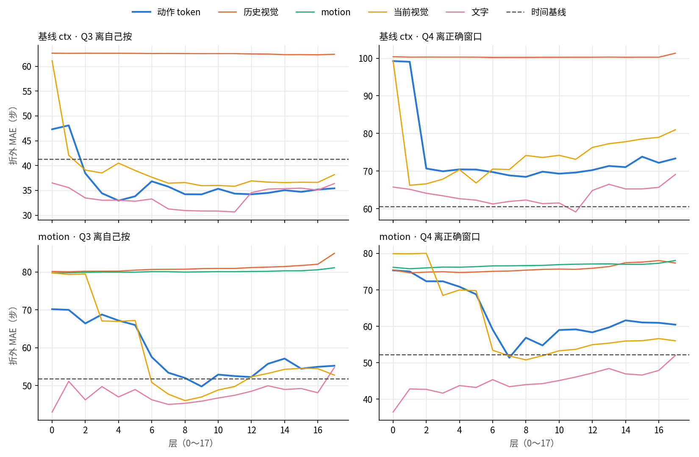

下面两张图把同一批结果换成相对时间基线的读法，0 以上表示比只用时间和次数更好。

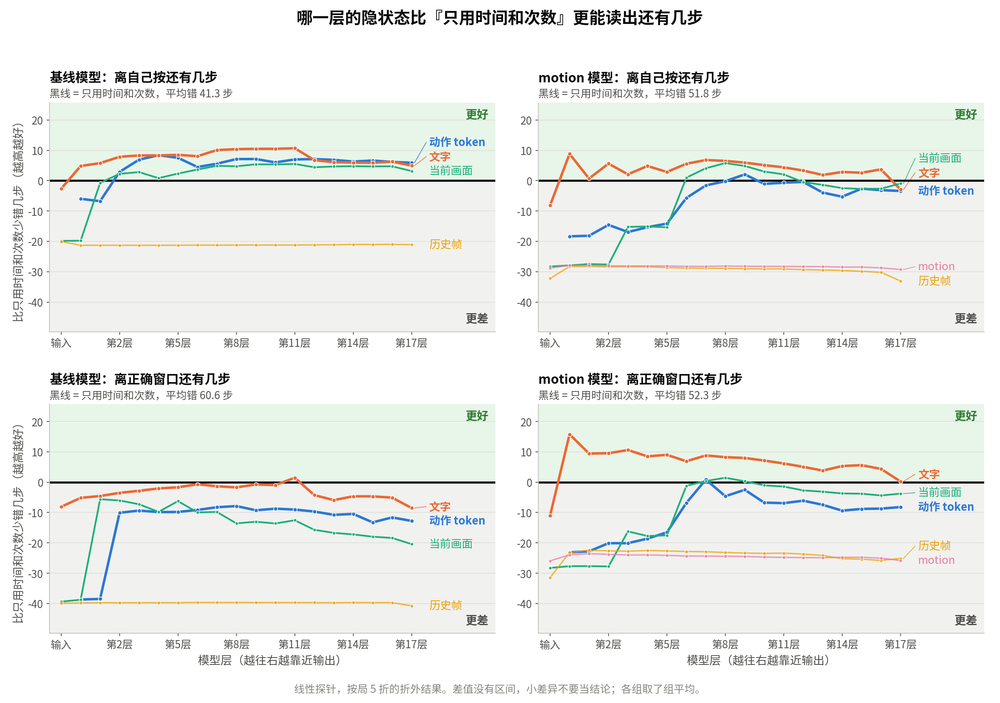

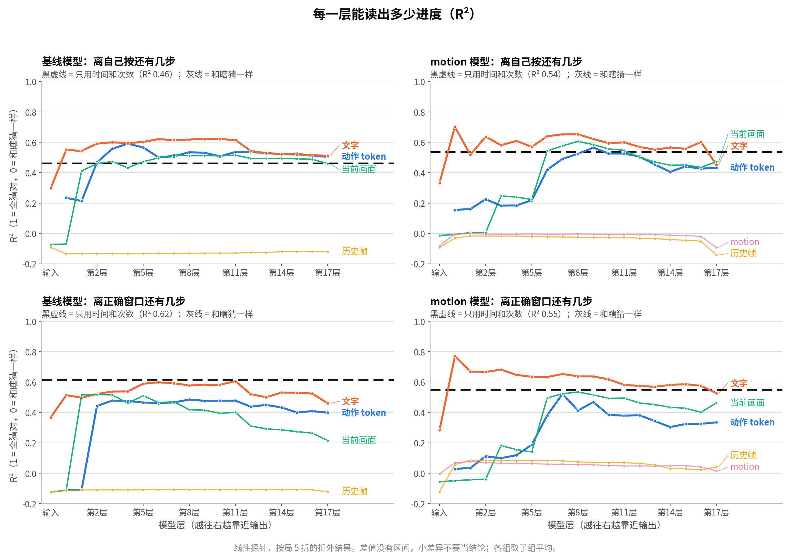

下面两张图只用 R²。第一张在上图基础上加了「只用时间」的细点线。第二张是第 17 层各组的折外预测对真值，彩色粗线是每局等权的拟合直线，灰线是猜对的位置；R² 来自 `records/fit-summary.json`，其中 22 项和 `records/probe-summary.json` 相同。第 17 层是固定选择，看不到文字组在第 0 层的高点，这个高点看第一张图。

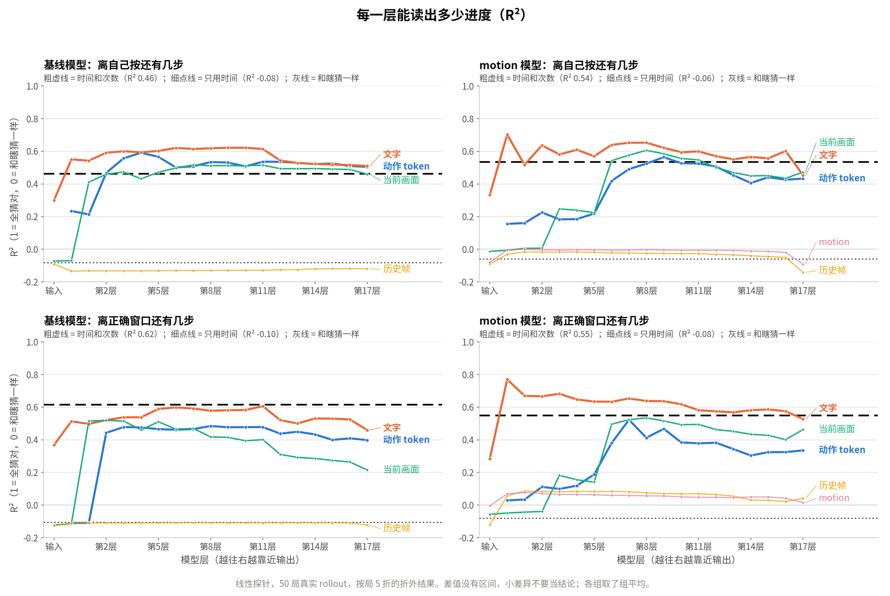

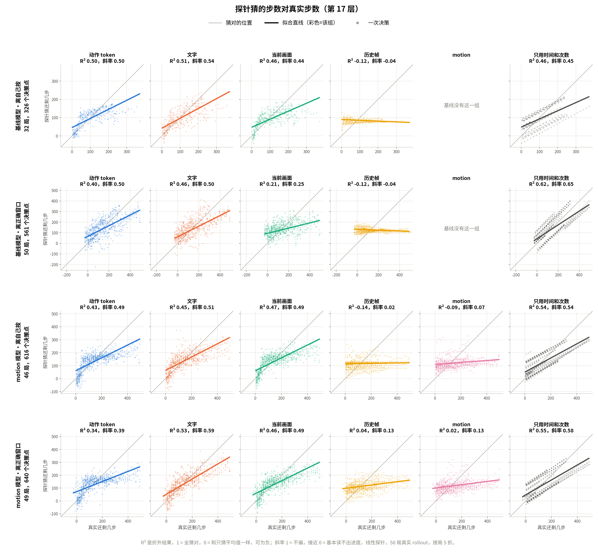

下面两张图只看 Q4（离正确窗口）。第二张把两个模型的第 17 层画在同一格里对比；两个模型走出的轨迹不同，决策点不是同一批，差值没有区间。

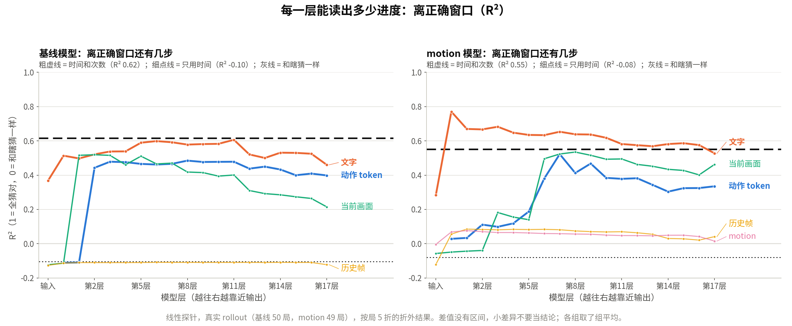

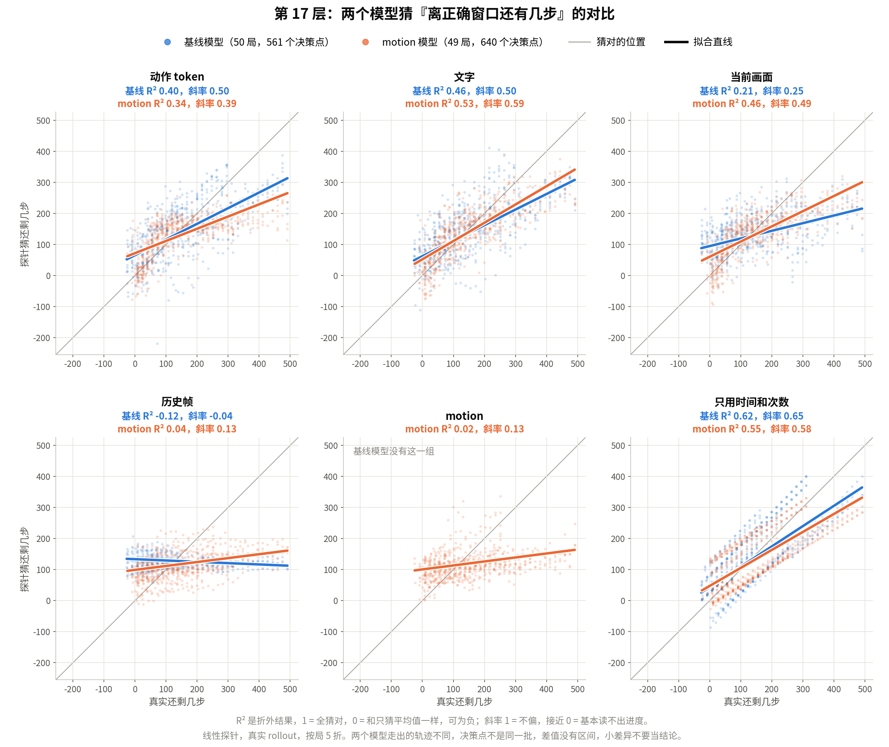

### 同位置配对：回归换算成分类

下面两张图没有训练分类探针，只把第 17 层 Q4 回归的折外预测用真实 M、N 换算成类别：0 < y ≤ M 判为该按，ceil(y/M) 是剩余次数，N 减剩余次数是已过次数。配对取同一局内方块 xy 相差不超过 2 cm、TCP 相差不超过 1 cm 且标签不同的决策点，容差由用户指定，没有逐张比对画面。已过次数基线 155 对 28 局、motion 277 对 27 局；该不该按基线 73 对 17 局、motion 146 对 26 局。结果见 `records/class-derived.json`，脚本 `records/diagnostics/derive_class.py`。

换算结果没有明显超过只用时间和次数：该不该按的配对准确率，基线最高 0.46（时间和次数 0.40），motion 最高 0.48（时间和次数 0.54），区间都很宽。这个结果既可能低估分类能力（回归不是为分类训练的，还往中间收缩），也借用了探针没读到的 M、N，所以不能回答隐状态里能否分清。

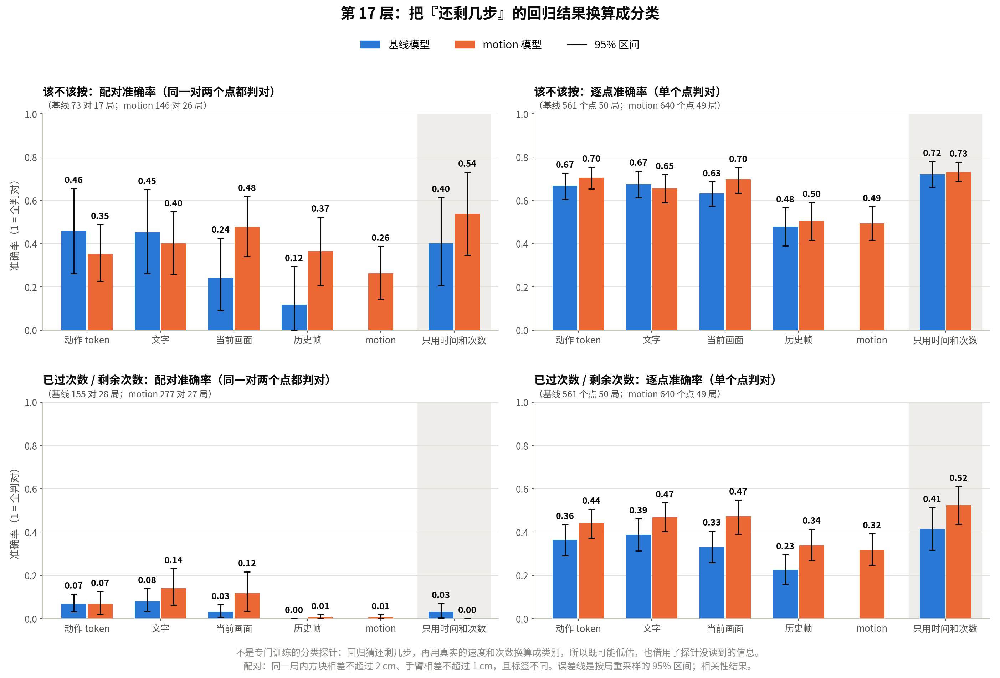

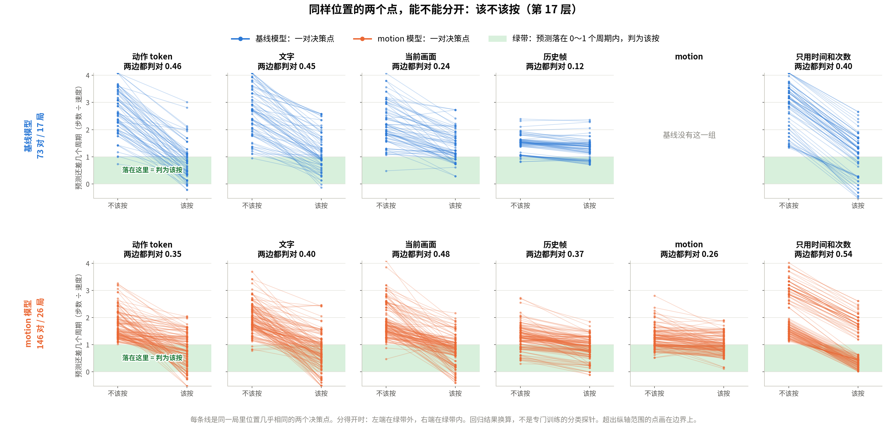

用户随后要求看所有层。原分析每层只留了 R²，没留折外预测，所以按同样的折和 λ 选择重算了 169 次回归（CPU，没有新增推理），再做同样的换算。回归训练时不知道配对和分类目标。每层 R² 与 `records/probe-summary.json` 相同，第 17 层换算结果与 `records/class-derived.json` 相同，配对数不变（`CLASS_LAYERS=PASS`）。结果见 `records/class-layers.json`，脚本 `records/diagnostics/derive_class_layers.py`。

第 17 层不是换算结果最好的层，中间层普遍更高，但最高点是事后挑的，没有校正多重比较，只作描述：

| 配对准确率（事后挑的最高层） | 基线 | motion 模型 |
| --- | ---: | ---: |
| 该不该按：只用时间和次数 | 0.40 [0.21, 0.61] | 0.54 [0.35, 0.73] |
| 该不该按：最高组 | 动作 token 第 12 层 0.60 [0.39, 0.81] | 当前画面第 6 层 0.65 [0.53, 0.76] |
| 已过次数：只用时间和次数 | 0.03 [0.00, 0.07] | 0.00 [0.00, 0.00] |
| 已过次数：最高组 | 文字第 11 层 0.13 [0.04, 0.25] | 文字第 0 层 0.23 [0.12, 0.34] |

该不该按的区间都和时间次数重叠。已过次数在 motion 模型上高于时间次数，区间不重叠，但绝对值仍低，每层也都没有校正。逐点准确率几乎没有超过时间次数的层，只有文字组在少数层略高（该不该按最高 0.75 对 0.73，已过次数最高 0.57 对 0.52）。motion 模型的历史帧从输入 0.12 升到第 1 层 0.54，基线的历史帧一直约 0.12；两个模型的配对不是同一批，这个差别只作描述，也没有测信息流量。

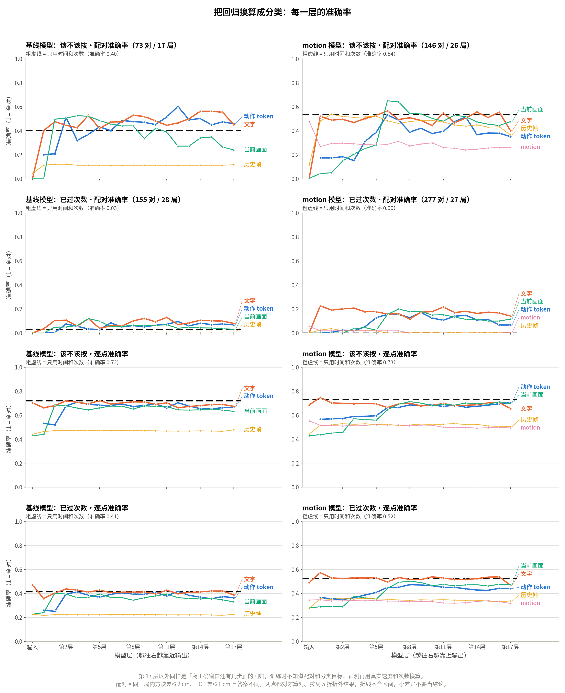

### motion 输入带有互补的进度信息

下表是计划外的事后分解，只用已有隐状态和同一折划分，没有新增推理，见 `records/probe-decompose.json`、`records/probe-decompose-ci.json`。

| 第 0 层输入（Q4 离正确窗口） | motion 模型 MAE / R² | 基线 MAE / R² |
| --- | ---: | ---: |
| 时间基线 `[t,N]` | 52.3 / 0.55 | 60.6 / 0.62 |
| 文字 | 63.3 / 0.28 | 68.7 / 0.37 |
| 文字 + 历史帧 | 58.5 / 0.46 | 67.4 / 0.49 |
| 文字 + 当前画面 | 59.3 / 0.36 | 69.9 / 0.33 |
| motion 单独 | 78.2 / 0.00 | 无 |
| 文字 + motion | **31.1 / 0.85** | 无 |
| `[t,N]` + motion | 36.2 / 0.80 | 无 |

| 相对时间基线的 MAE 差（motion 模型，局级区间） | Q4 离窗口 | Q3 离自己按 |
| --- | ---: | ---: |
| 文字 + motion | −21.1 [−29.4, −12.8] | −4.7 [−17.5, 8.2] |
| `[t,N]` + motion | −16.1 [−25.8, −6.2] | −2.0 [−13.1, 8.9] |
| 文字 + 历史帧 | +6.2 [−2.3, 14.6] | +5.4 [−3.9, 15.4] |
| motion 单独 | +25.9 [13.1, 39.2] | +28.8 [13.4, 44.7] |

motion 组单独读不出（R²≈0），和文字或时间次数合用后，Q4 的误差才明显下降，所以这是互补信息，不是 motion 自身可解码。文字 + motion 比文字 + 历史帧少错 27.3 步，区间 [17.0, 37.4]。Q3 上没有这种提升。基线的全部拼接在 Q4 上不优于时间基线（+6.4 [−2.8, 15.9]），在 Q3 上优于时间基线（−8.0 [−14.9, −1.0]）。

Q4 等于 `M×(N−0.5) − t`，缺少的信息可能包括方块周期 M，也可能是方块相位或其他信息。这次没有解码 M，无法区分。线性探针里 M 和 N 只能相加，标签却含乘积项，所以即使 motion 携带 M 也未必能完整读出。

文字组经过第 0 层之后也能读出类似的信息（motion Q4 MAE 36.5，基线 65.7），而文字输入本身不含它（63.3）。代码允许文字 token 在第 0 层读记忆，所以这与「信息从 motion 流入文字」相容，但没有测流量，也没有证明模型用了它：到第 17 层时文字组已退回 MAE 52.0，第 17 层动作 token 是 60.5。

### 对问题的回答

- **模型知不知道离正确窗口还有几步：** motion 模型把文字和 motion 输入合用时可以线性解码，MAE 比时间基线低 21.1 步，区间 [12.8, 29.4]，这是事后分解。基线模型在 Q4 上未超过时间基线，但拼接维度不同，跨模型只作描述。预先定的主读数读不出来，所以还不能说模型在决策时用了它。
- **模型知不知道离自己按还有几步：** 主读数不优于第 0 层输入，motion 模型也不优于时间基线，没有看到超过输入的自身进度信息。线性探针读不出非线性编码，这不等于模型没有预期。

打乱标签的 R² 最高 0.335，超过警告线 0.1。这是因为打乱时没有打乱时间 `t`；同一份打乱标签上时间基线的 R² 最高达到 0.38～0.56，比探针更高，这和时间泄漏的水平相符，没有发现过拟合证据。折内同局泄漏为 0，正则系数在训练折内部嵌套选择。

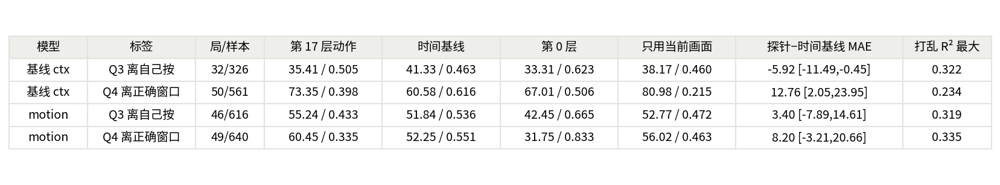

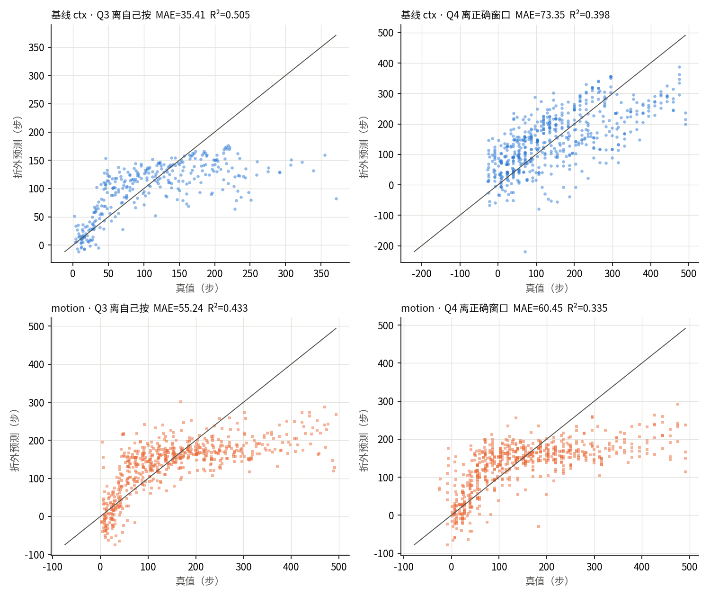

## 运行与验证

正式 rollout 两边各 50 局全部有终局，没有基础设施重试；1527 次推理全部有记录。全部推理的原路径重放误差都是 0。方块与窗口表差异为 0。

| 模型 | 成功 | 推理 | 展开路径动作差 中位 / p99 / 最大 | 对齐点最大 |
| --- | ---: | ---: | --- | ---: |
| 基线 | 7/50 | 721 | 0.0027 / 0.012 / 1.63 | 0.022 |
| motion | 22/50 | 806 | 0.0029 / 0.0078 / 0.062 | 0.062 |

基线的 1.63 只出现在第 5 局第 3 次推理（第 49 步，正在到位，这局没有按），差异超过 0.1 的仅此一点，不是对齐点。

## 实施中调整

| 调整 | 旧→新 | 依据 |
| --- | --- | --- |
| 到位阈值 | 1 cm → 1.5 cm | 模型实际悬停高于 `z_hover`，1 cm 把 3 局误判到第 197～321 步；`ADJUST_REVIEW=PASS scale=same findings=3` |
| 窗口核对 | 未覆盖步跳过 → 窗口内未覆盖或一步没比到记不符局 | W3 审查阻塞项，属于收紧 |
| `HIDDEN_PARITY` | 逐位 → 动作≤0.02、单头≤0.005、总质量≤0.001、motion 相对差≤10% → 单头≤0.02（最终值） | bf16 下开关捕获动作差 0.00195，f32 下约 1.2e-7，说明逻辑不变；两次 `ADJUST_REVIEW=PASS scale=same` |
| 启动方式与顺序 | 运行子代理启动 → 主会话启动；W5 合并前先冒烟 | 冒烟结果立即要用，监听归主会话 |
| 探针分解 | 计划外新增 | 第 0 层拼接异常强，需要拆开才能回答问题；只用已有隐状态 |

放宽 `HIDDEN_PARITY` 不影响结论：总质量差最大 0.00038，比分析尺度小两到三个量级，原路径重放 1e-6 没有放宽。

## 解释边界

- **模型差异：** 两个模型训练来源和步数不同，只有一个模型 seed、一次运行和固定 50 局，差异不能全部归因于 motion。统计单位是局，不是推理。
- **注意力：** 只看动作 token 的直接读取，不覆盖跨层间接路径。
- **探针：** 只说明可解码，不说明模型使用了这些信息；跨模型比较的共同局见 `probe-summary.json`（第 17 层动作 token，motion 减基线：Q4 −11.7 [−22.1, −0.2]，Q3 +27.3 [16.9, 38.2]），只作描述；约 600 个样本、维度上千，线性探针也读不出非线性编码。样本在模型按下后就终止，偏早局没有窗口附近的样本。
- **时间分辨率：** 每 16 步一次推理，决策的准确时点可能夹在两次推理之间。
- **输入分解：** 第 0 层按组取平均，会丢失单 token 细节；拼接维度随组数变化，比较时混入特征维度和岭回归容量的影响，跨模型只作描述。
- **精度：** 模型运行在 bfloat16，注意力和隐状态取自开启捕获的那次运行。`HIDDEN_PRECISION` 补测里，motion 后段 3 点判 `FAIL`（历史帧和当前画面组的点间距离只有误差的约 8 倍，未达 10 倍）；按「点间距离中位数 ÷ 最大误差」算，主读数约 200 倍、motion 组约 120 倍。这两组的逐层曲线和第 0 层对照要谨慎读。
- **事后分析：** 探针分解和最小 MAE 层都是看到数据后才做的，区间没有校正多重比较。
- **`motion_rel` 覆盖：** 全量每局只比较第 1 次推理，那时还没有 motion token，所以全量的 `motion_rel_maxabs=null`；这一项只在第 16 局冒烟测过（26 点，最大 0.15%）。
- **未到位的局：** motion 第 44 局从未进入 1.5 cm 到位带，第 122 步结束且未按，所以不进探针样本（Q4 为 49 局）。原因未查。

## 下一步

这些相关性要变成因果，需要干预实验，本轮没有做。是否继续，待用户决定。

## 人工交接

本轮 tmux 会话全部自然退出，没有在跑的模型进程，没有操作其他用户的进程或会话。原始数组、轨迹和视频留在 `v1-store/evaluation/stopcube-rollout-1105/`，约 8.8 GB。干净执行树 `v1-store/worktrees/stopcube-rollout-run` 保留，供原命令复现。任务按人工交接完成，未写状态机，也不据此开启其他任务。
