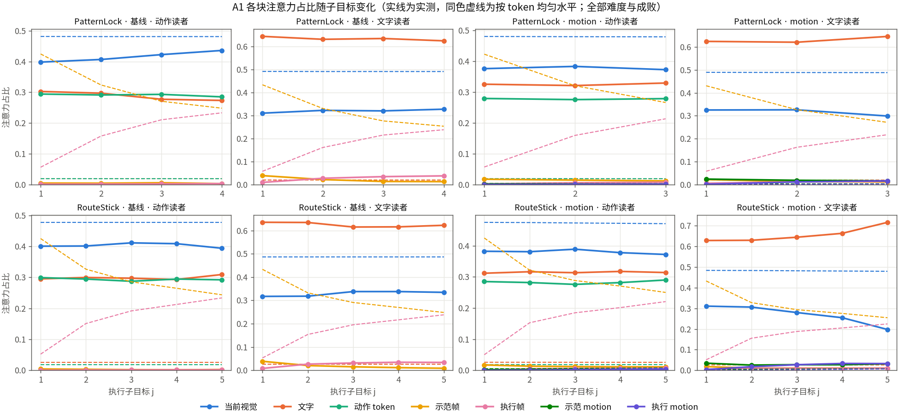
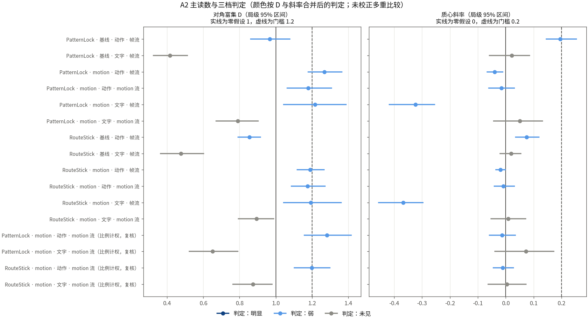
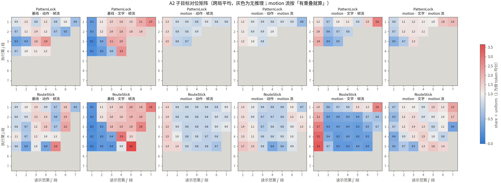
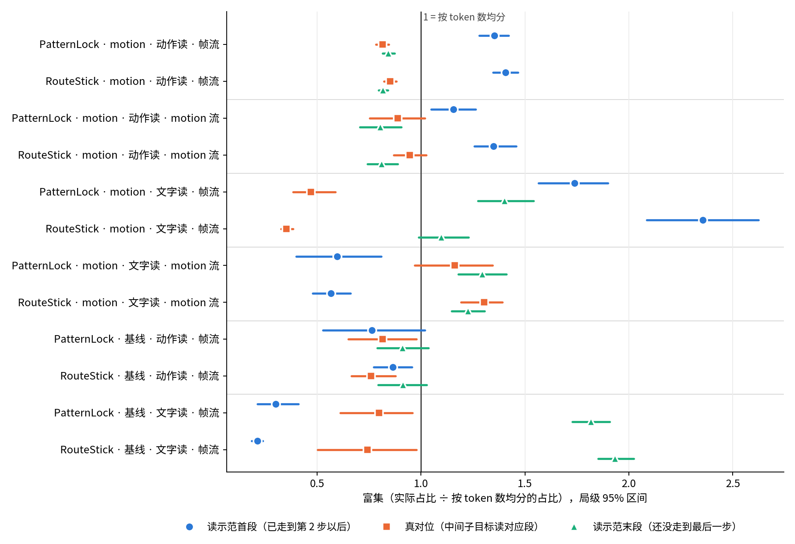
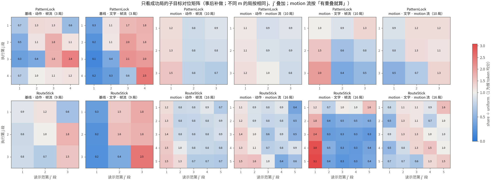
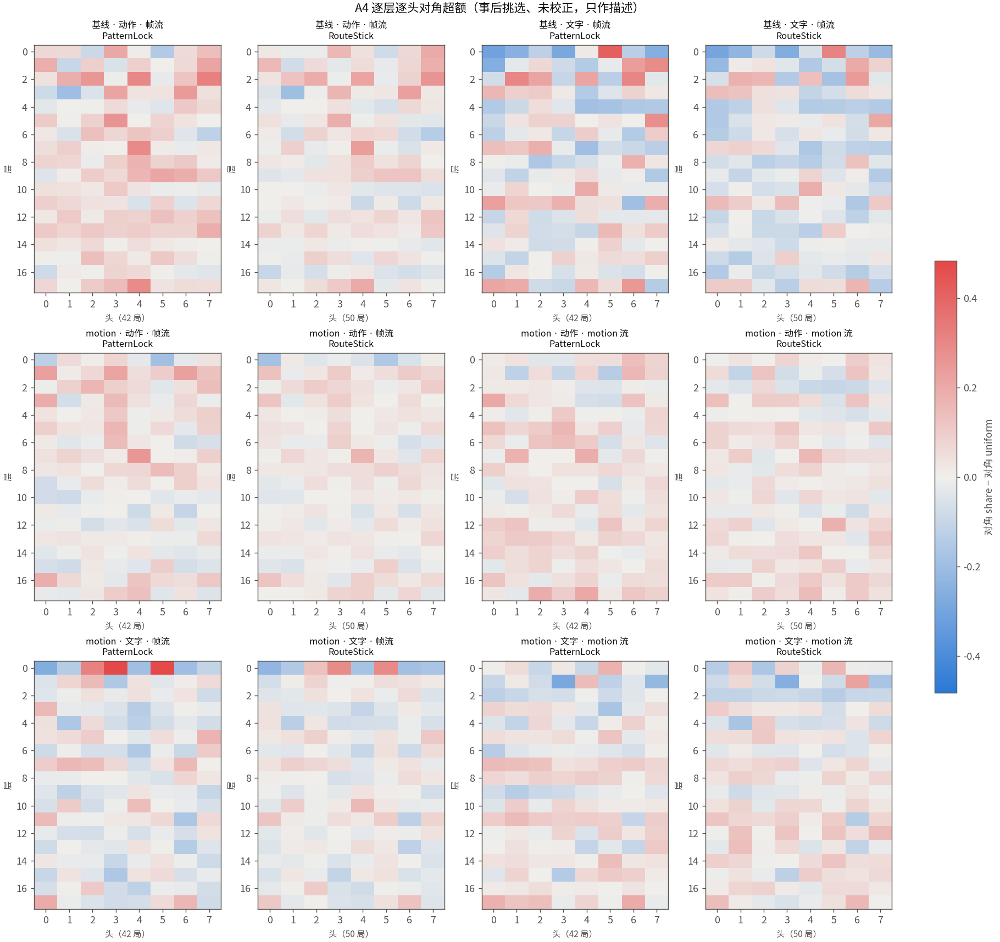
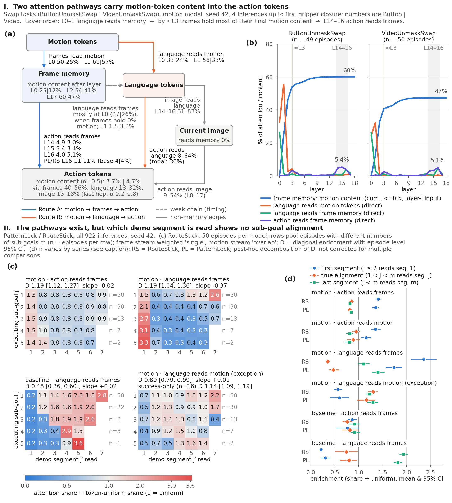

# PatternLock、RouteStick 按子目标的真实 rollout 注意力

两个模型各跑两任务官方 50 局，共 200 局、922 次推理，全部推理都算了注意力，并按 simulator 的 `current_task_index` 分组。**没有看到「走到第 j 步就读示范第 j 步」的对位：12 组主读数没有一组达到预先定的「明显」。** motion 模型的动作读帧、动作读 motion、文字读帧这三条，不管走到第几步都偏向**示范开头**；文字读 motion 是例外，偏向示范后部。基线的文字读帧偏向**示范末尾**。motion 回看开头与 Swap 那轮方向相同（两轮「开头」的定义不同），但它和走没走对的关系这里分不开。注意力只说明看了哪里，不能证明因果。

计划见 [1106-patternlock-routestick-subgoal-attention-plan.html](../../../1106-patternlock-routestick-subgoal-attention-plan.html)，起跑信息见 [launch.md](launch.md)，判定行见 [records/verification.summary.txt](records/verification.summary.txt)。

## 成绩

| 模型 | PatternLock | RouteStick | 合计 |
| --- | ---: | ---: | ---: |
| motion | 18/50 | 16/50 | 34/100 |
| 基线 | 9/50 | 9/50 | 18/100 |

都走原采样路径，无效局 0，基础设施重试 0。motion 的 16/50 与官方 800 局 seed 42 的 RouteStick 32% 相同；PatternLock 官方是 34%（17/50），这里 18/50。

多数局在第一个子目标就失败了，所以后面的子目标样本很少：

| 任务 · 模型 | m≥2 的局 | 第 1 个子目标就失败 | 走到第 2 个及以后 | 各子目标的推理数（j=1、2、3、4、5） |
| --- | ---: | ---: | ---: | --- |
| PatternLock · motion | 42 | 28 | 14 | 112、30、11 |
| PatternLock · 基线 | 42 | 29 | 13 | 113、31、4、2 |
| RouteStick · motion | 50 | 20 | 30 | 153、118、41、22、8 |
| RouteStick · 基线 | 50 | 28 | 22 | 159、80、25、10、3 |

## A1：注意力分给了哪几块

第 1 个子目标的占比（%），其他子目标接近，见下图。括号是按 token 数均分的水平。

| 读者 · 模型（RouteStick） | 当前画面 | 文字 | 动作 token | 示范帧（均分） | 执行帧 | 示范 motion（均分） | 执行 motion |
| --- | ---: | ---: | ---: | ---: | ---: | ---: | ---: |
| 动作 · motion | 38.2 | 31.2 | 28.5 | 1.73（42.5） | 0.15 | 0.22（0.5） | 0.01 |
| 动作 · 基线 | 40.1 | 29.5 | 29.9 | 0.45（42.5） | 0.03 | 无 | 无 |
| 文字 · motion | 31.1 | 62.9 | 0 | 1.81（43.3） | 0.40 | 3.46（0.5） | 0.39 |
| 文字 · 基线 | 31.7 | 63.5 | 0 | 3.89（43.3） | 0.84 | 无 | 无 |

PatternLock 除文字读 motion（见下）外数字相近。

- **直接读记忆的量很小：** 动作读示范帧，motion 模型约 1.7%，基线约 0.45%。其余九成多在当前画面、文字和动作 token 上。
- **文字读 motion 远高于均分：** RouteStick 3.46% 对 0.54%，约 6.4 倍；PatternLock 2.33% 对 0.31%，约 7.5 倍。

## A2：是否按子目标对位（主读数）

判据在跑数据之前写定：对角富集 D 的区间下界 ≥ 1.2，或质心斜率的区间下界 ≥ 0.2，算「明显」。局级重采样 2000 次，12 组未校正多重比较。

| 任务 | 模型 · 读者 · 流 | D [95% 区间] | 斜率 [95% 区间] | 判定 |
| --- | --- | ---: | ---: | --- |
| PatternLock | motion · 动作 · 帧 | 1.27 [1.18, 1.36] | -0.04 [-0.07, -0.01] | 弱 |
| PatternLock | motion · 动作 · motion | 1.18 [1.06, 1.31] | -0.02 [-0.06, 0.03] | 弱 |
| PatternLock | motion · 文字 · 帧 | 1.22 [1.04, 1.39] | -0.32 [-0.42, -0.25] | 弱 |
| PatternLock | motion · 文字 · motion | 0.79 [0.67, 0.90] | 0.05 [-0.04, 0.13] | 未见 |
| PatternLock | 基线 · 动作 · 帧 | 0.97 [0.86, 1.08] | 0.20 [0.15, 0.25] | 弱 |
| PatternLock | 基线 · 文字 · 帧 | 0.42 [0.32, 0.51] | 0.02 [-0.06, 0.08] | 未见 |
| RouteStick | motion · 动作 · 帧 | 1.19 [1.12, 1.27] | -0.02 [-0.03, -0.00] | 弱 |
| RouteStick | motion · 动作 · motion | 1.17 [1.09, 1.27] | -0.01 [-0.04, 0.03] | 弱 |
| RouteStick | motion · 文字 · 帧 | 1.19 [1.04, 1.36] | -0.37 [-0.46, -0.30] | 弱 |
| RouteStick | motion · 文字 · motion | 0.89 [0.79, 0.99] | 0.01 [-0.05, 0.07] | 未见 |
| RouteStick | 基线 · 动作 · 帧 | 0.86 [0.79, 0.91] | 0.08 [0.04, 0.12] | 弱 |
| RouteStick | 基线 · 文字 · 帧 | 0.48 [0.36, 0.60] | 0.02 [-0.02, 0.05] | 未见 |

明显 0 组，弱 8 组，未见 4 组。没有共同 pattern。这 8 个「弱」方向并不相同：motion 的 6 个来自 D>1，斜率为负或约 0；基线动作读帧的 2 个只来自正斜率，D 不高于均匀，这也更像读末段（见下面拆解，真对位 0.82、0.76）。比例计权的复核结果方向相同（如 PatternLock motion 动作读 motion 1.28、文字读 motion 0.65）。

斜率的分母只含走到第 2 个子目标以后的局（13～30 局）。局内打乱的零假设约为 0，按 token 均匀水平算出的斜率也在 ±0.01 内，所以记忆采样本身不带斜率。

矩阵如果有对位，应该出现一条对角线。实际看到的是：motion 模型帧流和动作读 motion 的第 1 列整列偏高（文字读 motion 的第 1 列反而偏低）；基线的文字最右几列偏高。

### D 为什么大于 1：拆开看（事后补做的描述）

这一节是看到矩阵之后才加的，没有写进预定判据，未校正多重比较。脚本 [decompose_first_last.py](records/decompose_first_last.py)，数值 [decompose.json](records/decompose.json)。

- **读首段：** 已走到第 2 个子目标以后，仍读示范第 1 段。这时第 1 段不在对角上。
- **真对位：** 走中间的子目标时读示范对应段，首尾段都不算。只有这一项能排除「偏爱首段或末段」。
- **读末段：** 还没走到最后一步，就读示范最后一段。

| 任务 | 模型 · 读者 · 流 | 读首段 | 真对位 | 读末段 |
| --- | --- | ---: | ---: | ---: |
| PatternLock | motion · 动作 · 帧 | 1.35 [1.28, 1.42] | 0.81 [0.78, 0.85] | 0.84 [0.81, 0.87] |
| RouteStick | motion · 动作 · 帧 | 1.41 [1.35, 1.47] | 0.85 [0.82, 0.88] | 0.82 [0.80, 0.84] |
| PatternLock | motion · 动作 · motion | 1.16 [1.05, 1.26] | 0.89 [0.75, 1.02] | 0.80 [0.71, 0.91] |
| RouteStick | motion · 动作 · motion | 1.35 [1.26, 1.46] | 0.95 [0.87, 1.03] | 0.81 [0.74, 0.89] |
| PatternLock | motion · 文字 · 帧 | 1.74 [1.56, 1.90] | 0.47 [0.38, 0.59] | 1.40 [1.27, 1.54] |
| RouteStick | motion · 文字 · 帧 | 2.36 [2.09, 2.62] | 0.35 [0.33, 0.38] | 1.10 [0.99, 1.23] |
| PatternLock | motion · 文字 · motion | 0.60 [0.40, 0.81] | 1.16 [0.97, 1.34] | 1.29 [1.18, 1.41] |
| RouteStick | motion · 文字 · motion | 0.57 [0.48, 0.66] | 1.30 [1.19, 1.39] | 1.23 [1.15, 1.31] |
| PatternLock | 基线 · 动作 · 帧 | 0.76 [0.53, 1.02] | 0.82 [0.65, 0.98] | 0.91 [0.79, 1.03] |
| RouteStick | 基线 · 动作 · 帧 | 0.87 [0.77, 0.96] | 0.76 [0.66, 0.88] | 0.91 [0.79, 1.03] |
| PatternLock | 基线 · 文字 · 帧 | 0.30 [0.21, 0.41] | 0.80 [0.61, 0.96] | 1.82 [1.73, 1.91] |
| RouteStick | 基线 · 文字 · 帧 | 0.21 [0.19, 0.24] | 0.74 [0.50, 0.98] | 1.93 [1.85, 2.02] |

- **motion 模型 D>1 主要来自读首段：** 动作读帧的 D 按子目标拆开，第 1 个子目标 1.36、1.42，第 2 个及以后都在 0.7～0.83。多数局只走到第 1 个子目标，所以这一格撑起了 D。
- **帧流没有对位：** motion 模型的真对位在动作、文字两个读者上都低于均匀；基线也都低于均匀。
- **文字读帧的负斜率：** 走得越后，读的位置越靠前（-0.32、-0.37），和「一直读开头」相符，方向与对位相反。
- **两个模型读的位置相反：** motion 的文字读首段（1.74、2.36），基线的文字读末段（1.82、1.93）、几乎不读首段（0.30、0.21）。矩阵里基线大 j 处的「对角线」，主要是第 j 段恰好是最后一段。

### 唯一值得再查的线索

motion 模型文字读 motion 流，在 RouteStick 上真对位 1.30 [1.19, 1.39]，矩阵第 3～5 行的峰值也沿对角走（1.4、1.5、1.6）。但这条证据不够强：

- 读末段同样高（1.23），分不开是对位还是偏爱后半段。
- 斜率 0.01 [-0.05, 0.07]，读的位置不随进度变。
- 后面几行样本很少（走到第 3、4、5 个子目标的分别是 13、7、2 局），第 3 行对角 1.38 与相邻格 1.31 也差不多。PatternLock 上区间含 1。
- 这一格的预定判定是「未见」（D 0.89 [0.79, 0.99]），线索来自事后拆解。

这里只作线索，不算结论。

### 只看成功局（事后补做的描述）

用户原话（美东 2026-11-06）：「如果只看成功的任务呢」

成功局都走完了全部子目标，每个 j 的样本结构一致，所以没有「多数局只走到第 1 步」的偏差。代价是样本少、偏 easy，且按结局筛选本身有选择偏差。脚本 [success_only.py](records/success_only.py)，数值 [success-only.json](records/success-only.json)。判定沿用同一规则，但没有预先写入判据，未校正多重比较，也没有派独立复核。

| 任务 · 模型 | 成功局 | 其中 m≥2 | easy / medium / hard |
| --- | ---: | ---: | --- |
| PatternLock · motion | 18 | 10 | 14 / 3 / 1 |
| PatternLock · 基线 | 9 | 3 | 8 / 1 / 0 |
| RouteStick · motion | 16 | 16 | 14 / 2 / 0 |
| RouteStick · 基线 | 9 | 9 | 9 / 0 / 0 |

| 任务 | 模型 · 读者 · 流 | D | 斜率 | 判定 | 读首段 | 真对位（局数） | 读末段 |
| --- | --- | ---: | ---: | --- | ---: | ---: | ---: |
| PatternLock | motion · 动作 · 帧 | 0.96 [0.92, 1.00] | -0.04 [-0.08, -0.00] | 未见 | 1.33 | 0.80（5） | 0.84 |
| RouteStick | motion · 动作 · 帧 | 0.95 [0.93, 0.96] | -0.03 [-0.05, -0.02] | 未见 | 1.32 | 0.82（7） | 0.82 |
| PatternLock | motion · 动作 · motion | 0.95 [0.90, 1.00] | -0.01 [-0.04, 0.02] | 未见 | 1.21 | 0.90（5） | 0.81 |
| RouteStick | motion · 动作 · motion | 0.93 [0.89, 0.98] | -0.03 [-0.05, -0.00] | 未见 | 1.24 | 0.91（7） | 0.83 |
| PatternLock | motion · 文字 · 帧 | 0.75 [0.71, 0.79] | -0.26 [-0.29, -0.22] | 未见 | 1.64 | 0.54（5） | 1.08 |
| RouteStick | motion · 文字 · 帧 | 0.69 [0.67, 0.71] | -0.27 [-0.29, -0.25] | 未见 | 1.93 | 0.34（7） | 0.86 |
| PatternLock | motion · 文字 · motion | 1.14 [1.06, 1.24] | 0.11 [0.05, 0.17] | 弱 | 0.65 | 1.25 [0.90, 1.46]（5） | 1.21 |
| RouteStick | motion · 文字 · motion | 1.14 [1.09, 1.19] | 0.07 [0.00, 0.15] | 弱 | 0.58 | 1.40 [1.34, 1.47]（7） | 1.18 |
| RouteStick | 基线 · 动作 · 帧 | 1.01 [0.95, 1.08] | 0.07 [0.02, 0.12] | 弱 | 0.83 | 0.70（3） | 1.09 |
| RouteStick | 基线 · 文字 · 帧 | 1.15 [1.12, 1.17] | 0.08 [0.06, 0.10] | 弱 | 0.23 | 1.09（3） | 1.69 |

基线 PatternLock 只有 3 局，不解读，数值在 JSON 里。

- **帧流和动作读 motion 仍然没有对位：** motion 模型成功局的 D 都不高于 1，读首段仍然最高。全部局里 D>1，主要来自第 1 步就失败的局。
- **文字读 motion 是唯一的正向信号：** 两个任务 D 都大于 1，斜率都为正，方向一致，矩阵也隐约有对角（PatternLock 第 2、3 行峰值 1.3、1.3，RouteStick 第 4、5 行 1.5、1.5）。全部局里这一格是「未见」（0.79、0.89），只看成功局变成「弱」，但没有到门槛 1.2、0.2。
- **这个信号还不能当对位：** 读末段也有 1.21、1.18；矩阵的同一行里，相邻格常常差不多（如 RouteStick 第 3 行 1.3、1.3）；第 4、5 行分别只有 2 局、1 局；斜率区间接近 0。
- **第 1 个子目标时，成功局读首段比失败局少：** motion 动作读帧 1.24 对 1.39、1.27 对 1.49；文字读帧 1.03 对 1.41、1.29 对 1.86。成功局大多是 easy，这里没有按难度控制，所以不能说「少回看开头更容易成功」。
- **基线的文字读帧：** 成功局 D 也大于 1，但读末段 1.69 远高于真对位 1.09，仍然是读末段。

## A3：和成败的关系

36 格 × D、斜率 2 个读数，共 72 项，只有 4 项每侧都够 10 局，全部是 RouteStick · motion · easy 的 D（成功 14、失败 12，只比两侧都有的第 1、2 个子目标）：

| 读者 · 流 | 成功减失败的 D [95% 区间] |
| --- | ---: |
| 动作 · 帧 | -0.19 [-0.29, -0.09] |
| 动作 · motion | -0.19 [-0.39, 0.00] |
| 文字 · 帧 | -0.37 [-0.52, -0.21] |
| 文字 · motion | 0.30 [0.11, 0.52] |

**这组差值不能解读成「少读对位才成功」。** 成功局都走到了第 2 个子目标，失败局有一部分只有第 1 个。帧流第 2 个子目标的 D 低，文字读 motion 第 2 个的 D 高，两个方向都和差值的符号相符，所以差值很可能只是这一构成差异，这一点没有单独验证。计划预期基线样本不足，实测如此；其余 68 格都是样本不足，包括基线的全部格子。

## A4：逐层逐头（探索性）

下表列每格两任务 `top_heads` 前 5 名的交集里超额为正且排名靠前的头（`motion · 文字 · motion` 没有交集；`L17H5`、`L6H4`、`L15H3` 等超额很小，未列）：

| 模型 · 读者 · 流 | 两任务都排前列的头 |
| --- | --- |
| motion · 文字 · 帧 | `L0H3`、`L0H5` |
| motion · 动作 · 帧 | `L7H4`、`L3H0`、`L16H0`、`L3H3` |
| motion · 动作 · motion | `L7H1`、`L16H0`、`L14H4` |
| 基线 · 文字 · 帧 | `L0H5`、`L2H6` |
| 基线 · 动作 · 帧 | `L15H2`、`L7H1`、`L5H5` |

`L0H3`、`L0H5`、`L3H0` 也是 Swap 那轮读开局的头（Button 83.1%、Video 67.9% 的是 `L0H3`），两轮有重叠。这里的超额没有按 j 拆开，而多数推理在 j=1，所以它们很可能反映的是读首段，而不是对位。这些头是事后挑选的，未校正。

## 表征之间的三跳（事后补做的描述）

用户原话（美东 2026-11-06）：「普通的 memory 它会首先先吸收这个 motion 的 memory，然后这个 language……会 attend 到这个普通的 memory token，然后最后再由 action 来吸收，这样的能力有吗？」「你先不看对应位置的叙述……纯粹是不同表征之间。」

帧读 motion 需要 prefix 注意力，本轮没有存，所以这一跳的数字来自两个 Swap 任务闭合前 4 次推理（脚本 [chain_hops.py](records/chain_hops.py)，输出 [chain-hops.txt](records/chain-hops.txt)）。文字、动作的逐层读取本轮也有（[layer_flow.py](records/layer_flow.py)，[layer-flow.json](records/layer-flow.json)）。累积和路径是注意力近似，`alpha` 取 0.2～0.8 复核。

| 环节 | Button | Video | 判断 |
| --- | ---: | ---: | --- |
| 帧读 motion（L0、L1） | 50%、69% | 25%、58% | 成立 |
| 帧累积 motion：L1 → L3 → 末层 | 25% → 54% → 60% | 13% → 41% → 47% | 成立 |
| 文字读帧：L0 → L1 | 26.5% → 1.5% | 26.2% → 3.3% | 成立，但只在 L0 |
| 文字读帧时帧里的 motion | L0 为 0 | L0 为 0 | 顺序对不上 |
| 文字直接读 motion：L0、L1 | 33%、56% | 24%、33% | 文字主要直接拿 |
| 文字经帧拿到 motion | L0～L15 每层不超过 0.8%，L16 2.3% | L0～L15 每层不超过 0.6%，L16 2.2% | 很小 |
| 动作读文字（层范围） | 8%～63% | 8%～64% | 成立 |
| 动作读帧：L14～L16 | 4.9%、5.4%、4.0% | 3.0%、3.4%、5.1% | 直接路径，此时帧里 motion 已到顶 |

动作里来自 motion 的量（`alpha=0.5`）：Button 7.7%，经帧 3.4、经文字 1.5、经图像 1.4、经 motion 1.4；Video 4.7%，经帧 2.3、经文字 1.1、经图像 0.8、经 motion 0.4。`alpha` 0.2～0.8 下经帧的占比 40%～56%，经文字 19%～32%，都是经帧最大。

本轮两任务的文字读取相同：L0 读帧 27%～31%、读 motion 24%～32%；L1 读 motion 18%～35%；L2 起都很少。动作读帧在 RouteStick 的 L16 为 11.1%（基线 3.9%）。

结论：帧吸收 motion、文字读记忆、动作读文字，这三件事单独都成立；但「motion → 帧 → 文字 → 动作」这条串联很弱，因为文字读记忆发生在帧吸收 motion 之前。更大的两条是「motion → 帧 → 动作（L14～L16）」和「motion → 文字（L0、L1）→ 动作」。这些都是注意力读数，没有验证信息真的这样流动。

### 论文主图

用户原话（美东 2026-11-06）：「总结一个完整的通路……这两条路分别是怎么去影响这个 action 部分的」「虽然它有这样的能力，但是它……对不同 memory 的 attention 并没有调整」「你分为两部分叙述……然后画图……生成一个 Fable agent 来梳理一下现在的这个逻辑以及画图」

图 [fig_pathway.pdf](records/paper-figures/fig_pathway.pdf)，逻辑与英文图注 [fig_pathway-logic.md](records/paper-figures/fig_pathway-logic.md)，脚本 [plot_pathway_figure.py](records/paper-figures/plot_pathway_figure.py)。Fable 代理起草，主会话目视复查并修正。独立核对 `PAPER_FIG_REVIEW=FAIL findings=13 errors=1`：数字都能从原始 JSON 重算，错误是 (d) 的样本标注，已和措辞问题一起修正；修正后未再派审查。

## 和 Swap 的关系

| | Swap（第一次取 bin 的 4 次推理） | 本轮（全部推理） |
| --- | --- | --- |
| 「开局」的定义 | 方块裸露帧 `[0,32)` | 第 1 个子目标段 |
| motion 回看开局 | 两任务都高于均匀（帧流） | 两任务都高于均匀（帧流、动作读 motion）；文字读 motion 低于均匀 |
| 基线回看开局 | 低于或接近均匀 | 动作低于或接近均匀；文字明显低于均匀 |
| 文字读开局的头 | `L0H3`、`L0H5` | `L0H3`、`L0H5` |
| 与成败的关系 | 没有可见关系 | 样本不足，分不开 |

全部推理都算之后，motion 帧流回看开局仍然成立，所以它不是关键点选得巧才出现的。但本轮也没有找到读对位的证据：要回答「模型靠什么知道下一步往哪走」，注意力读数到这里基本到头了，下一步要做干预才分得开。

## 限制

- **只有 seed 42：** 模型差异不能和 seed 波动分开；基线和 motion 的训练来源也不同。
- **注意力不等于信息流：** 模型可能经过文字、残差或 MLP 用到示范，这些读不出来。全链路累积本轮没算。
- **总量读数的局限：** 对角富集分不开读方向信息和靠时间码回读；开头 token 本身的位置偏好也可能抬高首段读数。
- **样本结构：** 大 j 的推理主要来自走得远的局，有选择偏差。
- **帧流全程只留 32 帧：** 长局每个子目标只分到几帧。
- **motion 窗与子目标：** 窗 32 帧按用户口径算，实际窗是 33 帧，只影响少数边界窗；PatternLock 子目标中位 35 帧，相邻段会被混在一起。
- **判定未校正多重比较；** 拆解是事后补做。
- **展开路径差：** 算注意力的路径与实际动作的最大差，motion 不超过 0.02；基线中位 0.003，427 次里 4 次超过 0.05，最大 0.45（最大两次是 `RouteStick:40`、`PatternLock:23` 的第 0 次推理）。去掉这 4 局，基线 D 变化不超过 0.013（[check_attn_path_outliers.txt](records/check_attn_path_outliers.txt)）。

## 资源与用时（美东 2026-11-06）

| 阶段 | 时段 | 说明 |
| --- | --- | --- |
| motion rollout | 17:36～18:12 | 两卡各 2 个 worker |
| 基线 rollout | 18:12～18:21 | 同上 |
| motion 离线 | 18:22～18:25 | 495 次，每片 140～170 秒 |
| 基线离线 | 18:25～18:28 | 427 次，每片 115～135 秒 |
| 分析 | 18:28 | |

约 1.7 GPU·h、4.8 GB，远低于软线 12 GPU·h、60 GB，也比计划估算的 2.5 小时快。

## 实施中调整

- **单卡双 worker（用户点名）：** 旧为每卡 1 个 worker、2 片；新为每卡 2 个 worker、4 片、比例 0.30。`ADJUST_REVIEW=FAIL scale=same findings=3` 指出 0.38 在 GPU1 无余量，因此改为 0.30 并在 GPU1 实测，峰值 35274 MiB。
- **运行型代理：** 计划写由运行型子代理启动 rollout 和离线；实际脚本已固定，由主会话直接按 Runbook 启动，职责调整，范围未变。
- **事后拆解：** 为了读懂 D，补做 `decompose_first_last.py`，只读已存产物，标为描述性，未改判据。
- **审查的 minor 未改：** W2 续跑不查 NaN、W3 窗宽 32、斜率判定与 0 比等，按第 2 条不叠加保护层。
