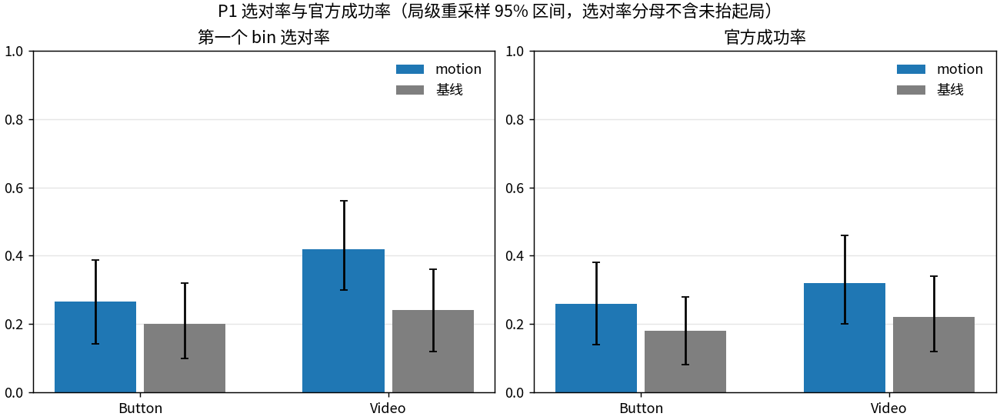
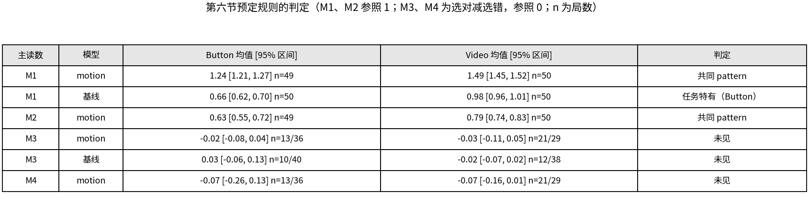
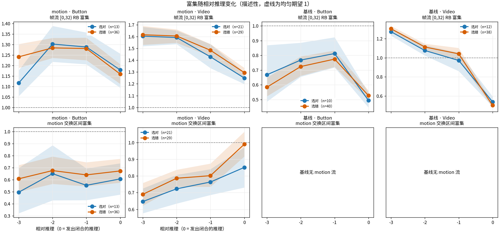
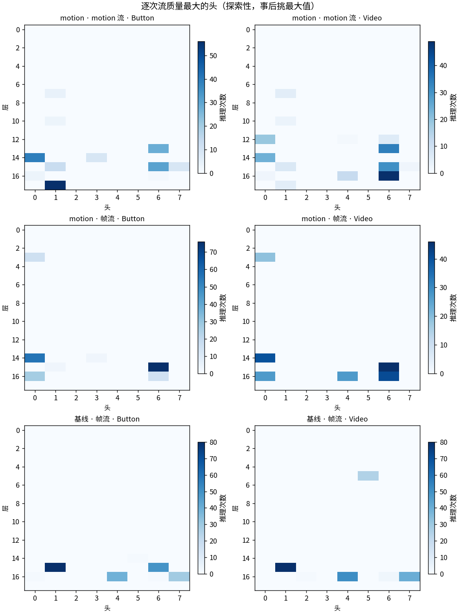
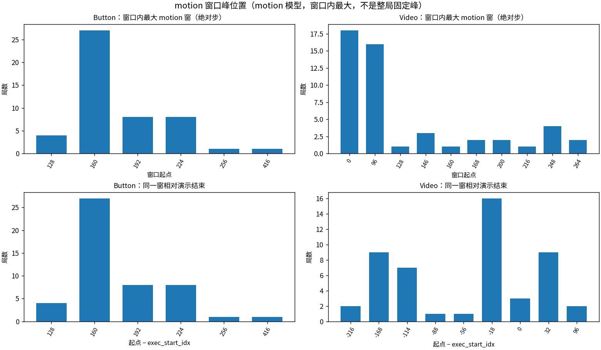
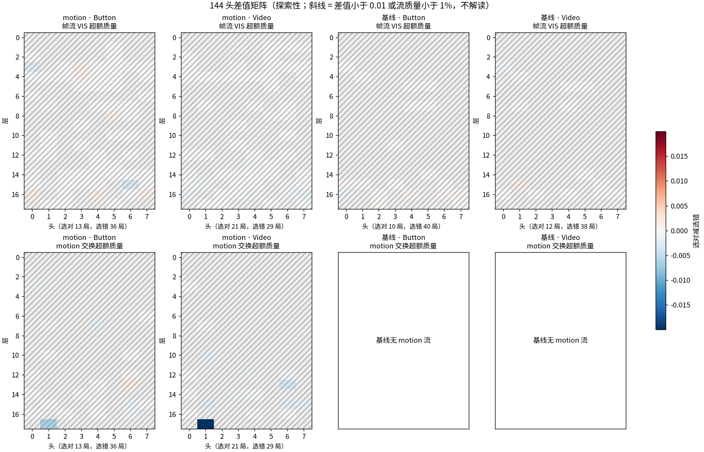

# 两个 Swap 任务第一次取 bin 的注意力与 motion 替换

两个任务各 50 局、两个模型共 200 局，每局只分析第一次取 bin 从靠近到夹爪闭合的 4 次推理。motion 模型在两个任务上都稳定多读开局方块裸露的帧，读 motion 时反而少读交换区间；基线不这样。但这些注意力读数和第一个 bin 选对还是选错都没有可见关系。峰值头和峰值窗口换任务后确实变了。注意力只说明看哪里，不能证明因果；替换实验见第二部分。

计划见 [1105-swap-first-bin-attention-plan.html](../../../1105-swap-first-bin-attention-plan.html)，起跑信息见 [launch.md](launch.md)。

## 第一部分：注意力

### 选对率和成功率

| 模型 / 任务 | 选对 | 选错 | 没抬起 | 官方成功 |
| --- | ---: | ---: | ---: | ---: |
| motion / Button | 13 | 36 | 1 | 13/50 |
| motion / Video | 21 | 29 | 0 | 16/50 |
| 基线 / Button | 10 | 40 | 0 | 9/50 |
| 基线 / Video | 12 | 38 | 0 | 11/50 |

总成功 motion 29/100、基线 20/100，都走原采样路径。两个模型在奇数局都明显更差，这是清单的难度分布造成的：偶数局只有 easy 和 medium，hard 都在奇数局，不是显卡差异。

`FIRST_BIN_LABEL` 两个模型都 PASS：`wrong_but_success=0`，`geom_mismatch=0`，`before_buttons=0`。

### 预定规则下的 pattern

规则在跑数据之前写定：每局 4 次推理先平均，局级重采样 2000 次，12 个主区间未校正多重比较。

| 主读数 | 模型 | Button | Video | 判定 |
| --- | --- | ---: | ---: | --- |
| M1 帧流 `[0,32)` 窗口版 RB 富集 | motion | 1.24 [1.21, 1.27] | 1.49 [1.45, 1.52] | 共同 pattern |
| M1 | 基线 | 0.66 [0.62, 0.70] | 0.98 [0.96, 1.01] | 任务特有（Button） |
| M2 motion 流交换区间富集 | motion | 0.63 [0.55, 0.72] | 0.79 [0.74, 0.83] | 共同 pattern |
| M3 M1 的选对减选错 | motion | -0.02 [-0.08, 0.04] | -0.03 [-0.11, 0.05] | 未见 |
| M3 | 基线 | 0.03 [-0.06, 0.13] | -0.02 [-0.07, 0.02] | 未见 |
| M4 M2 的选对减选错 | motion | -0.07 [-0.26, 0.13] | -0.07 [-0.16, 0.01] | 未见 |

- **回看开局是 motion 模型两任务共同的 pattern：** Button 49 局里 48 局、Video 50 局全部高于均匀。基线在 Button 上低于均匀（0.66）。
- **它不读交换过程：** motion 流落在交换区间的比例低于均匀，这也是共同 pattern。
- **和选择无关：** 四个选对减选错的区间都含 0，`selection_related` 为空。选对的局并没有多看开局或多看交换。这不等于注意力不重要，只是这几个总量读数分不开选对和选错。

下图的 `-3` 到 `0` 是相对闭合的推理。两个模型越接近闭合，开局富集都越低，这与注意力转向当前画面相容，选对和选错的线基本重合。

### 峰值换任务后变了（探索性）

这部分是在全部 144 个头里事后挑最大值，没有校正。

| 读数 | Button | Video |
| --- | --- | --- |
| 窗口内最大 motion 窗 | 160 为主（27/49），另有 192、224 | 0（18/50）和 96（16/50）为主 |
| 窗口内 motion 峰值头（每局最大的那次） | `L17H1` 26 局、`L13H6` 9 局 | `L13H6` 18 局、`L16H6` 12 局 |
| 全部推理的 motion 峰值头前四 | `L17H1`、`L14H0`、`L15H6`、`L13H6` | `L16H6`、`L13H6`、`L15H6`、`L14H0` |
| 峰窗与交换区间的重叠占窗宽 | 0.12 [0.06, 0.21] | 0.22 [0.14, 0.30] |

- **`L17H1` 配 160 窗是 Button 特有的：** 在 Video 上 `L17H1` 只有 3 局是峰值头。Video 的执行段窗口起点是 `D+32u`，通常没有 160，所以这个窗本来就不存在，也就不能当两任务共同的量。
- **上一轮的“固定峰”不是决策信号：** 上一轮 12 局的整局峰都在 step 240～256，只有 8 局落在新窗口内。按绝对时刻锁定，而不是按决策锁定。这轮 Button 也有 22 局窗口内最大的不是 160。
- **Video 峰窗 96 接近交换结束：** 1 次交换的局 `D=114`，96 窗覆盖交换末段，所以 Video 的 M2 比 Button 高一些，但仍低于均匀。
- **头并不完全随任务换：** motion 流前十头两任务重合 6 个（`L13H6`、`L14H0`、`L15H1`、`L15H6`、`L17H1`、`L7H1`），帧流重合 5 个（`L14H0`、`L15H6`、`L16H0`、`L16H6`、`L3H0`）。基线帧流前十重合 4 个，且 `L15H1` 在两个任务上都居首，和 motion 模型不同。
- **`L3H0` 回看开局在 motion 模型上跨任务都成立：** 窗口内 Button 49/49、Video 50/50。基线 Button 是 35/37，Video 只有 23/40。
- **`L16H0` 只在闭合那次才明显：** motion 模型在 `0` 位置 Button 26/49、Video 27/50，其他位置大多质量不足 1%。上一轮它最一致的是抬起阶段，这轮按截断看不到。

差值矩阵里最醒目的是 Video 上 motion 流 `L17H1`：选对的局读交换的超额更低。只有这一格、事后挑出，不作结论，只作下一步线索。

### 抓空重试和首次闭合对照

motion 模型有 32/99 局在抬起前抓空过（Button 24 局、Video 8 局），基线只有 9/100。主窗口锚在抬起前最后一次闭合，所以这些局看的是重试那次。因此另算了以第一次闭合为锚点的对照，标探索性。

| 主读数 | 模型 | Button | Video | 判定 |
| --- | --- | ---: | ---: | --- |
| M1 | motion | 1.26 [1.24, 1.28] | 1.53 [1.50, 1.56] | 共同 pattern |
| M1 | 基线 | 0.62 [0.60, 0.64] | 0.98 [0.96, 1.01] | 任务特有（Button） |
| M2 | motion | 0.57 [0.49, 0.66] | 0.80 [0.77, 0.84] | 共同 pattern |
| M3 | motion | -0.03 [-0.09, 0.02] | -0.00 [-0.06, 0.06] | 未见 |
| M3 | 基线 | -0.02 [-0.06, 0.01] | -0.02 [-0.07, 0.02] | 未见 |
| M4 | motion | 0.01 [-0.18, 0.21] | -0.02 [-0.10, 0.05] | 未见 |

两版判定完全相同，所以结论不依赖锚点选择。第一次闭合的 bin 与最后抬起的 bin 不同的局：motion 5 局（Video 第 9、19、27、30、44 局），基线 2 局（Button 第 15、40 局）。这些局的 `label` 仍按抬起的 bin。

### 和上一轮的关系

单次指标函数沿用上一轮。`BRIDGE_OLD22=PASS episodes=22 records=88 metric_maxabs=0.000e+00 rb_window_delta=7.975e-03 peak160_in_window=8/12`：同一推理的指标与上一轮逐元素差为 0，窗口版 RB 最多差 0.008（只在 Button 22 局上测过）。

下面这些和上一轮不等同：汇聚点只在窗口内确认；固定峰只能看窗口内；没有抬起阶段；注意力在原路径的动作上用展开路径重算；双目标局文字族只取第一目标色。

### 验证与盲区

| 判定行 | 结果 |
| --- | --- |
| rollout | motion `RUN_LOCAL=PASS` 两片；基线 `RUN_LOCAL=PASS` 两片；基础设施错误 0 |
| 重放 | 两模型全部 `ROLLOUT_REPLAY=PASS same_path_maxabs=0 tol=1e-6` |
| 注意力 | 全部 `ATTN_WINDOW=PASS`，行和误差最大 4.3e-4 |
| 汇总 | 两版 `PATTERN_SUMMARY=PASS tasks=2 models=2 readouts=12` |

- **展开路径异常值：** motion 396 条的 `attn_path_maxabs` 中位数 0.003，唯一异常是 Video 第 48 局第 4 次推理（0.86）；基线另有一条 1.80。这是单次数值分叉，没有剔除，每局 4 次平均里只占 1 次。
- **没有校正多重比较：** 主读数 12 个区间，单个结果按线索读。
- **模型差异：** 两个模型训练来源和步数不同，差异不能全归因于 motion。
- **单模型 seed：** 只有 seed 42。

## 第二部分：motion 替换

实验进行中，结果完成后写入这里。
